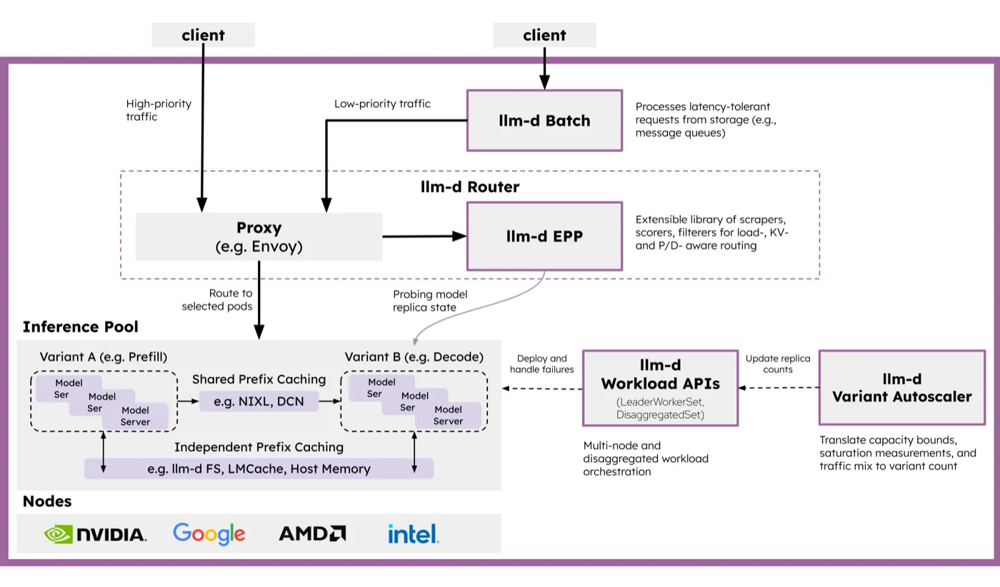
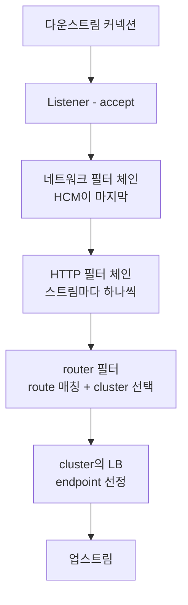
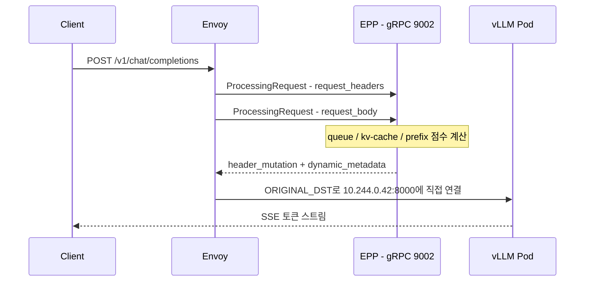
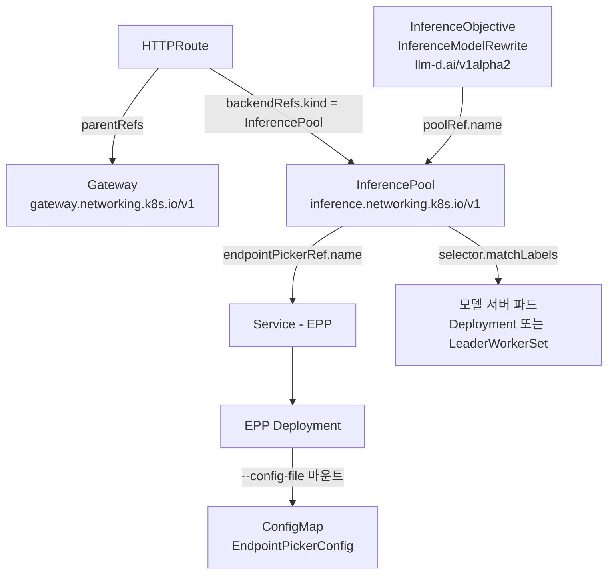
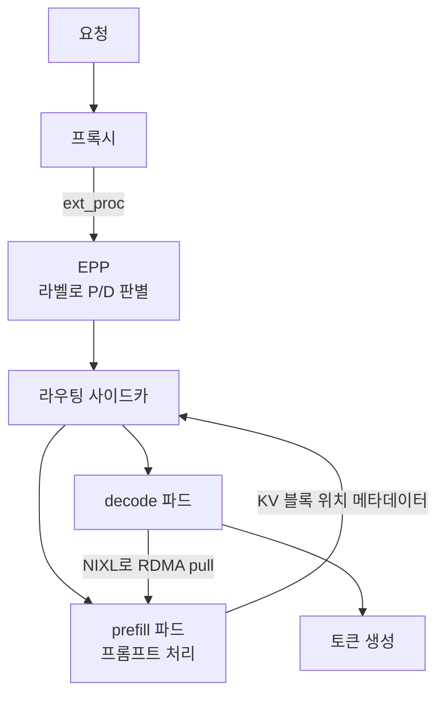
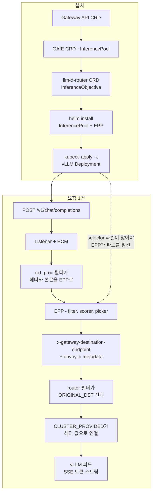

<nav id="manual-toc" class="manual-toc" aria-label="목차">

### 목차

**[1부. 추론 라우팅이 별도 컴포넌트를 부르는 이유](#section-1)**

- [1.1 추론 요청이 일반 HTTP 요청과 다른 지점](#s1-1)
- [1.2 llm-d의 두 조각 - Proxy와 EPP](#s1-2)

**[2부. Envoy - 요청 경로 한가운데의 프록시](#section-2)**

- [2.1 리스너에서 엔드포인트까지 - 다섯 층](#s2-1)
- [2.2 요청이 라우팅되는 순간](#s2-2)
- [2.3 xDS - 재시작 없이 바뀌는 설정](#s2-3)
- [2.4 해시 입력에 본문이 없다](#s2-4)

**[3부. ext_proc - 판단을 프로세스 밖으로](#section-3)**

- [3.1 재컴파일 없이 확장하는 세 가지](#s3-1)
- [3.2 외부에 물어보는 패턴은 이미 있었다](#s3-2)
- [3.3 llm-d의 ext_proc 설정](#s3-3)
- [3.4 목적지를 헤더로 받는 클러스터](#s3-4)

**[4부. llm-d를 이루는 CR들](#section-4)**

- [4.1 llm-d가 직접 정의하는 CRD는 둘뿐](#s4-1)
- [4.2 llm-d가 빌려 쓰는 CRD](#s4-2)
- [4.3 EndpointPickerConfig는 CRD가 아니다](#s4-3)
- [4.4 CR 사이의 의존성](#s4-4)
- [4.5 EPP가 점수를 매기는 방식](#s4-5)

**[5부. 적용부터 라우팅까지](#section-5)**

- [5.1 설치 순서](#s5-1)
- [5.2 Standalone Mode와 Gateway Mode](#s5-2)
- [5.3 P/D 분리는 CRD가 아니라 라벨](#s5-3)
- [5.4 모델 여러 개 - base model마다 풀 하나](#s5-4)

**[6부. 대가와 이름](#section-6)**

- [6.1 요청마다 늘어나는 홉](#s6-1)
- [6.2 이름이 바뀐 것들](#s6-2)

**[전체 흐름 정리](#section-7)**

**[출처](#section-8)**

</nav>

---

## 1부. 추론 라우팅이 별도 컴포넌트를 부르는 이유

<a id="s1-1"></a>

### 1.1 추론 요청이 일반 HTTP 요청과 다른 지점

일반적인 웹 요청은 헤더만 보고 어디로 보낼지 정할 수 있습니다. 추론 요청은 그렇지 않습니다.

- **판단 근거가 본문에 있습니다**
  - 어느 모델을 쓸지, 프롬프트가 얼마나 긴지, 앞부분이 이미 어느 파드에 캐시돼 있는지는 전부 JSON 본문 안에 있습니다. 헤더만 읽고 넘기는 경로로는 이 정보를 보지 못합니다.
- **처리 시간이 요청마다 수십 배 차이 납니다**
  - 토큰 20개를 생성하는 요청과 2,000개를 생성하는 요청이 같은 엔드포인트로 들어옵니다. 라운드 로빈은 이미 대기열이 긴 파드에 또 하나를 얹습니다.
- **응답이 스트림입니다**
  - SSE로 토큰이 흘러나오는 동안 커넥션이 유지됩니다. 커넥션 단위로 분산하는 L4 로드밸런서는 첫 배정 이후 아무 조정도 하지 못합니다.

앞선 글에서 Kubernetes Service 직결과 load-only 라우터, prefix-aware 라우터에 같은 워크로드를 흘려 prefix cache hit rate가 33%·30%·65%로 갈리는 것을 실측했습니다. 그 65%를 만든 배선은 설정 파일 몇 줄과 CR 몇 개로 되어 있습니다.

<a id="s1-2"></a>

### 1.2 llm-d의 두 조각 - Proxy와 EPP

<figure>

<figcaption>llm-d Router는 한 덩어리가 아니라 두 조각입니다. 트래픽이 지나가는 데이터플레인은 Envoy 같은 범용 프록시가 맡고, 어느 replica로 보낼지는 EPP가 모델 복제본 상태를 probing해 정합니다. 출처: <a href="https://github.com/llm-d/llm-d/blob/main/docs/assets/images/llm-d-arch.svg">llm-d 공식 아키텍처 도식</a> (Apache 2.0)</figcaption>
</figure>

`Proxy (e.g. Envoy)`에 `e.g.`가 붙은 것은 llm-d가 특정 프록시에 묶여 있지 않기 때문이고, 판단 로직이 `llm-d EPP`라는 별도 박스로 빠진 것은 그 로직이 프록시 바이너리 안으로 들어가지 않기 때문입니다.

EPP는 Endpoint Picker의 약자입니다. 요청마다 "이 요청은 어느 파드로" 한 줄을 답하는 gRPC 서버입니다.

## 2부. Envoy - 요청 경로 한가운데의 프록시

<a id="s2-1"></a>

### 2.1 리스너에서 엔드포인트까지 - 다섯 층

Envoy 설정은 다섯 개 개념으로 이루어집니다.

```yaml
static_resources:
  listeners:
  - name: httpbin-demo
    address:
      socket_address: { address: 0.0.0.0, port_value: 15001 }   # 1 Listener
    filter_chains:
    - filters:
      - name: envoy.filters.network.http_connection_manager      # 2 네트워크 필터
        typed_config:
          http_filters:
          - name: envoy.filters.http.router                      # 3 HTTP 필터(터미널)
          route_config:
            virtual_hosts:
            - domains: ["*"]
              routes:
              - match: { prefix: "/" }
                route: { cluster: httpbin_service }              # 4 Route to Cluster
  clusters:
  - name: httpbin_service
    lb_policy: ROUND_ROBIN
    load_assignment:
      endpoints:
      - lb_endpoints:
        - endpoint:
            address:
              socket_address: { address: httpbin, port_value: 8000 }  # 5 Endpoint
```

- **Listener** - 포트를 엽니다. 들어온 커넥션이 어떤 필터 체인을 탈지도 여기서 정합니다.
- **Network filter** - 바이트 스트림을 프로토콜로 해석합니다. Envoy는 본질적으로 L3/L4 바이트 처리 엔진이고, MongoDB·Redis·Kafka용 필터가 같은 자리에 붙습니다. HTTP를 맡는 것이 HTTP Connection Manager(HCM)입니다.
- **HTTP filter** - HCM 안에 또 하나의 필터 체인이 있습니다. CORS·RBAC·속도 제한이 여기 붙고, 체인은 반드시 `router` 터미널 필터로 끝나야 합니다.
- **Route** - 경로·헤더·도메인을 보고 어느 cluster로 보낼지 정합니다.
- **Cluster** - 업스트림 서비스 하나를 가리키는 논리 단위입니다. 그 안에 실제 IP인 endpoint들이 들어 있습니다.

마지막 두 줄의 중첩을 보면 `clusters[].load_assignment.endpoints[].lb_endpoints[].endpoint.address`, endpoint가 cluster 안에 담겨 있습니다. cluster를 고르는 일과 그 안에서 IP 하나를 고르는 일은 별개입니다.

<a id="s2-2"></a>

### 2.2 요청이 라우팅되는 순간

Envoy 공식 문서의 Life of a Request가 12단계로 적어둔 경로를 줄이면 이렇습니다.



- **cluster를 고르는 것은 `router` 필터입니다.** HTTP 필터 체인 맨 끝의 터미널 필터이고, 이 필터가 헤더를 디코드하는 시점에 route 매칭과 cluster 선택이 함께 일어납니다.
- **endpoint를 고르는 것은 그 다음 단계입니다.** cluster가 정해진 뒤 `lb_policy`가 실제 IP 하나를 뽑고, 이때 circuit breaker를 검사합니다.
- **응답은 정확히 역순으로 내려옵니다.** 요청에서 마지막이던 필터가 응답에서는 처음입니다.

`router`가 체인의 마지막이라는 말은, 그 앞에 필터를 하나 끼우면 **cluster가 정해지기 전에 요청을 만질 수 있다**는 뜻입니다.

<a id="s2-3"></a>

### 2.3 xDS - 재시작 없이 바뀌는 설정

위 YAML은 `static_resources`입니다. 파드가 뜨고 지는 환경에서 엔드포인트 목록을 파일에 박아둘 수는 없습니다. Envoy는 이 부분을 API로 받습니다.

| API | 무엇을 받는가 | 관계 |
|-----|---------------|------|
| LDS | Listener | — |
| RDS | Route | LDS의 부분집합 |
| CDS | Cluster | — |
| EDS | Endpoint | CDS의 부분집합 |
| SDS | 인증서 | — |
| ADS | 위 전부를 하나의 스트림으로 | 순서 보장 |

부트스트랩 설정 하나만 정적으로 두고 나머지를 전부 동적으로 받을 수 있습니다. 설정이 바뀌어도 프로세스를 재시작하지 않으므로, 스케일 인·아웃이 잦은 추론 파드 집합에 맞습니다.

ADS가 따로 있는 것은 순서 때문입니다. RDS로 "클러스터 foo로 가는 새 루트"가 먼저 도착하고 foo를 담은 CDS 업데이트가 아직 안 왔으면, 그 사이 요청은 라우팅 오류가 납니다. ADS는 모든 변경을 직렬화된 한 스트림으로 흘려 이 경쟁 상태를 없앱니다.

EDS가 CDS의 부분집합이라는 점도 여기서 쓰입니다. 파드가 하나 늘었을 때 cluster 정의 전체를 다시 밀 필요 없이 엔드포인트 목록만 갱신됩니다.

<a id="s2-4"></a>

### 2.4 해시 입력에 본문이 없다

Envoy에도 "같은 키는 같은 백엔드로" 보내는 기능이 이미 있습니다. `RING_HASH`와 `MAGLEV`입니다. 호스트 하나가 빠졌을 때 재배치되는 요청은 ring hash에서 대략 1/N이고, maglev는 테이블 조회와 호스트 선택이 각각 10배·5배 빠른 대신 호스트 제거 시 이동하는 키가 ring hash의 두 배쯤 됩니다.

해시할 수 있는 입력은 정해져 있습니다. `RouteAction.HashPolicy`가 받는 것은 다섯 가지입니다.

| 입력 | 필드 |
|------|------|
| 요청 헤더 | `header.header_name` |
| 쿠키 | `cookie.name` |
| 커넥션 속성 | `connection_properties.source_ip` |
| 쿼리 파라미터 | `query_parameter.name` |
| 필터 상태 | `filter_state.key` |

**요청 본문이 목록에 없습니다.** 프롬프트 앞부분이 어느 파드에 캐시돼 있는지로 라우팅하려면 본문을 읽어야 하는데, Envoy의 consistent hashing은 본문을 해시 입력으로 받지 않습니다. 추론 라우팅에 별도 컴포넌트가 붙는 것은 이 제약 때문입니다.

## 3부. ext_proc - 판단을 프로세스 밖으로

<a id="s3-1"></a>

### 3.1 재컴파일 없이 확장하는 세 가지

끼울 자리가 있어도 필터를 만드는 비용은 따로 듭니다. Envoy는 C++로 쓰였고, 필터를 추가하려면 원칙적으로 Envoy를 다시 빌드해야 합니다. Istio가 그렇게 하고, 그 대가로 커스텀 빌드를 유지보수합니다.

바이너리를 다시 만들지 않고 확장하는 방법은 세 가지입니다.

- **Lua** - 스크립트를 필터로 실행합니다. 가볍지만 스크립트 안에서 할 수 있는 일이 제한됩니다.
- **Wasm** - WebAssembly 모듈을 얹습니다. 언어 선택이 넓어지지만 빌드 체계가 따라붙습니다.
- **External processing** - 처리를 Envoy 프로세스 밖의 gRPC 서버에 위임합니다. 서버를 어떤 언어로 쓰든 상관없고, 배포와 스케일도 따로 갑니다.

llm-d의 스케줄링 로직은 KV 캐시 인덱스를 들고 있어야 하고 모델 서버 메트릭을 주기적으로 긁어야 합니다. 프록시 안에 두기에는 무거워서 세 번째를 씁니다.

<a id="s3-2"></a>

### 3.2 외부에 물어보는 패턴은 이미 있었다

필터가 외부 서비스를 호출해 요청을 계속할지 결정하는 구조는 Envoy에 이미 있습니다. 글로벌 속도 제한이 그렇습니다.

```
요청 -> 속도 제한 필터가 디스크립터(헤더·주소 등)를 뽑음
     -> 외부 속도 제한 서버(RLS)에 gRPC로 전송
     -> RLS가 Redis 카운터를 보고 판정
     -> 초과면 429 Too Many Requests + x-envoy-ratelimited: true
```

복제본이 몇 개든 같은 서버를 보기 때문에 전역 한도가 성립합니다. ext_proc도 같은 구조인데, 보내는 것이 디스크립터가 아니라 요청 전체이고 받는 것이 허용 여부가 아니라 목적지입니다.

<a id="s3-3"></a>

### 3.3 llm-d의 ext_proc 설정

공식 문서는 ext_proc를 "외부 프로세서라 불리는 외부 서비스를 필터 체인에 연결한다"고 설명합니다. 인터페이스는 양방향 스트림 RPC 하나뿐입니다.

```protobuf
service ExternalProcessor {
  rpc Process(stream ProcessingRequest) returns (stream ProcessingResponse) {}
}
```

llm-d가 Kubernetes 없이 도는 예제에 실린 설정이 이렇습니다.

```yaml
http_filters:
  - name: envoy.filters.http.ext_proc
    typed_config:
      "@type": type.googleapis.com/envoy.extensions.filters.http.ext_proc.v3.ExternalProcessor
      grpc_service:
        envoy_grpc:
          cluster_name: ext_proc
          authority: localhost:9002
        timeout: 10s
      processing_mode:
        request_header_mode: SEND
        response_header_mode: SEND
        request_body_mode: FULL_DUPLEX_STREAMED
        response_body_mode: FULL_DUPLEX_STREAMED
      message_timeout: 1000s
```

- **`request_header_mode: SEND`** - 요청 헤더를 EPP로 넘깁니다. `router`보다 앞이라 아직 cluster가 정해지지 않았습니다. 이 값은 기본값이기도 합니다.
- **`request_body_mode: FULL_DUPLEX_STREAMED`** - 기본값은 `NONE`, 즉 본문을 아예 안 보냅니다. 추론 라우팅에서는 반드시 바꿔야 하는 값입니다. `BUFFERED`로 두면 본문을 다 모은 뒤 넘기므로 스트리밍 응답의 첫 토큰이 마지막 토큰을 기다립니다.
- **`message_timeout: 1000s`** - 기본값은 200ms입니다. 다만 공식 문서는 body send mode가 `FULL_DUPLEX_STREAMED`일 때 이 타임아웃이 적용되지 않는다고 적고 있어서, 위 설정에서 1000s는 실질적으로 무해한 값에 가깝습니다.

기본 동작은 응답을 받을 때까지 필터 체인을 멈추는 것입니다. 멈추지 않는 모드(`observability_mode`)가 따로 있습니다. ext_proc의 지연은 대부분 이 대기에서 옵니다.

<a id="s3-4"></a>

### 3.4 목적지를 헤더로 받는 클러스터

EPP가 고른 파드를 Envoy에게 알리는 방법은 새 cluster를 만드는 것이 아닙니다. 헤더 한 줄입니다.

```yaml
- name: original_destination_cluster
  type: ORIGINAL_DST
  lb_policy: CLUSTER_PROVIDED
  original_dst_lb_config:
    use_http_header: true
    http_header_name: x-gateway-destination-endpoint
```

`ORIGINAL_DST`는 고정된 엔드포인트 목록이 없는 클러스터 타입입니다. `use_http_header: true`를 켜면 지정한 헤더 값을 그대로 목적지로 씁니다. `lb_policy: CLUSTER_PROVIDED`는 로드밸런싱을 Envoy가 하지 않는다는 뜻이라, 라운드 로빈도 least request도 여기서는 돌지 않습니다.

Endpoint Picker 프로토콜 규격은 EPP가 두 군데에 같은 값을 쓰도록 요구합니다.

1. HTTP 헤더 `x-gateway-destination-endpoint`
2. ext_proc 응답의 `dynamic_metadata`, 네임스페이스 `envoy.lb`

```go
dynamicMetadata: {
  "envoy.lb": {
    "x-gateway-destination-endpoint": "10.244.0.42:8000"
  }
}
```

`envoy.lb`인 이유는 Envoy의 subset 로드밸런싱이 호스트 메타데이터를 그 네임스페이스에서 읽기 때문입니다. 값은 콤마로 구분한 여러 개일 수 있고, 재시도가 설정돼 있으면 순서대로 내려갑니다. 헤더와 메타데이터에 서로 다른 값을 넣는 것은 규격이 금지합니다.



적격 엔드포인트가 없으면 EPP는 `ImmediateResponse`로 503을, 과부하라 요청을 버려야 하면 429를 돌려줍니다. 둘 다 규격에 정해진 값입니다.

EPP가 붙는 자리는 별도 cluster로 선언합니다.

```yaml
- name: ext_proc
  type: STATIC
  lb_policy: LEAST_REQUEST
  health_checks:
    - grpc_health_check:
        service_name: "envoy.service.ext_proc.v3.ExternalProcessor"
  load_assignment:
    endpoints: [{ address: 127.0.0.1, port_value: 9002 }]
```

`127.0.0.1:9002`입니다. EPP를 Envoy와 같은 호스트에 붙여 왕복을 루프백으로 줄입니다. Kubernetes 배포에서는 한 걸음 더 나가 Unix Domain Socket(`unix:///etc/ai-gateway-extproc-uds/run.sock`)을 씁니다.

## 4부. llm-d를 이루는 CR들

<a id="s4-1"></a>

### 4.1 llm-d가 직접 정의하는 CRD는 둘뿐

llm-d 조직의 저장소를 훑어 `kind: CustomResourceDefinition` 파일을 세면, 활성 저장소에서 llm-d가 자기 그룹으로 정의하는 CRD는 두 개입니다. 둘 다 `llm-d-router`에 있습니다.

| apiVersion | kind | spec 필드 | 하는 일 |
|------------|------|-----------|---------|
| `llm-d.ai/v1alpha2` | `InferenceObjective` | `poolRef`, `priority` | 풀 안에서 워크로드 우선순위를 정합니다. 자원이 모자랄 때 누구를 먼저 처리할지 |
| `llm-d.ai/v1alpha2` | `InferenceModelRewrite` | `poolRef`, `rules` | 요청 본문의 `model` 값을 가중치에 따라 다른 이름으로 바꿉니다. A/B와 카나리 |

```yaml
apiVersion: llm-d.ai/v1alpha2
kind: InferenceObjective
metadata:
  name: premium-traffic
spec:
  priority: 100
  poolRef:
    name: flow-control
```

`priority`는 높을수록 우선이고 음수도 됩니다. 같은 가이드가 `standard-traffic`에 `0`, `best-effort-traffic`에 `-10`을 줍니다.

둘 다 라우팅 정책용이고, **워크로드를 만드는 CRD는 llm-d에 없습니다.** vLLM 파드를 띄우는 것은 CR이 아니라 Helm 차트와 kustomize입니다. 그 자리에 있던 `ModelService`(`llm-d.ai/v1alpha1`)는 저장소가 보관 처리되면서 은퇴했고, 후속은 CRD가 아니라 `llm-d-modelservice` Helm 차트입니다.

<a id="s4-2"></a>

### 4.2 llm-d가 빌려 쓰는 CRD

나머지는 이미 있는 표준 API를 씁니다.

| apiVersion | kind | 주인 | llm-d에서의 역할 |
|------------|------|------|------------------|
| `gateway.networking.k8s.io/v1` | `Gateway` | Gateway API | 외부 진입점 |
| `gateway.networking.k8s.io/v1` | `HTTPRoute` | Gateway API | Gateway와 InferencePool을 잇습니다 |
| `inference.networking.k8s.io/v1` | `InferencePool` | Gateway API Inference Extension | 파드 집합 + EPP 지정 |
| `leaderworkerset.x-k8s.io/v1` | `LeaderWorkerSet` | kubernetes-sigs/lws | 여러 노드에 걸친 모델 하나 |
| `disaggregatedset.x-k8s.io/v1` | `DisaggregatedSet` | kubernetes-sigs/lws | 역할별 배치. llm-d가 설치 스크립트로 lws v0.10.0을 박아 가져옵니다 |
| `keda.sh/v1alpha1` | `ScaledObject` | KEDA | 오토스케일링 대상 |
| `monitoring.coreos.com/v1` | `ServiceMonitor` | Prometheus Operator | EPP·모델 서버 메트릭 수집 |

`InferencePool`의 spec은 필드 세 개입니다.

```yaml
apiVersion: inference.networking.k8s.io/v1
kind: InferencePool
metadata:
  name: llama32-1b
spec:
  selector:
    matchLabels:
      app: llama32-1b
  targetPorts:
    - number: 8000
  endpointPickerRef:
    name: llama32-1b-epp
    port:
      number: 9002
    failureMode: FailClose
```

- **`selector`** - 같은 네임스페이스의 파드만 고릅니다. 라벨이 정확히 일치해야 하고, 최대 64개까지입니다.
- **`targetPorts`** - 최대 8개. `podIP:portNumber` 각각이 별개 엔드포인트로 취급됩니다.
- **`endpointPickerRef`** - EPP를 가리킵니다. `kind` 기본값은 `Service`이고 `ExternalName` Service는 금지돼 있습니다.

`failureMode`는 값이 어디서 오느냐에 따라 달라집니다. **API 기본값은 `FailClose`인데 llm-d 차트의 기본값은 `FailOpen`입니다.** 규격 문서만 보고 EPP가 죽으면 요청이 막힌다고 단정하면 실제 배포와 어긋나므로, 적용된 리소스에서 값을 직접 확인해야 합니다.

이름만 보면 llm-d 것으로 오해하기 쉬운 리소스도 있습니다.

- **`LLMInferenceService`는 llm-d 것이 아닙니다.** KServe의 CRD(`serving.kserve.io`, 약칭 `llmisvc`)입니다. llm-d 저장소에는 이 정의가 하나도 없습니다.
- **`VariantAutoscaling` CRD는 제거됐습니다.** "VariantAutoscaling CRD를 없앤다"는 제안서가 Implemented 상태입니다. 지금은 KEDA `ScaledObject`나 HPA에 붙은 애노테이션으로 대상을 찾고 `wva_desired_replicas` 메트릭을 내보냅니다. 참고로 이 은퇴한 CRD의 그룹만 하이픈 없는 `llmd.ai`였습니다.
- **`InferencePoolImport`는 llm-d가 쓰지 않습니다.** 멀티클러스터용으로 규격에는 있지만 llm-d의 CRD 설치 스크립트가 적용하는 매니페스트에는 들어 있지 않습니다.

<a id="s4-3"></a>

### 4.3 EndpointPickerConfig는 CRD가 아니다

EPP 설정은 CRD처럼 생겼습니다.

```yaml
apiVersion: llm-d.ai/v1alpha1
kind: EndpointPickerConfig
plugins:
  - type: prefix-cache-affinity-filter
  - type: token-load-scorer
schedulingProfiles:
  - name: default
    plugins:
      - pluginRef: prefix-cache-affinity-filter
      - pluginRef: token-load-scorer
```

`apiVersion`과 `kind`가 있으니 `kubectl apply`로 넣는 리소스처럼 보이지만, **CRD 정의 파일이 존재하지 않습니다.** `kubectl get endpointpickerconfigs`는 실패합니다.

근거는 이렇습니다.

- 저장소 어디에도 이 kind의 CRD YAML이 없습니다. 같은 저장소의 `InferenceObjective`는 CRD YAML과 clientset·informer·lister를 전부 갖고 있는데, 이쪽은 타입 정의와 deepcopy뿐입니다.
- Go 타입이 `metav1.TypeMeta`만 품고 **`metav1.ObjectMeta`가 없습니다.** 이름도 네임스페이스도 없으니 API 서버가 저장할 수 없습니다.
- EPP 바이너리가 `--config-file`로 읽고, 그 파일은 ConfigMap으로 마운트됩니다. Helm 차트의 `pluginsCustomConfig` 값이 그 ConfigMap 내용이 됩니다.

Kubernetes의 YAML 형식만 빌려 쓰고 API 서버에는 등록하지 않는 구조입니다. 그룹 이름을 정한 커밋도 이것을 `pseudo CRD`라고 적고 있습니다.

<a id="s4-4"></a>

### 4.4 CR 사이의 의존성

참조가 어느 필드로 걸리는지까지 넣으면 이렇습니다.



화살표가 가리키는 쪽이 먼저 있어야 합니다.

- **`HTTPRoute.spec.rules[].backendRefs[].kind: InferencePool`** - 이 한 줄이 "일반 로드밸런싱 말고 EPP에게 물어봐라"로 해석됩니다. Service를 가리키면 평범한 kube-proxy 분산으로 돌아갑니다.
- **`InferencePool.spec.selector`** - 라벨이 모델 서버 파드와 정확히 일치해야 합니다.
- **`InferenceObjective.spec.poolRef`** - `group` 기본값이 `inference.networking.k8s.io`, `kind` 기본값이 `InferencePool`이라 실제로는 `name` 한 줄만 씁니다.

EPP는 CR이 만들어주는 것이 아니라 평범한 Deployment와 Service입니다. `InferencePool`은 그것을 이름으로 가리키기만 하므로, EPP를 갈아끼울 때 풀 정의는 건드리지 않아도 됩니다.

watch하는 주체는 둘입니다. Gateway 구현체 컨트롤러가 `HTTPRoute`와 `InferencePool`을 보고 프록시에 ext_proc 필터를 설정하고, EPP가 `InferenceObjective`와 `InferenceModelRewrite`를 보고 우선순위와 리라이트 규칙을 적용합니다. Deployment를 만드는 llm-d 컨트롤러는 없습니다.

<a id="s4-5"></a>

### 4.5 EPP가 점수를 매기는 방식

스케줄링 프로파일은 네 종류의 플러그인으로 조립됩니다.

- **filter** - 후보에서 빼는 단계입니다. `decode-filter`, `prefill-filter`, `utilization-filter` 같은 것들입니다.
- **scorer** - 남은 후보에 점수를 매깁니다. 현재 구현에 21개가 등록돼 있습니다.
- **picker** - 점수를 받아 하나를 고릅니다. `max-score-picker`, `random-picker`, `weighted-random-picker`.
- **profile handler** - 프로파일이 여럿일 때 어느 것을 돌릴지 정합니다. P/D 분리에는 `disagg-profile-handler`를 씁니다.

실습에서 쓴 프로파일은 스코어러 셋뿐이었습니다.

```yaml
plugins:
  - type: queue-scorer
  - type: kv-cache-utilization-scorer
  - type: prefix-cache-scorer
```

- **`queue-scorer`** - 각 파드의 대기 요청 수.
- **`kv-cache-utilization-scorer`** - KV 캐시 점유율. 꽉 찬 파드는 새 요청을 받으면 기존 시퀀스를 선점 축출하게 됩니다.
- **`prefix-cache-scorer`** - 프롬프트 앞부분이 이미 어느 파드에 올라가 있는지.

`pluginRef`에 `weight`를 붙여 가중치를 줄 수 있습니다. 그래서 대기열이 가장 짧은 파드가 항상 뽑히지는 않습니다. 대기열이 한 칸 길어도 프리픽스가 캐시된 파드가 선택되는 경우가 있고, 프리필을 건너뛰는 이득이 더 크면 그쪽이 맞습니다.

점수의 원천은 모델 서버가 노출하는 Prometheus 메트릭입니다. 규격이 요구하는 것이 셋, 프리픽스 스코어러가 쓰는 선택 항목이 둘입니다.

| 규격상 이름 | vLLM 메트릭 | 쓰는 곳 |
|-------------|-------------|---------|
| TotalQueuedRequests | `vllm:num_requests_waiting` | queue-scorer |
| TotalRunningRequests | `vllm:num_requests_running` | queue-scorer |
| KVCacheUtilization | `vllm:kv_cache_usage_perc` | kv-cache-utilization-scorer |
| BlockSize (선택) | `vllm:cache_config_info{block_size}` | prefix-cache-scorer |
| NumGPUBlocks (선택) | `vllm:cache_config_info{num_gpu_blocks}` | prefix-cache-scorer |

모델 서버가 이 메트릭을 내보내지 않으면 스코어러는 점수를 매기지 못합니다. 그래도 라우팅은 계속 돌기 때문에 겉으로는 정상으로 보입니다. 실습에서 `llama.cpp`를 모델 서버로 썼을 때가 그랬습니다. EPP가 메트릭을 긁으러 갈 때마다 501이 돌아왔고, 요청은 정상 처리되지만 스코어링 신호는 비어 있었습니다.

## 5부. 적용부터 라우팅까지

<a id="s5-1"></a>

### 5.1 설치 순서

```
1. CRD 등록
   Gateway API standard-install.yaml
   GAIE v1-manifests.yaml            (InferencePool)
   llm-d-router manifests.yaml       (InferenceObjective, InferenceModelRewrite)
2. Gateway 생성                       (Gateway Mode만)
3. helm install llm-d-router-*        InferencePool + EPP ConfigMap/Deployment/Service/RBAC
4. kubectl apply -k modelserver/      vLLM Deployment 또는 LeaderWorkerSet
5. InferenceObjective 적용            (차트 값으로 만들거나 따로)
```

3번과 4번 사이는 라벨로 이어집니다. 차트가 만든 `InferencePool.spec.selector`와 모델 서버 파드의 라벨이 같아야 EPP가 그 파드를 발견합니다.

`ServiceMonitor`를 쓸 거라면 Prometheus Operator CRD가 먼저 있어야 하므로, 모니터링 스택을 라우터보다 먼저 설치합니다.

<a id="s5-2"></a>

### 5.2 Standalone Mode와 Gateway Mode

차트가 둘로 갈리는 기준은 프록시를 누가 소유하느냐입니다.

| | Standalone Mode | Gateway Mode |
|---|---|---|
| 차트 | `llm-d-router-standalone` | `llm-d-router-gateway` |
| 프록시 | 차트가 **직접 띄웁니다** (Envoy 기본) | 기존 Kubernetes Gateway가 맡습니다 |
| `Gateway` | 필요 없음 | 필요 |
| `HTTPRoute` | 만들지 않음 | 만듭니다 |
| 진입점 | `<release>-epp` Service | Gateway 주소 |

Standalone은 Gateway API 구현체 없이 llm-d만 세워볼 때 쓰고, Gateway Mode는 이미 Istio나 kgateway 같은 게이트웨이가 있는 클러스터에 얹을 때 씁니다. 두 차트 모두 `routerlib` 라이브러리 차트를 공유해서, 만드는 `InferencePool`과 EPP는 같습니다.

<a id="s5-3"></a>

### 5.3 P/D 분리는 CRD가 아니라 라벨

prefill과 decode를 나누는 전용 리소스는 없습니다. 공식 문서도 전용 리소스가 아니라 파드 라벨로 표현한다고 적고 있습니다.

```yaml
apiVersion: apps/v1
kind: Deployment
metadata:
  name: decode
  labels:
    llm-d.ai/role: decode
```

`llm-d.ai/role=prefill`과 `llm-d.ai/role=decode`를 단 Deployment 둘이 **같은 InferencePool 안에** 들어갑니다. EPP는 그 라벨을 보고 어느 쪽이 prefill이고 어느 쪽이 decode인지 압니다.



decode 파드가 prefill이 만든 KV를 RDMA로 끌어옵니다. 이 전송을 맡는 것이 NIXL이고, 각 파드에 붙는 라우팅 사이드카가 경로를 중계합니다.

<a id="s5-4"></a>

### 5.4 모델 여러 개 - base model마다 풀 하나

LoRA 어댑터처럼 같은 base model 위에 올라가는 모델이 여럿이면, 요청 본문의 `model` 값과 실제 파드 집합이 1:1로 맞지 않습니다. 그 차이를 헤더로 메웁니다.

```
본문 {"model": "food-review-1"}
  -> 프록시가 ext_proc 호출
  -> base model이 Qwen/Qwen3-32B 임을 확인
  -> 헤더 X-Gateway-Base-Model-Name: Qwen/Qwen3-32B 설정
  -> HTTPRoute가 그 헤더로 매치해 qwen-pool 로 라우팅
  -> EPP가 엔드포인트 선택 (원래 모델 이름은 그대로 둠)
  -> 모델 서버가 food-review-1 LoRA 어댑터를 로드
```

base model 하나에 InferencePool 하나와 HTTPRoute 하나가 대응합니다. HTTPRoute가 `X-Gateway-Base-Model-Name`을 `Exact`로 매치하는 것도 그래서입니다. 실습에서 헤더를 바꿔 넣었을 때 응답의 모델명이 갈린 것도 같은 구조였습니다.

```
x-ai-eg-model: llama-3.2-1b   -> "model": "bartowski/Llama-3.2-1B-Instruct-GGUF"
x-ai-eg-model: qwen2.5-0.5b   -> "model": "Qwen/Qwen2.5-0.5B-Instruct-GGUF"
```

## 6부. 대가와 이름

<a id="s6-1"></a>

### 6.1 요청마다 늘어나는 홉

- **홉이 하나 늘어납니다.** 헤더와 본문 단계에서 gRPC 왕복이 일어나고, 그동안 필터 체인은 멈춥니다. EPP를 루프백이나 UDS로 붙이는 것은 이 왕복을 줄이기 위해서입니다.
- **버퍼 한도를 올려야 합니다.** Envoy Gateway의 기본 버퍼 한도는 32KiB인데, AI 워크로드에는 모자라서 `bufferLimit: 50Mi`로 올립니다.
- **라우트 캐시를 비우는 동작이 인가와 얽힙니다.** ext_proc가 라우팅 입력을 바꾸면 라우트를 다시 계산해야 합니다. 공식 문서는 RBAC처럼 라우트에 의존해 인가를 판단하는 필터가 ext_proc보다 먼저 도는 구성에서 이것이 위험해질 수 있다고 경고하고, 신뢰하는 외부 프로세서에만 켜고 `mutation_rules`로 바꿀 수 있는 헤더를 제한하라고 적고 있습니다.

첫 토큰까지의 시간이 수백 밀리초인 워크로드에서 루프백 gRPC 한 번은 작은 비용입니다. 프리필을 통째로 건너뛰는 이득과 비교하면 더 그렇습니다. 물론 EPP의 판단이 맞을 때의 이야기이고, 모델 서버가 메트릭을 안 내보내면 이 계산은 성립하지 않습니다.

<a id="s6-2"></a>

### 6.2 이름이 바뀐 것들

자료를 찾을 때 옛 이름에 걸리는 곳이 세 군데 있습니다.

- **Envoy AI Gateway는 Agent Router로 바뀌었습니다.** `aigateway.envoyproxy.io`와 `envoyproxy/ai-gateway`가 각각 `theagentrouter.ai`와 `theagentrouter/agent-router`로 301 리다이렉트됩니다. 코드와 메인테이너는 그대로이고 Agentic AI Foundation 프로젝트로 옮겼습니다.
- **`llm-d-inference-scheduler`는 `llm-d-router`로 바뀌었습니다.** 옛 이름으로 적힌 저장소 경로는 지금 리다이렉트로만 열립니다.
- **EPP 구현체가 Gateway API Inference Extension에서 llm-d로 이관됐습니다.** v1.6.0 릴리스 노트가 Endpoint Picker와 Body-Based Routing을 llm-d 저장소로 옮겼다고 적고 있습니다. 지금 규격 쪽에 남은 CRD는 `InferencePool`과 `InferencePoolImport` 둘뿐입니다.

GAIE와 llm-d는 경쟁 관계가 아닙니다. API 규격은 GAIE가 들고 있고 구현체는 llm-d에 있습니다.

## 전체 흐름 정리



**기억할 숫자**

| 값 | 무엇 |
|----|------|
| 2 | llm-d가 자기 그룹으로 정의하는 CRD 개수 |
| 21 | llm-d-router에 등록된 scorer 플러그인 개수 |
| 9002 | EPP의 ext_proc gRPC 기본 포트 |
| 200ms | ext_proc `message_timeout` 기본값 |
| 32KiB | Envoy Gateway 기본 버퍼 한도 (AI 워크로드에는 부족) |
| 64 / 8 | `InferencePool`의 selector 라벨 최대 개수 / targetPorts 최대 개수 |
| 1024 / 65537 | ring hash `minimum_ring_size` / maglev `table_size` 기본값 |
| 33% · 30% · 65% | Service 직결 · load-only · prefix-aware의 prefix cache hit rate |

## 출처

- [Envoy - External Processing filter](https://www.envoyproxy.io/docs/envoy/v1.39.1/configuration/http/http_filters/ext_proc_filter)
- [Envoy - ExternalProcessor proto (v3)](https://www.envoyproxy.io/docs/envoy/v1.39.1/api-v3/extensions/filters/http/ext_proc/v3/ext_proc.proto)
- [Envoy - ProcessingMode proto (v3)](https://www.envoyproxy.io/docs/envoy/v1.39.1/api-v3/extensions/filters/http/ext_proc/v3/processing_mode.proto)
- [Envoy - external_processor.proto (gRPC 서비스 정의)](https://www.envoyproxy.io/docs/envoy/v1.39.1/api-v3/service/ext_proc/v3/external_processor.proto)
- [Envoy - Life of a Request](https://www.envoyproxy.io/docs/envoy/v1.39.1/intro/life_of_a_request)
- [Envoy - xDS 프로토콜](https://www.envoyproxy.io/docs/envoy/v1.39.1/api-docs/xds_protocol)
- [Envoy - Supported load balancers (ring hash, maglev)](https://www.envoyproxy.io/docs/envoy/v1.39.1/intro/arch_overview/upstream/load_balancing/load_balancers)
- [Envoy - route_components.proto (RouteAction.HashPolicy)](https://www.envoyproxy.io/docs/envoy/v1.39.1/api-v3/config/route/v3/route_components.proto)
- [Envoy - Listeners](https://www.envoyproxy.io/docs/envoy/v1.39.1/intro/arch_overview/listeners/listeners)
- [Envoy - What is Envoy](https://www.envoyproxy.io/docs/envoy/v1.39.1/intro/what_is_envoy)
- [llm-d - 공식 문서](https://llm-d.ai/docs)
- [llm-d - Architecture](https://llm-d.ai/docs/architecture)
- [llm-d - InferenceObjective API 레퍼런스](https://llm-d.ai/docs/api-reference/inferenceobjective)
- [llm-d - InferenceModelRewrite API 레퍼런스](https://llm-d.ai/docs/api-reference/inferencemodelrewrite)
- [llm-d - EndpointPickerConfig API 레퍼런스](https://llm-d.ai/docs/api-reference/endpointpickerconfig)
- [llm-d - P/D disaggregation](https://llm-d.ai/docs/well-lit-paths/foundations/pd-disaggregation)
- [llm-d - Multi-model routing](https://llm-d.ai/docs/well-lit-paths/foundations/multi-model-routing)
- [llm-d - no-kubernetes 배포용 envoy.yaml](https://github.com/llm-d/llm-d/blob/main/guides/no-kubernetes-deployment/router/envoy/envoy.yaml)
- [llm-d-router - CRD 정의](https://github.com/llm-d/llm-d-router/tree/main/config/crd/bases)
- [Gateway API Inference Extension - Endpoint Picker Protocol](https://github.com/kubernetes-sigs/gateway-api-inference-extension/blob/main/docs/proposals/004-endpoint-picker-protocol/README.md)
- [Gateway API Inference Extension - Model Server Protocol (메트릭 규격)](https://github.com/kubernetes-sigs/gateway-api-inference-extension/blob/main/docs/proposals/003-model-server-protocol/README.md)
- [Gateway API Inference Extension - InferencePool](https://gateway-api-inference-extension.sigs.k8s.io/api-types/inferencepool/)
- [Gateway API Inference Extension - v1.6.0 릴리스 노트 (EPP·BBR의 llm-d 이관)](https://github.com/kubernetes-sigs/gateway-api-inference-extension/releases/tag/v1.6.0)
- [Agent Router (구 Envoy AI Gateway) - Architecture](https://theagentrouter.ai/docs/concepts/architecture/)
- [Envoy Gateway - External Processing 확장](https://gateway.envoyproxy.io/docs/tasks/extensibility/ext-proc/)
