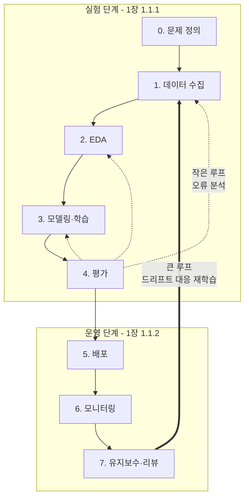
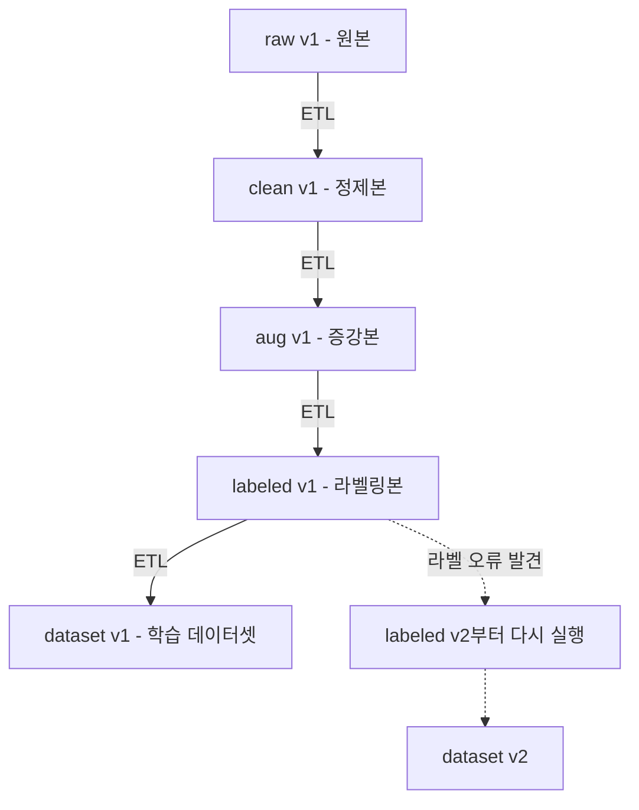
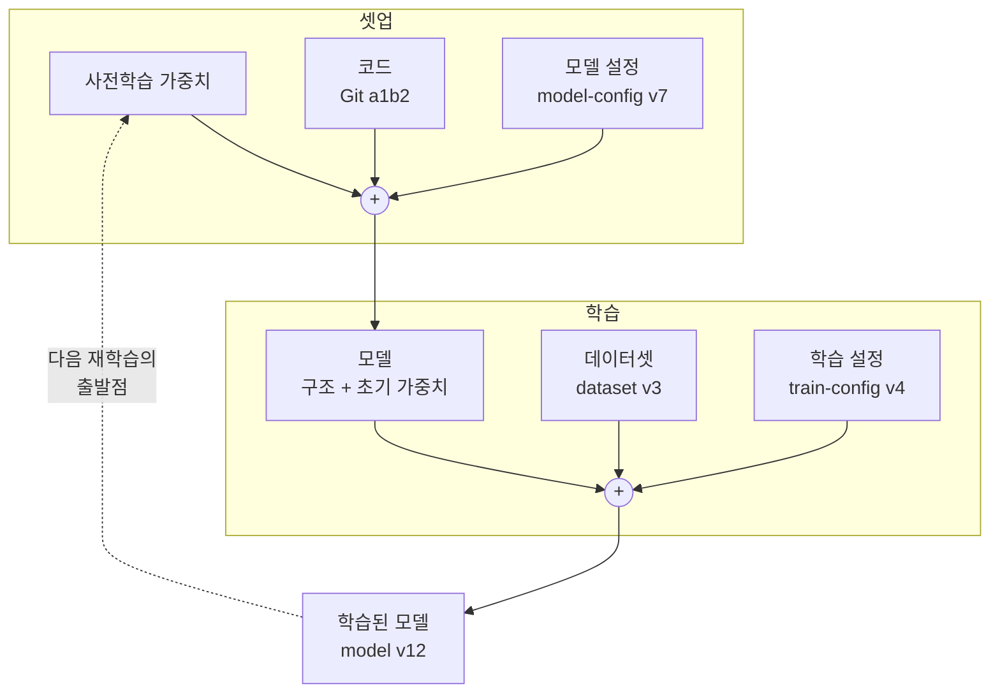
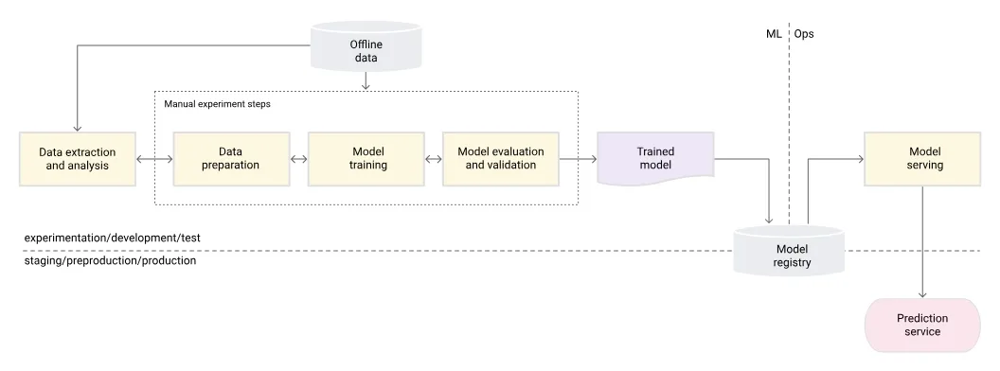
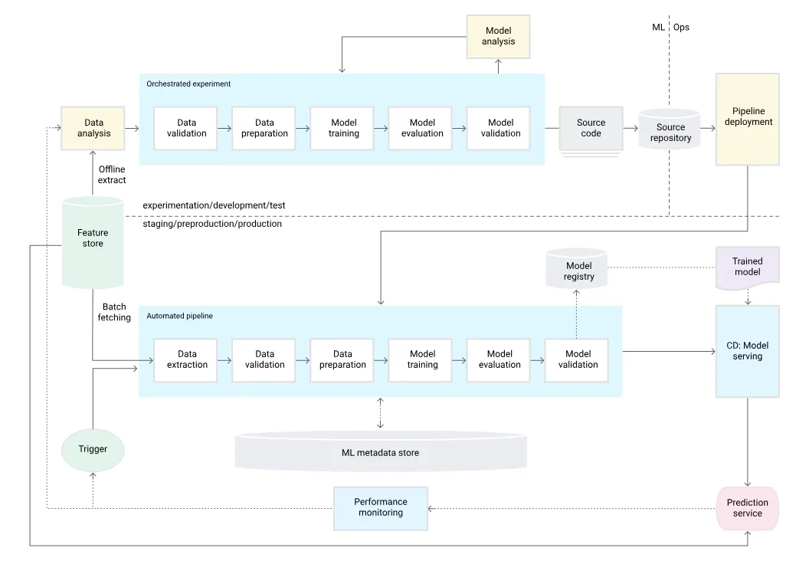
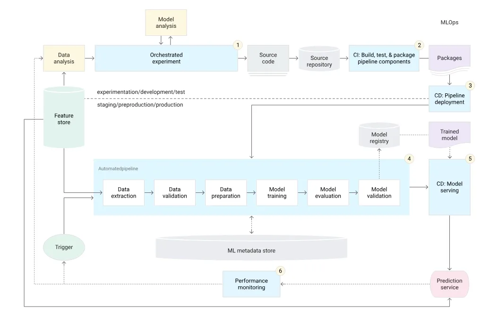
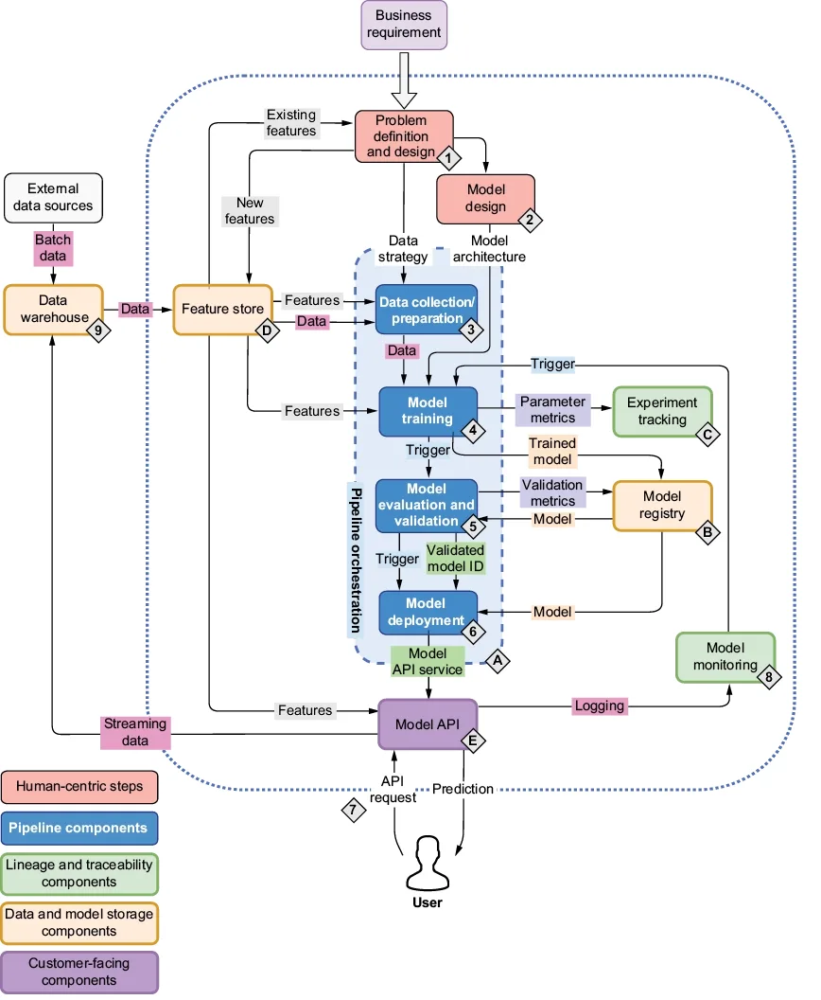
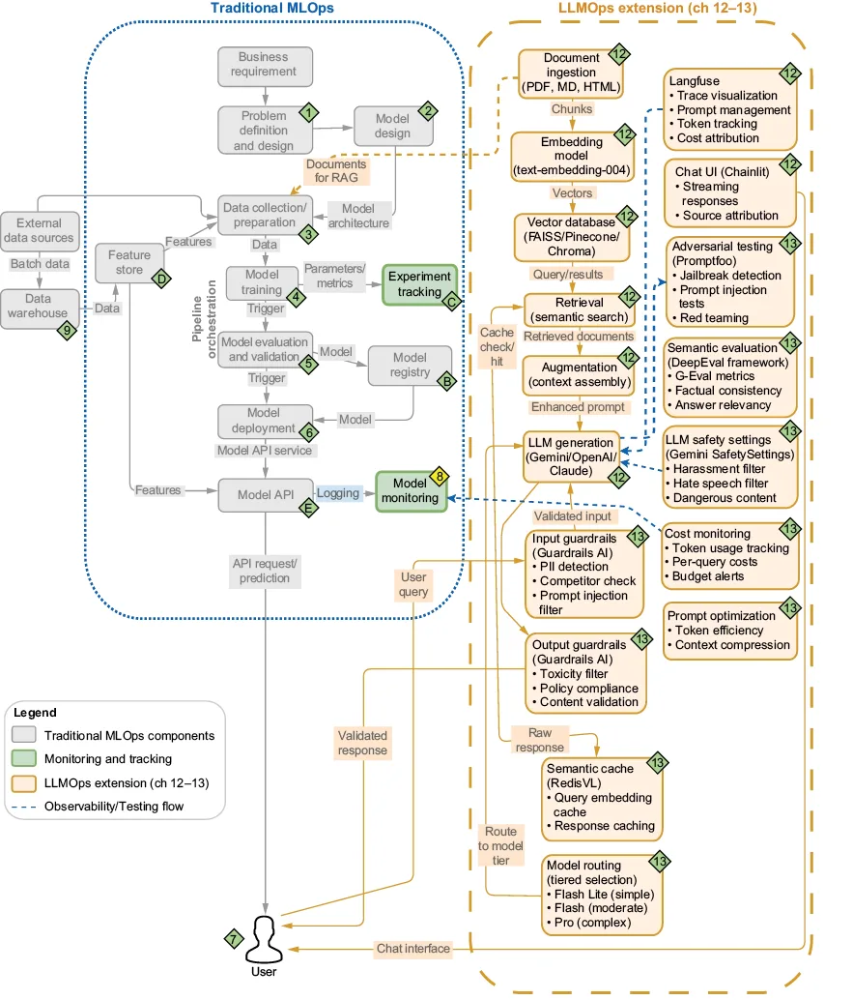

<nav id="manual-toc" class="manual-toc" aria-label="목차">

### 목차

**[1부. ML 프로젝트가 일반 소프트웨어와 다른 점](#section-1)**

- [1.1 모델은 목적이 아니라 수단 - 간극을 묻는 5가지 질문](#s1-1)
- [1.2 ML을 쓰기 전의 질문 - 휴리스틱으로 풀 수 있는가](#s1-2)
- [1.3 ML 엔지니어의 역량 - 소프트웨어 공학·DevOps·데이터 과학](#s1-3)

**[2부. ML 생애주기 - 문제 정의부터 유지보수까지](#section-2)**

- [2.1 실험 단계와 개발·스테이징·운영 단계](#s2-1)
- [2.2 문제 정의 - 세 이해관계자의 질문](#s2-2)
- [2.3 데이터 수집 - 편향·누수와 계보](#s2-3)
- [2.4 EDA - 가정을 리스크로 다룬다](#s2-4)
- [2.5 모델링과 학습 - 모델 = 코드 + 설정 + 데이터](#s2-5)
- [2.6 평가와 검증 - 지표 선택과 홀드아웃 버전](#s2-6)
- [2.7 배포 - 평가한 모델을 그대로 배포한다](#s2-7)
- [2.8 모니터링 - 데이터·성능·오류 세 종류](#s2-8)
- [2.9 유지보수와 재학습 - 루프를 닫는다](#s2-9)

**[3부. DevOps와 MLOps](#section-3)**

- [3.1 MLOps가 어려운 일곱 가지 이유](#s3-1)
- [3.2 DevOps와 다른 점 - CI/CD에 CT가 붙는다](#s3-2)
- [3.3 성숙도 Level 0 → 1 → 2](#s3-3)

**[4부. ML 플랫폼 지도](#section-4)**

- [4.1 플랫폼을 점진적으로 키운다 - 직접 구축 vs 구매](#s4-1)
- [4.2 네 도구가 푸는 문제 - Kubeflow Pipelines·Feast·MLflow·CI/CD](#s4-2)
- [4.3 MLOps에서 LLMOps로, 그리고 책의 세 프로젝트](#s4-3)

**[전체 흐름 정리](#section-5)** · **[출처](#section-6)**

</nav>

---

## 1부. ML 프로젝트가 일반 소프트웨어와 다른 점

<a id="s1-1"></a>

### 1.1 모델은 목적이 아니라 수단 - 간극을 묻는 5가지 질문

| 설명용 예시값 | 나오는 곳 |
|---------------|-----------|
| 주행거리 20만 km, 정확도 1~2%p | 1.2 |
| 석 달 (모델 교체 주기, 재구축 기간, 코드 무변경 기간) | 2.1, 3.1, 3.2 |
| 3월 1일 거래와 3월 5일 평균 결제액 | 2.3, 4.2 |
| 레이어 6 → 4 | 2.5 |
| 차량 5대 오차 2·10만 원, 홀드아웃 MAE 120·118·180·135 | 2.6 |
| 메일 100통 (TP 6, FP 2, FN 4, TN 88) | 2.6 |
| 카나리 5% → 50% → 100% | 2.7 |
| 평균 연식 6년 → 2년 | 2.8 |
| 첫 모델 2주, F1 0.03, p99 80ms, 하루 2회 배포 | 3.1 |
| 주행거리 60,000 km | 4.2 |

저자는 모델 구조를 새로 설계하는 회사가 소수라고 봅니다. 대부분은 사전학습 모델을 가져와 자기 데이터로 맞춥니다.

어려운 곳은 비즈니스 요구와 인프라 사이의 간극입니다. 저자는 이 간극을 다섯 질문으로 바꿉니다.

| 질문 | 답하는 곳 (2장) |
|------|-----------------|
| 모델을 어떻게 학습시키는가 | 2.1.3 모델링과 학습 |
| 데이터는 어떤 경로로 모델에 전달되는가 | 2.1.1 데이터 수집, 2.1.2 EDA |
| 다른 서비스와 어떻게 상호작용하는가 | 2.1.5 배포 |
| 어디에서 실행되는가 | 2.1.5 배포 |
| 시간이 지나도 정확도를 어떻게 유지하는가 | 2.1.6 모니터링, 2.1.7 유지보수 |

2장의 하위 절은 이 질문에 하나씩 답합니다. 중고차 모델에 대입하면 질문이 이렇게 바뀝니다.

- 매물 데이터를 배치로 받는가, 실시간으로 받는가
- 추천 가격 API를 매물 등록 화면에 동기로 붙이는가, 큐로 붙이는가
- 모델 서버는 어느 클러스터에 두는가
- 전기차가 늘면 누가 언제 다시 학습시키는가

<a id="s1-2"></a>

### 1.2 ML을 쓰기 전의 질문 - 휴리스틱으로 풀 수 있는가

1장 실험 단계의 첫 질문은 "ML을 써야 하는가"입니다.

- **규칙으로 충분하면 ML은 운영 부담만 늘린다**
  - 규칙의 동작은 데이터에 따라 바뀌지 않습니다.
  - ML을 넣으면 데이터 버전, 재학습, 드리프트 감시가 따라옵니다.
- **ML은 고차원·비선형 패턴에서 값을 한다**
  - 중고차 가격에는 차종, 연식, 주행거리, 사고 이력, 지역이 얽혀 있어서 ML 후보입니다.
  - "주행거리 20만 km 초과 매물에 경고 표시"는 규칙 한 줄로 충분합니다.
- **휴리스틱을 ML의 기준선(baseline)으로 쓴다**
  - "지난주 같은 요일 판매량", "최근 7일 판매 상위 10개" 같은 규칙은 출시 첫날부터 동작합니다.
  - 먼저 이 규칙으로 비즈니스 지표를 잽니다. 정확도가 1~2%p 오르는 정도로는 학습 파이프라인과 서빙, 모니터링의 운영 비용을 정당화하기 어렵습니다.

ML을 쓸지는 비즈니스 담당자와 기술 담당자가 함께 정합니다. 2.2절이 그 판단을 질문 목록으로 구체화합니다.

<a id="s1-3"></a>

### 1.3 ML 엔지니어의 역량 - 소프트웨어 공학·DevOps·데이터 과학

1장 1.2절은 MLOps를 소프트웨어 공학, DevOps, 데이터 과학 세 분야의 교집합으로 그립니다(Figure 1.3). 본문은 데이터 엔지니어링을 하나 더 요구합니다.

| 분야 | 저자가 요구하는 수준 |
|------|----------------------|
| 소프트웨어 공학 | 단순하지 않은 시스템을 배포해 본 경험 |
| 데이터 과학 | 역전파의 세부는 불필요. 주요 프레임워크를 능숙하게 씀 |
| 데이터 엔지니어링 | 양질의 학습 데이터 확보. 대부분의 실무자가 가장 어렵다고 꼽는 과제 |
| DevOps | 자동화와 실험 재현성. 규제·감사 대상 모델은 다시 만들 수 있어야 한다 |

---

## 2부. ML 생애주기 - 문제 정의부터 유지보수까지

<a id="s2-1"></a>

### 2.1 실험 단계와 개발·스테이징·운영 단계

1장은 먼저 ML 프로젝트가 배포 후에도 반복된다고 주장합니다.


데이터는 코드 변경 없이도 바뀝니다. 그래서 Git만으로는 모델을 재현할 수 없습니다. 목표는 **반복 한 번의 비용을 줄이는 것**입니다.

1장은 생애주기를 두 단계로 나눕니다.

| 관심사 | 실험 단계 | 운영 단계 |
|--------|-----------|-----------|
| 목표 | 가능성 탐색 | 안정적 유지, 지속적 개선 |
| 파이프라인 자동화 | 거의 자동, 사람이 실행 | 완전 자동, 트리거가 실행 |
| 보안·윤리 | 느슨함 | 최우선 요구사항 |
| 확장성·실시간 성능 | 거의 무관 | 서비스 품질을 좌우 |
| 실패 비용 | 실험 한 번 | 사용자와 매출 |

트리거는 파이프라인 실행을 시작하는 신호입니다.

**실험 단계**는 문제 정의, 데이터 수집과 준비, 데이터 버전 관리, 학습, 평가, 검증의 여섯 단계입니다. 실제로는 거의 모든 단계에서 앞 단계로 되돌아갑니다. 그래서 저자는 실험 단계부터 파이프라인을 쓰라고 권합니다. 노트북 셀을 손으로 실행하면 무엇을 바꿨는지 놓치기 때문입니다.

**운영 단계**는 같은 절차를 완전히 자동화합니다. 그리고 끝에 배포, 모니터링, 재학습을 붙입니다. 재학습이 파이프라인을 다시 실행하면 루프가 닫힙니다. 트리거는 CI에서 오거나 다른 프로그램의 호출에서 옵니다.

운영 단계의 환경은 개발, 스테이징, 운영 세 개이고 파이프라인은 모델을 이 순서로 승격(*promote*)합니다.

2장의 8단계 루프(Figure 2.2)에서 0~4단계는 1장의 실험 단계에, 5~7단계는 운영 단계에 속합니다.



저자는 모델, 데이터, 하이퍼파라미터를 일시적이라고 봅니다. 오늘 배포한 모델도 석 달 뒤에는 교체 대상입니다. 모델은 몇 달마다 바뀌고 파이프라인과 계보 기록은 수년 동안 남습니다. 이 수명 차이 때문에 3.3절의 Level 1은 모델 대신 파이프라인을 배포합니다.

<a id="s2-2"></a>

### 2.2 문제 정의 - 세 이해관계자의 질문

"고객 이탈률을 예측하라"는 문제 정의가 아닙니다. 아래 항목이 하나도 정해지지 않았습니다.

- 이탈의 정의 (30일 미접속인가, 해지인가)
- 예측 시점 (얼마나 미리 알아야 하는가)
- 대상 (전체 고객인가, 유료 고객인가)
- 결과의 쓰임 (쿠폰 발송인가, 상담 연결인가)
- 틀렸을 때의 비용

이 항목이 없으면 평가 지표를 고를 수 없습니다. 저자는 비즈니스, 기술, 법무 세 그룹이 **모델링 전에 함께** 답하라고 합니다. 세 그룹의 질문은 성격에 따라 다섯 묶음으로 나뉩니다.

| 성격 | 질문의 방향 | 이어지는 단계 |
|------|-------------|---------------|
| 필요성 | 정말 ML이 필요한가 | 1.2절 |
| 성공의 정의 | 성공 지표, 허용 오차, 오예측의 영향 | 2.6 평가 |
| 데이터 | 저장 위치, 파이프라인, 민감정보 | 2.3 수집, 2.4 EDA |
| 자원과 운영 | 학습·서빙 자원, 배포 전략, 재학습 지표 | 2.7 ~ 2.9 |
| 위험과 규제 | 윤리, 개인정보, 거버넌스 | 3.1 |

- **모델을 만들기 전에 교체 조건을 정한다**
  - 기술 그룹의 질문에 "재학습을 트리거할 지표"가 있습니다.
- **법무 질문을 빠뜨리면 다시 학습해야 한다**
  - 이탈 모델을 다 만든 뒤에 상담 녹취에 별도 동의가 필요하다는 사실이 드러나면 그 피처를 빼고 다시 학습해야 합니다.

<a id="s2-3"></a>

### 2.3 데이터 수집 - 편향·누수와 계보

데이터 수집 단계의 편향은 이후 모든 단계로 전파됩니다. 데이터셋 요구사항은 관련성, 크기, 품질, 편향·누수 방지, 대표성, 다양성, 계보입니다. 저자는 이 중 계보를 가장 길게 다룹니다.

<aside class="callout">
<p class="eyebrow">(용어) 계보 (lineage)</p>

어떤 산출물이 어떤 입력으로 만들어졌는지 추적할 수 있게 남긴 기록입니다.

- **데이터 계보** - 원본에서 학습 데이터셋까지 단계마다 버전과 메타데이터를 남긴 사슬
- **모델 계보** - 모델 하나를 만든 코드 커밋, 설정, 데이터 버전의 연결

</aside>



화살표마다 버전 관리되는 ETL 단계와 메타데이터(언제·어디서·어떻게·왜)가 붙습니다. 계보가 있으면 오류가 난 단계부터 다시 실행하면 됩니다.

저자는 계보를 미루는 것을 기술 부채로 봅니다. 임시 스크립트는 처음에만 빠릅니다. 데이터에서 오류가 나오면 계보가 있는 팀은 쿼리 하나로 원인을 찾고 계보가 없는 팀은 추출 스크립트를 처음부터 다시 짭니다.

- **첫 데이터셋은 거의 최선이 아니다**
  - 저자는 처음부터 고칠 수 있는 데이터셋을 만들라고 합니다.
- **메타데이터는 언제, 어디서, 어떻게, 왜를 남긴다**
  - 가장 자주 빠지는 항목은 "왜"입니다.
  - 사기 탐지용으로 의심 거래만 모은 데이터가 있다고 해봅시다. 이 데이터를 일반 거래 분석에 쓰면 결과가 왜곡됩니다.

원문은 중고차 가격 모델의 수집 지침을 이렇게 정합니다. 중고 시장의 승용차 데이터는 모두 모으고 트럭과 오토바이는 뺍니다. 한 플랫폼에서만 모은 데이터가 지방 저가 차량에서 부족하면 그 매물을 보강한 v2를 만들고, v1과 v2로 학습한 모델을 비교합니다.

#### 편향과 누수

편향은 데이터가 현실과 다른 문제이고 누수는 평가가 현실과 다른 문제입니다. 둘 다 학습 뒤에는 고치기 어려워서 원문은 수집과 큐레이션 단계에서 막으라고 합니다.

| 편향 | 예시 |
|------|------|
| 표본 편향 | 밝은 실내의 신분증만 학습하면 어두운 곳에서 휴대폰으로 찍은 사진을 못 찾음 |
| 선택 편향 | 고객이 신고한 거래만 사기로 표시하면 신고되지 않은 사기를 놓침 |
| 과거 편향 | 과거 대출 심사의 차별을 모델이 재현 |

| 누수 | 원인 | 예시 |
|------|------|------|
| 샘플 중복 | 같은 데이터가 학습과 테스트에 모두 들어감 | 같은 신분증 사진이 두 번 수집됨 |
| 미래 정보 | 예측 시점에 알 수 없는 값을 피처로 씀 | 3월 1일 거래의 사기 판정에 3월 5일에 계산한 "최근 7일 평균 결제액"을 씀 |
| 정답 단서 | 정답을 간접적으로 알려 주는 피처 | 사기 확정 뒤에 생기는 "계정 정지 여부"를 피처로 씀 |

누수를 막는 규칙은 네 가지입니다.

1. 분할 전에 중복을 제거합니다.
2. 시간 순서가 있는 데이터는 무작위로 섞지 않고 시간 순서로 나눕니다.
3. 피처마다 "예측 시점에 이 값을 알 수 있는가"를 묻습니다.
4. 점수가 지나치게 좋으면 누수를 먼저 의심합니다.

사기 샘플을 늘리는 균형 조정은 학습 데이터에만 합니다. 검증·테스트 데이터까지 조정하면 분포가 운영 환경과 달라지고 점수가 실제보다 높게 나옵니다.

#### 라벨과 데이터셋 분할

라벨은 사람이 CVAT로 경계 상자를 그려 붙이거나(애노테이션), 고객 신고 같은 업무 기록에서 얻거나, 합성 데이터를 만들 때 프로그램이 함께 만듭니다. 합성 데이터는 실제와 너무 다르면 운영에서 성능이 떨어지므로 평가는 실제 데이터로 합니다.

라벨이 붙은 데이터는 보통 학습 60~80%, 검증 10~20%, 테스트 10~20%로 나눕니다. 배포 뒤의 실시간 요청에는 정답이 없고 사기 라벨은 신고까지 며칠이 걸립니다. 그래서 2.8절의 성능 모니터링은 라벨이 도착한 뒤에야 할 수 있습니다.

<a id="s2-4"></a>

### 2.4 EDA - 가정을 리스크로 다룬다

EDA(탐색적 데이터 분석)는 잘못 정의된 문제와 숨은 가정을 찾습니다. 저자는 검증하기 전까지 모든 가정을 리스크로 봅니다.

원문의 EDA 질문은 대부분 운영에서 생길 문제를 묻습니다.

| EDA 질문 | 운영에서의 의미 |
|----------|-----------------|
| 스키마가 바뀔 수 있는가 | 상위 시스템이 컬럼을 바꾸면 모델이 망가진다. 입력 검증이 필요하다 |
| 피처 계산 비용이 비싼가 | 실시간 서빙에서 지연 시간이 커진다 |
| 입력이 주기적으로 변하는가 | 계절성과 이벤트가 미래의 드리프트 후보다 |
| 운영 중 이상치는 어떻게 처리하는가 | 운영에서는 이상치 요청에도 응답해야 한다 |

- **가정을 목록으로 만들어 자동 검사로 넣는다**
  - `amount` 필드를 원화로 가정했는데 일부가 달러일 수 있습니다.
  - `created_at`을 UTC로 가정했는데 한국 시간일 수 있습니다.
  - 이런 문제는 모델 코드에서 보이지 않습니다. 파이프라인 초반의 검사가 잡습니다.
- **EDA로 공수를 추정한다**
  - 데이터가 지저분할수록 정제와 운영 검증에 시간이 더 듭니다.
- **ML 엔지니어도 EDA를 알아야 한다**
  - EDA에서 본 분포를 아는 엔지니어가 드리프트를 먼저 의심합니다.

원문은 변수를 여러 개 함께 보는 다변량 분석(*multivariate analysis*)도 권합니다. 키와 몸무게를 따로 보면 둘 다 평범해도 둘의 관계에서 BMI 같은 새 피처가 나옵니다. 변수가 수십 개를 넘으면 PCA나 t-SNE로 2~3차원에 줄여 그립니다.

<a id="s2-5"></a>

### 2.5 모델링과 학습 - 모델 = 코드 + 설정 + 데이터

이 책의 모델링 절은 학습 기법 대신 **학습 과정 추적**을 다룹니다.

저자가 꼽는 MLOps 도구는 모델·데이터 버전 관리, 실험 추적(*experiment tracking*), 학습 파이프라인, 하이퍼파라미터 탐색 네 가지이고 공통 원칙은 계보, 추적, 수작업 제거입니다.

탐색 도구는 설정만 바꿔서 학습을 반복하므로 하이퍼파라미터를 코드에서 분리해 둡니다. `model = Net(layers=6)`처럼 값을 코드에 박아 두면 사람이 매번 코드를 고쳐야 합니다. 값을 설정 파일로 빼면 탐색 도구가 설정만 바꿔 반복 실행하고 실행마다 값을 기록합니다.

```yaml
# config.yaml
layers: 6
lr: 0.001
```

계보와 재현성을 위해 실행마다 설정을 기록합니다. 저자는 학습된 모델을 **코드에 설정과 데이터를 적용한 산출물**로 정의합니다.

Figure 2.5는 이 정의를 재학습 파이프라인 두 단계로 나눕니다. 설정도 모델 설정과 학습 설정 두 개입니다.



다섯 입력은 각자 버전을 가집니다. 역방향으로는 model v12를 만든 사전학습 가중치, 코드 a1b2, 모델 설정 v7, 학습 설정 v4, 데이터 v3를 찾습니다. 순방향으로는 dataset v3로 학습한 모델을 찾습니다.

- **모델 파일과 코드는 버전이 따로 바뀐다**
  - 코드는 Git에, 모델 파일은 레지스트리에 두고 모델에는 짝이 되는 코드 커밋을 메타데이터로 남깁니다.
  - PyTorch `state_dict`는 가중치만 담으므로 구조를 바꾼 코드에 넣으면 오류가 나거나 엉뚱한 결과가 나옵니다. pickle 파일은 로드할 때 코드를 실행할 수 있어서 출처를 모르는 파일을 `pickle.load`하면 보안 위험이 있습니다.
- **실험 추적은 잘못된 결론을 막는다**
  - 팀원 A가 레이어를 6에서 4로 줄였더니 검증 손실이 좋아졌다고 보고합니다.
  - 팀원 B가 추적 서버에서 두 실행을 비교합니다. 데이터셋 버전이 다릅니다.
  - 원인을 가릴 수 없으므로 팀은 다시 실험합니다.
- **설정 항목을 너무 늘리지 않는다**
  - 저자는 팩토리 패턴으로 설정에서 모델 객체를 만들라고 권합니다. 동시에 과도한 파라미터화(*overparametrization*)를 경계합니다.
  - 모든 값을 설정으로 빼면 설정 파일이 코드만큼 복잡해집니다. 자주 바꾸는 값부터 뺍니다.

<a id="s2-6"></a>

### 2.6 평가와 검증 - 지표 선택과 홀드아웃 버전

1장은 **평가**(*evaluation*)와 **검증**(*validation*)을 구분합니다.

평가는 모델을 만든 팀이 학습에 쓰지 않은 데이터로 정량 지표를 재는 일입니다. 검증은 비즈니스 이해관계자가 "이 모델을 내보내도 되는가"를 사례로 확인하는 일입니다. 중고차 모델이 테스트 세트 평균 오차 기준을 넘어도, 희귀 차종에 터무니없는 가격을 내면 검증에서 떨어집니다.

평가를 통과해도 검증에서 떨어질 수 있습니다. 지표가 업무 요구를 다 담지 못하기 때문입니다.

2장은 평가를 문제 정의와 연결합니다. 지표를 고르려면 **어떤 오류가 누구에게 어떤 피해를 주는가**를 먼저 정해야 합니다.

메일 100통 중 진짜 스팸이 10통이라고 해봅시다. 모델이 8통을 스팸으로 판정했고 그중 6통이 진짜입니다. 그러면 TP 6, FP 2(헛경보), FN 4(놓침), TN 88입니다.

| 지표 | 식 | 값 | 중요할 때 |
|------|----|----|-----------|
| Precision | TP / (TP + FP) | 6 ÷ 8 = 0.75 | 헛경보가 아플 때 |
| Recall | TP / (TP + FN) | 6 ÷ 10 = 0.60 | 놓침이 아플 때. 암 선별 검사 |
| F1 | 2 × P × R / (P + R) | 0.90 ÷ 1.35 = 0.667 | 둘 다 볼 때 |
| Accuracy | (TP + TN) / 전체 | 94 ÷ 100 = 0.94 | 클래스가 균형일 때 |

모든 메일을 정상이라고 찍어도 Accuracy는 0.90입니다. 그래서 불균형 데이터에서는 Accuracy만 보지 않습니다.

차량 5대의 오차(만 원)로 평균 절대 오차(MAE)와 평균 제곱 오차(MSE)를 비교합니다.

| 모델 | 5대 오차 | MAE | MSE |
|------|----------|-----|-----|
| A | 2, 2, 2, 2, 2 | 10 ÷ 5 = 2.0 | 20 ÷ 5 = 4.0 |
| B | 0, 0, 0, 0, 10 | 10 ÷ 5 = 2.0 | 100 ÷ 5 = 20.0 |

MSE는 큰 오차를 더 크게 반영합니다.

- **홀드아웃셋도 버전 관리한다**
  - 홀드아웃셋은 학습에 쓰지 않고 최종 평가에만 쓰는 데이터입니다.
  - 운영 분포가 바뀌면 홀드아웃셋도 갱신합니다.
  - 점수마다 홀드아웃 버전을 함께 기록합니다.

| 점수(MAE) | 홀드아웃 v1 | 홀드아웃 v2 (전기차 추가) |
|-----------|-------------|---------------------------|
| 모델 v3 | 120 | 180 |
| 모델 v4 | 118 | 135 |

같은 홀드아웃 버전끼리만 비교합니다.

분할 규칙도 고정합니다. 분할이 바뀌면 예전 평가 데이터 일부가 새 학습 데이터로 들어가 이전 점수를 믿을 수 없습니다. 그래서 분할의 시드와 기준을 버전으로 남깁니다.

평가는 점수 계산 뒤에 오분류 샘플 분석으로 이어집니다. 틀린 샘플의 패턴에서 찾은 편향은 데이터 수집 단계로 돌아갑니다.

<a id="s2-7"></a>

### 2.7 배포 - 평가한 모델을 그대로 배포한다

모델의 예측을 서비스에서 쓰려면 먼저 배포해야 합니다. 저자는 배포 방식을 둘로 나눕니다.

- API 엔드포인트 뒤에 두는 마이크로서비스
- 하드웨어나 엣지 디바이스에 직접 올리는 방식

두 방식 모두 지연 시간이 중요해서 배포 전에 최적화 단계를 거칩니다.

FP32 가중치를 INT8로 양자화하면 크기가 약 1/4이 됩니다. 대신 특정 클래스의 정확도가 떨어질 수 있습니다. 그래서 저자는 **최적화된 최종 모델로 다시 평가하라**고 합니다.


- **ML의 스테이징은 평가 모드다**
  - 스테이징에서 새 모델과 운영 모델을 실제 데이터로 비교합니다.
  - 새 모델이 기준을 통과하면 파이프라인이 자동으로 승격합니다.
  - 전환 기록이 있으므로 롤백은 운영 표시를 이전 버전으로 바꾸는 일입니다.
- **배포 범위는 단계적으로 넓힌다**
  - 카나리 배포는 사용자 5%에게만 새 모델을 보여 주고, 지표가 정상이면 50%와 100%로 넓힙니다.

1장은 배포 점검표를 줍니다. REST API로 감싸는 것은 출발점일 뿐입니다(*slapping on a REST API*).

| 점검 항목 | 확인 질문 |
|-----------|-----------|
| 부하 테스트 | 매물 등록이 몰리는 주말 저녁의 트래픽을 견디는가 |
| 오토스케일링 | TV 광고 직후의 폭증에 자동으로 늘어나는가 |
| 배포 버전 관리 | 지금 떠 있는 것이 어느 모델, 어느 이미지인가 |
| 롤백 전략 | 몇 분 안에 이전 버전으로 돌아가는가 |

책은 BentoML로 모델을 HTTP 엔드포인트로 만듭니다. 그다음 Docker로 패키징하고 Yatai로 Kubernetes에 배포합니다. 그래서 3장이 Kubernetes로 시작합니다.

<a id="s2-8"></a>

### 2.8 모니터링 - 데이터·성능·오류 세 종류

저자는 운영 데이터를 만난 모델의 성능이 대개 떨어진다고 보고 모니터링을 배포와 동시에 갖추라고 합니다.

ML 모델은 `200 OK`와 함께 틀린 예측값을 돌려줄 수 있습니다.

| 층 | 무엇을 보는가 | 대표 지표 |
|----|---------------|-----------|
| 시스템 | 서비스가 살아 있고 빠른가 | RPS, HTTP 상태 코드, 지연 시간 |
| ML 고유 | 입력과 예측이 학습 때와 비슷한가 | 데이터 드리프트, 개념 드리프트 |
| 비즈니스 | 모델이 가치를 만드는가 | 추천 가격 수락률, 전환율 |

시스템 층이 정상이어도 위의 두 층은 나빠질 수 있습니다. BentoML의 기본 Prometheus 지표는 시스템 층만 봅니다.

<aside class="callout">
<p class="eyebrow">(용어) 데이터 드리프트와 개념 드리프트</p>

둘 다 재학습의 신호입니다. 감지 방법이 다릅니다.

- **데이터 드리프트** - 입력의 분포가 학습 때와 달라지는 것. 예를 들어 평균 연식이 6년에서 2년이 됩니다. 입력만 봐도 감지할 수 있습니다.
- **개념 드리프트** - 입력과 정답 사이의 관계가 바뀌는 것. 예를 들어 같은 연식인데 유가 변동으로 디젤차 시세가 떨어집니다. 정답이 도착해야 감지할 수 있습니다.

</aside>

2장은 모니터링을 세 종류로 나눕니다. 표의 순서는 감지가 빠른 순서입니다.

| 종류 | 정답 라벨 | 감지 속도 | 얻는 정보 |
|------|-----------|-----------|-----------|
| 데이터 모니터링 | 불필요 | 가장 빠름 | 입력이 달라졌다 |
| 성능 모니터링 | 필요 | 라벨 도착 후 | 결과가 나빠졌다 |
| 오류 모니터링 | 필요 + 사람 분석 | 가장 느림 | 왜, 어디서 틀리는가 |

중고차 모델이라면 데이터 모니터링이 입력 매물의 평균 연식 하락을 먼저 잡습니다. 몇 주 뒤 실거래가가 쌓이면 성능 모니터링에서 MAE가 오르고, 오류 모니터링이 출고 1년 미만 차량의 과소 예측을 찾아 신차급 매물 보강과 재학습으로 이어집니다. 책은 분포 비교와 재학습 트리거에 Evidently를 씁니다.

- **모니터링에는 계보가 필요하다**
  - 경보가 울리면 언제부터, 어느 모델 버전에서 나빠졌는지 알아야 합니다. 2.3절의 계보를 거슬러 올라가면 둘 다 확인할 수 있습니다.
- **알림이 담당자에게 닿아야 한다**
  - 아무도 보지 않는 대시보드와 너무 많은 알림은 둘 다 담당자가 경보를 놓치게 만듭니다.
  - 수신자, 임계값, 런북을 미리 정합니다.

<a id="s2-9"></a>

### 2.9 유지보수와 재학습 - 루프를 닫는다

유지보수에는 버그 수정, 엣지 케이스 데이터 수집, 드리프트 대응 재학습이 있습니다.

| 구분 | 주기 기반 | 임계값 기반 |
|------|-----------|-------------|
| 장점 | 예측 가능하고 운영 계획이 쉽다 | 필요할 때만 빠르게 대응한다 |
| 단점 | 급변에 늦고, 변화가 없어도 비용이 든다 | 임계값 설계가 어렵고, 라벨이 늦으면 감지도 늦다 |

실무에서는 두 트리거를 함께 씁니다. 저자는 재학습을 자동화하려면 배포도 자동화해야 한다고 강조합니다. 배포가 수작업이면 새 모델이 운영에 나가는 데 며칠이 걸립니다.


2장에서 유지보수는 생애주기의 모든 단계에서 합니다. 데이터 수집 단계는 상위 시스템의 스키마 변경에 대응하고, 평가 단계는 홀드아웃셋을 갱신합니다. 대체되거나 요구가 사라진 모델은 **은퇴**시킵니다. 레지스트리에서 그 모델의 운영 표시를 해제하고 서빙을 중단합니다.

---

## 3부. DevOps와 MLOps

<a id="s3-1"></a>

### 3.1 MLOps가 어려운 일곱 가지 이유

원문 2.2절은 MLOps를 건너뛰면 기술 부채가 쌓인다고 결론 냅니다.

| # | 어려움 (원문 2.2) | 넘었을 때의 이점 (원문 2.3) |
|---|-------------------|-----------------------------|
| 1 | 블록마다 복잡도가 곱해진다 | 실험 가속. 인프라가 추상화된다 |
| 2 | 데이터 관리 실패는 소송으로 이어진다 | 재현성과 추적성 |
| 3 | 시스템 전체의 구조적 결함이 보이지 않는다 | CI/CD로 반복 작업 자동화 |
| 4 | 직군마다 다른 지표로 말한다 | 공통 도구로 협업 |
| 5 | 대규모 트래픽은 다른 문제를 만든다 | 표준 워크플로우로 확장 |
| 6 | 엣지 케이스는 에러 없이 결과만 틀린다 | 모니터링과 롤백 |
| 7 | 도구 생태계가 파편화되어 있다 | 공유 컴포넌트로 중복 투자 제거 |

4번은 데이터 과학자가 "F1 0.03 상승"으로, ML 엔지니어가 "p99 80ms, 하루 2회 배포"로 같은 모델을 말하는 문제입니다. 공통 실험 추적 서버가 두 지표를 한 실행 기록에 묶습니다.

플랫폼 엔지니어가 학습 코드에 모델 로깅을 기본 설정하면 데이터 과학자는 별도 작업 없이 버전을 남깁니다.

7번의 예로 원문은 모델 레지스트리 솔루션만 최소 10가지라고 씁니다.

세 명의 팀이 첫 모델을 수작업으로 2주 만에 냈다고 해봅시다. 반년 뒤 이 팀은 모델 다섯 개의 학습 데이터를 추적하지 못하고 모델을 다시 만드는 데 석 달을 씁니다.

<a id="s3-2"></a>

### 3.2 DevOps와 다른 점 - CI/CD에 CT가 붙는다

MLOps와 DevOps는 자동화, CI/CD, 협업을 공유합니다. 원문이 드는 차이점 여섯 가지(모델 수명주기 중심, 데이터 관리, 지속 학습, 해석 가능성과 편향, 성능 저하 감시, 실험 추적)는 대부분 ML 시스템의 동작을 코드와 데이터가 함께 정한다는 사실에서 나옵니다.


<aside class="callout">
<p class="eyebrow">(용어) CT (Continuous Training, 지속 학습)</p>

데이터 변화를 트리거로 모델을 자동으로 다시 학습시키는 체계입니다.

- **CI/CD의 트리거** - 코드 커밋
- **CT의 트리거** - 새 데이터 도착, 드리프트 감지, 성능 저하. 코드가 바뀌지 않아도 파이프라인이 실행됩니다.

</aside>

코드 커밋만 트리거로 쓰면 코드가 석 달 동안 그대로일 때 재학습도 없습니다. 그사이 사용자 행동이 바뀌면 성능만 떨어집니다.

MLOps는 빌드뿐 아니라 **실험**도 추적합니다. 실패한 실험도 기록합니다. 그래야 팀원이 같은 실험을 반복하지 않습니다.

<a id="s3-3"></a>

### 3.3 성숙도 Level 0 → 1 → 2

2장은 Google의 기준으로 성숙도를 나눕니다. 레벨을 가르는 질문은 **무엇을 배포하는가**입니다.

| 루프 단계 | Level 0 | Level 1 | Level 2 |
|-----------|---------|---------|---------|
| 데이터 추출·검증 | 수동 | 자동 | 자동 |
| 데이터·모델 분석 | 수동 | 수동 | 수동 |
| 학습 | 수동 | 자동 | 자동 |
| 평가 | 수동 | 자동 | 자동 |
| 모델 배포 | 수동 | 자동 | 자동 |
| 모니터링·재학습 트리거 | 없음 | 자동 | 자동 |
| 파이프라인 자체의 빌드·배포 | 수동 | 수동 | 자동 |

Google 도식에서 가로 점선 위는 실험 환경이고 아래는 운영 환경입니다. 세로 점선 `ML | Ops`는 데이터 과학자가 운영 쪽에 넘기는 지점입니다.

<figure>
  
  <figcaption>Level 0. <code>ML | Ops</code> 경계가 <strong>모델 레지스트리</strong> 위를 지나고, 데이터 과학자가 넘기는 것은 모델 파일 하나입니다. 운영 쪽에 모니터링이 없습니다. (출처: Google Cloud, <a href="https://docs.cloud.google.com/architecture/mlops-continuous-delivery-and-automation-pipelines-in-machine-learning">MLOps: Continuous delivery and automation pipelines in machine learning</a>, CC BY 4.0)</figcaption>
</figure>

<figure>
  
  <figcaption>Level 1. 같은 단계가 점선 위아래에 두 번 그려져 있습니다(<strong>실험-운영 대칭성</strong>). 경계는 <strong>소스 저장소</strong> 옆으로 옮겨 갔고 넘기는 것은 파이프라인 코드입니다. 아래쪽 Performance monitoring에서 Trigger로 가는 고리가 CT입니다. (출처: Google Cloud, <a href="https://docs.cloud.google.com/architecture/mlops-continuous-delivery-and-automation-pipelines-in-machine-learning">MLOps: Continuous delivery and automation pipelines in machine learning</a>, CC BY 4.0)</figcaption>
</figure>

<figure>
  
  <figcaption>Level 2. ②의 CI가 파이프라인 컴포넌트를 빌드·테스트·패키징하고 ③의 CD가 파이프라인 자체를 배포합니다. <code>ML | Ops</code> 경계선이 사라지고 <strong>MLOps</strong> 하나만 남습니다. (출처: Google Cloud, <a href="https://docs.cloud.google.com/architecture/mlops-continuous-delivery-and-automation-pipelines-in-machine-learning">MLOps: Continuous delivery and automation pipelines in machine learning</a>, CC BY 4.0)</figcaption>
</figure>

- **Level 1의 핵심은 실험-운영 대칭성이다**
  - 실험과 운영에서 같은 파이프라인을 씁니다(*experimental-operational symmetry*).
  - 노트북은 결측값을 평균으로 채우고 운영 코드는 0으로 채운다고 해봅시다. 그러면 같은 입력이 학습 때와 서빙 때 다른 피처 값이 됩니다. 이런 어긋남을 학습-서빙 불일치라고 합니다(4.2절).
  - 같은 컴포넌트를 양쪽에서 쓰면 이 불일치가 생기지 않습니다.
- **Level 1은 사람의 판단을 규칙으로 적는다**
  - 데이터 검증이 "이 데이터 괜찮나"라는 판단을, 트리거가 "언제 재학습하나"라는 판단을 대신합니다.
- **Level 2에서도 데이터 분석과 모델 분석은 사람이 한다**

레벨은 다음 단계를 계획하는 기준이고 레벨 사이의 난이도는 일정하지 않습니다. 영화 추천 프로젝트는 Level 0에서 시작해 학습 파이프라인과 드리프트 트리거를 갖추면 Level 1이 됩니다.

---

## 4부. ML 플랫폼 지도

<a id="s4-1"></a>

### 4.1 플랫폼을 점진적으로 키운다 - 직접 구축 vs 구매

1장 1.3절은 루프를 받치는 공통 기반으로 ML 플랫폼을 다룹니다. 데이터 웨어하우스와 레이크는 플랫폼 밖에 둡니다. 플랫폼은 Kubernetes 위의 Kubeflow에서 시작합니다.

<figure>
  
  <figcaption>책은 매 장 이 지도를 다시 그리고 그 장의 블록을 강조합니다. 숫자는 데이터가 흐르는 단계이고 알파벳은 인프라 컴포넌트입니다. Model monitoring ⑧에서 Model training ④로 올라가는 <strong>Trigger</strong> 화살표가 2.9절의 재학습 루프입니다. 운영 데이터는 Model API Ⓔ의 <strong>Streaming data</strong> 화살표를 따라 점선 밖 Data warehouse ⑨로 돌아가 다음 학습 데이터가 됩니다. (출처: Benjamin Tan Wei Hao 외, <a href="https://www.manning.com/books/machine-learning-platform-engineering"><em>Machine Learning Platform Engineering</em></a>, Manning, Figure 1.4)</figcaption>
</figure>

| 표시 | 구성 요소 | 범례 분류 | 이 글 또는 책의 도구 |
|------|-----------|-----------|----------------------|
| 1 ~ 8 | 문제 정의부터 모니터링까지의 단계 | 사람 중심, 파이프라인, 계보·추적 | 2.2 ~ 2.8 |
| 9 | 데이터 웨어하우스 | 데이터·모델 저장 | 플랫폼 밖 |
| A | 파이프라인 오케스트레이션 | - | Kubeflow Pipelines |
| B | 모델 레지스트리 | 데이터·모델 저장 | MLflow |
| C | 실험 추적 | 계보·추적 컴포넌트 | MLflow |
| D | 피처 스토어 | 데이터·모델 저장 | Feast |
| E | 모델 API | 고객 대면 컴포넌트 | BentoML |

숫자와 알파벳의 순서는 책이 컴포넌트를 소개하는 순서이자 파이프라인에서 데이터가 흐르는 순서입니다.

모든 조직에 맞는 단일 구조는 없으므로(*no one-size-fits-all*) 저자는 부족한 부분이 드러날 때마다 구성 요소를 하나씩 붙입니다. SageMaker나 Vertex AI를 쓰는 팀에게도 플랫폼을 한 번 직접 조립해 보라고 권합니다. 직접 조립해 본 사람은 매니지드 서비스 안의 파이프라인, 실험 추적, 레지스트리, 서빙을 구별하고, 한계에 부딪혔을 때 원인을 찾습니다.

<a id="s4-2"></a>

### 4.2 네 도구가 푸는 문제 - Kubeflow Pipelines·Feast·MLflow·CI/CD

1.3.3절은 도구 네 블록을 출발점으로 제시합니다.

| 도구 블록 | 생애주기 위치 | 없을 때의 문제 | 책의 선택 |
|-----------|---------------|----------------|-----------|
| 파이프라인 자동화 | 전 단계를 연결 | 단계 순서를 틀리고, 무엇을 돌렸는지 잊는다 | Kubeflow Pipelines |
| 피처 스토어 | 데이터 수집과 준비 | 팀마다 같은 피처를 다시 만들고, 학습과 서빙의 값이 어긋난다 | Feast |
| 모델 레지스트리 | 학습·평가 이후 | 어느 실행이 어떤 모델을 만들었는지 모른다 | MLflow |
| 배포 자동화 | 배포·재학습 이후 | 배포가 느리고 사람마다 방식이 다르다 | 컨테이너 + CI/CD + Kubernetes |

Kubeflow Pipelines에서 각 단계는 컴포넌트이고, 파이프라인 정의가 실행 순서와 입출력을 고정합니다. 피처 스토어는 팀끼리 피처를 공유하게 하고 학습-서빙 불일치를 막습니다.

<aside class="callout">
<p class="eyebrow">(용어) 학습-서빙 불일치 (training-serving skew)</p>

학습 때 모델이 본 데이터와 추론 때 보는 데이터가 어긋나는 현상입니다. 대표 원인은 학습과 서빙의 데이터 변환 코드가 서로 다른 것입니다. 서버는 정상 응답하므로 놓치기 쉽습니다.

</aside>

학습은 km, 서빙은 마일을 쓰면 같은 차량의 주행거리가 60,000에서 약 37,000으로 입력됩니다.

피처 스토어는 저장소 두 개를 함께 둡니다. 피처 정의는 하나이고 오프라인 스토어의 값을 온라인 스토어로 주기적으로 복사(*materialize*)해 최신 값을 유지합니다.

| 구분 | 오프라인 스토어 | 온라인 스토어 |
|------|-----------------|---------------|
| 목적 | 모델 학습, 배치 추론 | 실시간 추론 |
| 데이터 양 | 과거 전체 이력 | 엔티티별 최신 값 |
| 응답 속도 | 초~분 단위 | 밀리초 단위 |
| 저장소 예 | Parquet, S3, BigQuery | Redis, DynamoDB |

- **시점 기준 조회(*point-in-time*)는 미래 정보 누수를 막는다**
  - 3월 1일 거래의 사기 여부를 학습할 때는 3월 1일에 알 수 있었던 값만 써야 합니다.
  - 피처 스토어는 타임스탬프를 기준으로 그때의 피처 값을 가져옵니다. 2.3절 누수 표의 두 번째 줄을 막는 기능입니다.
- **레지스트리는 실행마다 산출물 전부를 남긴다**
  - 산출물은 모델, 손실 곡선 같은 플롯 이미지, 하이퍼파라미터, 지표, 메타데이터(데이터 버전, 코드 커밋, 실행 환경)입니다.
  - 레지스트리에서 승격과 롤백은 운영 표시를 옮기는 일이 됩니다.
- **배포 자동화는 네 단계다**
  - 트리거, 이미지 빌드, 컨테이너 레지스트리 푸시, 매니페스트 적용입니다.

<a id="s4-3"></a>

### 4.3 MLOps에서 LLMOps로, 그리고 책의 세 프로젝트

LLMOps는 LLM 시스템의 운영입니다. 파이프라인, 배포, 모니터링은 그대로 쓰고 프롬프트 버전과 토큰 비용 같은 관리 대상이 더해집니다. 문서가 바뀌면 검색 결과가 바뀌는 것도 2.1절의 데이터와 같은 원리입니다.

<figure>
  
  <figcaption>책은 LLMOps 컴포넌트를 기존 블록에 연결합니다. RAG용 문서는 <strong>Documents for RAG</strong> 점선을 따라 기존 Data collection/preparation ③으로 들어갑니다. Cost monitoring의 점선도 기존 Model monitoring ⑧로 들어갑니다. 오른쪽 상자의 번호 12와 13은 그 컴포넌트를 다루는 장입니다. (출처: Benjamin Tan Wei Hao 외, <a href="https://www.manning.com/books/machine-learning-platform-engineering"><em>Machine Learning Platform Engineering</em></a>, Manning, Figure 1.5)</figcaption>
</figure>

| 장 | 그림 오른쪽의 컴포넌트 | 도구 |
|----|------------------------|------|
| 12장 | 문서 수집 → 임베딩 → 벡터 DB → 검색 → 증강 → LLM 생성 | FAISS·Pinecone·Chroma, Gemini·OpenAI·Claude |
| 12장 | 트레이스, 프롬프트 관리, 토큰 비용 추적과 채팅 UI | Langfuse, Chainlit |
| 13장 | 입력·출력 가드레일, 적대적 테스트, 의미 평가 | Guardrails AI, Promptfoo, DeepEval |
| 13장 | 비용 모니터링, 시맨틱 캐시, 모델 라우팅 (Flash Lite·Flash·Pro) | RedisVL |

저자는 도구를 짧은 PoC로 시험해 사용 사례에 맞게 고르라고 권합니다.

책은 프로젝트 세 개를 씁니다.

| 구분 | 1. OCR (신분증 검출) | 2. 영화 추천 | 3. DakkaBot (RAG) |
|------|----------------------|--------------|-------------------|
| 데이터 | MIDV-500 영상 (신분증 50종 × 10편 = 500편), 합성 데이터 | MovieLens 1M (사용자 6,000명, 평점 100만 건) | 사내 문서 텍스트 |
| 모델 | COCO 사전학습 YOLO 미세 조정 | 노트북 베이스라인에서 재학습 파이프라인으로 | 임베딩 모델 + 벡터 DB + 채팅 UI |
| 부각되는 블록 | 데이터셋 구축과 라벨링(CVAT), 파이프라인, 서빙 | 피처 스토어, 드리프트, 모니터링 | 벡터 DB, 가드레일, Langfuse 관측성, 비용 |

COCO의 91개 클래스에는 신분증이 없어서 라벨이 붙은 데이터로 YOLO를 미세 조정합니다. 영화 추천 프로젝트는 운영 중에 데이터가 쌓이는 상황을 흉내 내려고 MovieLens를 도착 시점별 조각 v1, v2, v3로 나눠 차례로 넣습니다. 표 데이터는 주행거리 열의 평균과 분위수만 계산해도 드리프트를 잴 수 있어서, 책은 피처 스토어와 드리프트를 이 프로젝트로 설명합니다.

---

## 전체 흐름 정리

```
[1부] ML 모델은 수단이다
  - 어려움은 비즈니스 요구와 인프라의 간극 → 5가지 질문
  - 첫 질문: 휴리스틱으로 풀 수 있는가 → 휴리스틱이 ML의 baseline
        │
        ▼
[2부] 생애주기 = 닫힌 루프
  - 데이터가 바뀌면 코드가 그대로여도 모델이 바뀐다
  - 실험 단계는 사람이 실행, 운영 단계는 트리거가 실행
  - 0 문제 정의: 세 이해관계자가 함께, 재학습 지표까지 미리
  - 1 데이터 수집: 편향과 누수를 여기서 막고 계보를 남긴다
  - 2 EDA: 가정 = 리스크
  - 3 모델링: (가중치 + 코드 + 모델 설정) → 모델 → (+ 데이터 + 학습 설정) → 학습된 모델
  - 4 평가: 지표는 오류의 피해로 고른다, 홀드아웃과 분할 규칙도 버전 관리
  - 5 배포: 평가한 모델 = 배포하는 모델
  - 6 모니터링: 데이터 → 성능 → 오류
  - 7 유지보수: 주기 + 임계값 트리거, 출구는 은퇴
        │
        ▼
[3부] DevOps와 다른 점
  - 코드와 데이터가 함께 동작을 정함 → CI/CD + CT
  - 성숙도: 모델(L0) → 파이프라인(L1) → 파이프라인을 만드는 시스템(L2)
  - ML | Ops 경계: 모델 레지스트리(L0) → 소스 저장소(L1) → 없음(L2)
        │
        ▼
[4부] 루프를 받치는 플랫폼
  - 지도: 숫자 1~9 = 데이터 흐름, 알파벳 A~E = 인프라
  - Kubeflow Pipelines → Feast → MLflow → CI/CD
  - LLMOps는 기존 블록(데이터 수집 ③, 모니터링 ⑧)에 구성 요소를 끼운다
        │
        ▼
  다음: 3장 Kubernetes 위에 실제 플랫폼을 올린다
```

---

## 출처

- Benjamin Tan Wei Hao, Varun Mallya, Shanoop Padmanabhan, [*Machine Learning Platform Engineering*](https://www.manning.com/books/machine-learning-platform-engineering), Manning, 1장 *Getting started with MLOps and ML engineering*, 2장 *What is MLOps?* (O'Reilly Learning에서 읽음). Figure 1.4, 1.5 인용
- 원문 2.5절이 기준으로 삼는 Google의 MLOps 레벨 정의 - Google Cloud, [*MLOps: Continuous delivery and automation pipelines in machine learning*](https://docs.cloud.google.com/architecture/mlops-continuous-delivery-and-automation-pipelines-in-machine-learning). Level 0·1·2 도식 인용 (CC BY 4.0)
