<nav id="manual-toc" class="manual-toc" aria-label="목차">

### 목차

**[1부. ML 프로젝트가 일반 소프트웨어와 다른 점](#section-1)**

- [1.1 모델은 목적이 아니라 수단 - 간극을 묻는 5가지 질문](#s1-1)
- [1.2 ML을 쓰기 전의 질문 - 휴리스틱으로 풀 수 있는가](#s1-2)

**[2부. ML 생애주기 - 문제 정의부터 유지보수까지](#section-2)**

- [2.1 실험 단계와 개발·스테이징·운영 단계](#s2-1)
- [2.2 문제 정의 - 세 이해관계자의 질문](#s2-2)
- [2.3 데이터 수집 - 계보를 남긴다](#s2-3)
- [2.4 EDA - 가정을 리스크로 다룬다](#s2-4)
- [2.5 모델링과 학습 - 모델 = 코드 + 설정 + 데이터](#s2-5)
- [2.6 평가와 검증 - 지표 선택과 홀드아웃 버전](#s2-6)
- [2.7 배포 - 평가한 모델을 그대로 배포한다](#s2-7)
- [2.8 모니터링 - 데이터·성능·오류 세 종류](#s2-8)
- [2.9 유지보수와 재학습 - 루프를 닫는다](#s2-9)

**[3부. DevOps와 MLOps](#section-3)**

- [3.1 MLOps가 어려운 일곱 가지 이유](#s3-1)
- [3.2 DevOps와 다른 점 - CI/CD에 CT가 붙는다](#s3-2)
- [3.3 성숙도 Level 0 → 1 → 2](#s3-3)

**[4부. ML 플랫폼 지도](#section-4)**

- [4.1 플랫폼을 점진적으로 키운다 - 직접 구축 vs 구매](#s4-1)
- [4.2 네 도구가 푸는 문제 - Kubeflow Pipelines·Feast·MLflow·CI/CD](#s4-2)
- [4.3 MLOps에서 LLMOps로, 그리고 책의 세 프로젝트](#s4-3)

**[전체 흐름 정리](#section-5)** · **[출처](#section-6)**

</nav>

---

## 1부. ML 프로젝트가 일반 소프트웨어와 다른 점

<a id="s1-1"></a>

### 1.1 모델은 목적이 아니라 수단 - 간극을 묻는 5가지 질문

| 설명용 예시값 | 나오는 곳 |
|---------------|-----------|
| 주행거리 20만 km | 1.2 |
| 석 달 (모델 교체 주기, 재구축 기간, 코드 무변경 기간) | 2.1, 3.1, 3.2 |
| 레이어 6 → 4 | 2.5 |
| 차량 5대 오차 2·10만 원, 홀드아웃 MAE 120·118·180·135 | 2.6 |
| 카나리 5% → 50% → 100% | 2.7 |
| 평균 연식 6년 → 2년 | 2.8 |
| 첫 모델 2주, F1 0.03, p99 80ms, 하루 2회 배포 | 3.1 |
| 주행거리 60,000 km | 4.2 |

저자는 ML 모델을 목적을 이루는 수단(*a means to an end*)으로 봅니다. 모델 구조를 새로 설계하는 회사는 소수입니다. 대부분은 사전학습 모델을 가져와 자기 데이터로 맞춥니다. Hugging Face 같은 라이브러리 덕분에 모델링은 쉬워졌습니다.

어려운 곳은 비즈니스 요구와 인프라 사이의 간극입니다. 저자는 이 간극을 다섯 질문으로 바꿉니다.

| 질문 | 답하는 곳 (2장) |
|------|-----------------|
| 모델을 어떻게 학습시키는가 | 2.1.3 모델링과 학습 |
| 데이터는 어떤 경로로 모델에 전달되는가 | 2.1.1 데이터 수집, 2.1.2 EDA |
| 다른 서비스와 어떻게 상호작용하는가 | 2.1.5 배포 |
| 어디에서 실행되는가 | 2.1.5 배포 |
| 시간이 지나도 정확도를 어떻게 유지하는가 | 2.1.6 모니터링, 2.1.7 유지보수 |

2장의 하위 절은 이 질문에 하나씩 답합니다. 중고차 모델에 대입하면 질문이 이렇게 바뀝니다.

- 매물 데이터를 배치로 받는가, 실시간으로 받는가
- 추천 가격 API를 매물 등록 화면에 동기로 붙이는가, 큐로 붙이는가
- 모델 서버는 어느 클러스터에 두는가
- 전기차가 늘면 누가 언제 다시 학습시키는가

<a id="s1-2"></a>

### 1.2 ML을 쓰기 전의 질문 - 휴리스틱으로 풀 수 있는가

1장 실험 단계의 첫 질문은 "ML을 써야 하는가"입니다. 저자는 *ML sledgehammer*라는 말을 씁니다. 필요 이상으로 큰 도구를 쓰려는 충동을 가리킵니다.

- **규칙으로 충분하면 ML은 운영 부담만 늘린다**
  - 규칙의 동작은 데이터에 따라 바뀌지 않습니다.
  - ML을 넣으면 데이터 버전, 재학습, 드리프트 감시가 따라옵니다.
- **ML은 고차원·비선형 패턴에서 값을 한다**
  - 중고차 가격에는 차종, 연식, 주행거리, 사고 이력, 지역이 얽힙니다. 그래서 ML 후보입니다.
  - "주행거리 20만 km 초과 매물에 경고 표시"는 규칙 한 줄로 충분합니다.

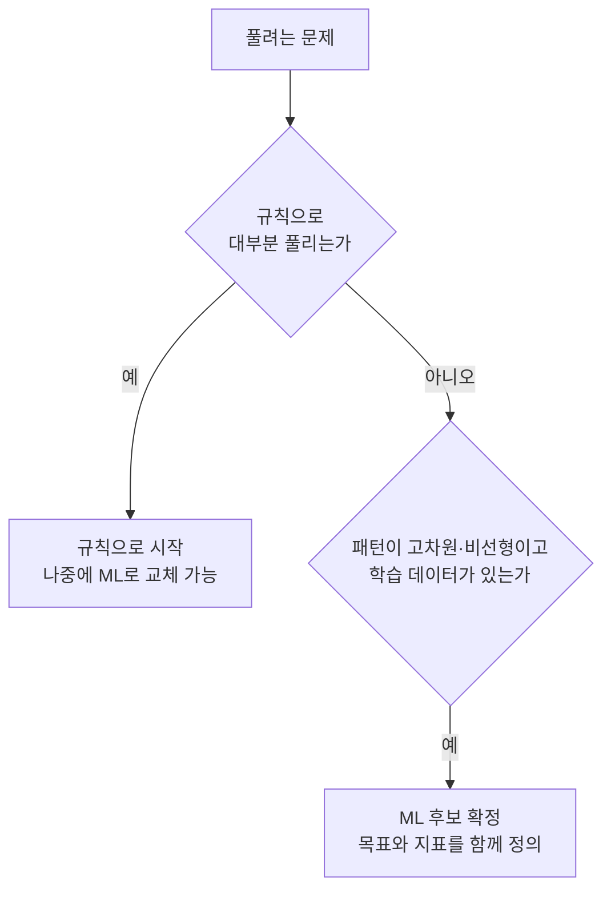

이 결정은 비즈니스 담당자와 기술 담당자가 함께 내립니다. 2.2절이 이 결정을 질문 목록으로 구체화합니다.

---

## 2부. ML 생애주기 - 문제 정의부터 유지보수까지

<a id="s2-1"></a>

### 2.1 실험 단계와 개발·스테이징·운영 단계

1장의 첫 주장은 "ML 프로젝트는 본질적으로 반복적이다"(*iterative in nature*)입니다. 저자는 첫 배포로 끝난 ML 프로젝트를 본 적이 없다고 말합니다.

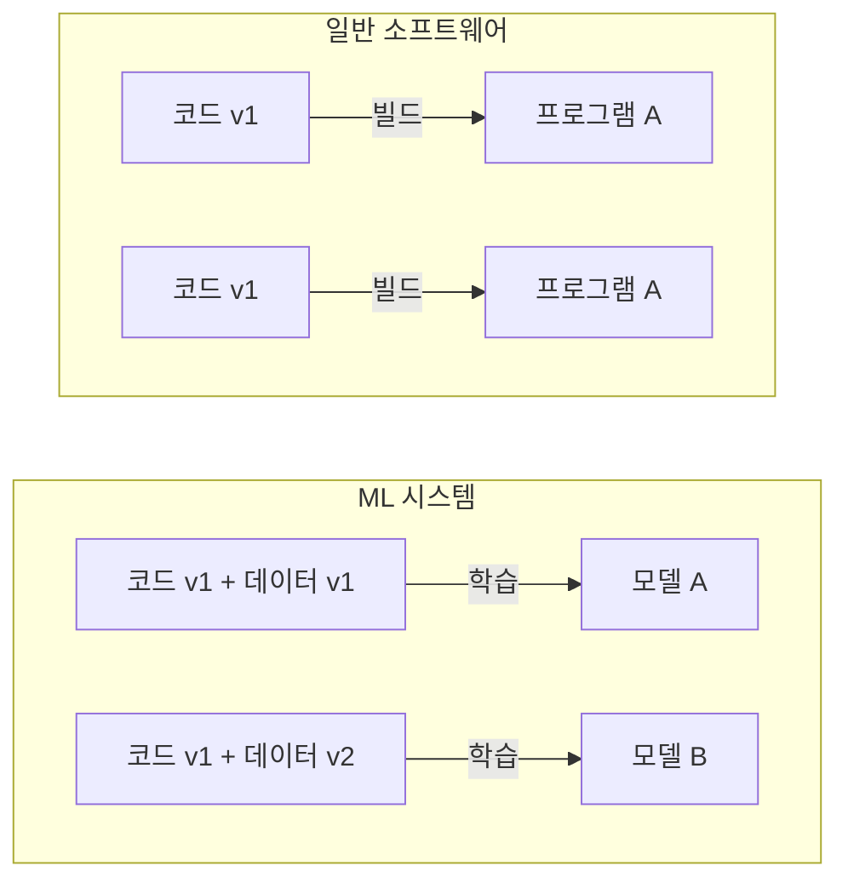

일반 소프트웨어의 동작은 코드가 정합니다. ML 시스템의 동작은 코드와 데이터가 함께 정합니다. 데이터는 코드 변경 없이도 바뀝니다. 그래서 Git만으로는 ML 모델을 재현할 수 없고, 반복도 피할 수 없습니다. 목표는 **반복 한 번의 비용을 줄이는 것**입니다.

1장은 생애주기를 두 단계로 나눕니다.

| 관심사 | 실험 단계 | 운영 단계 |
|--------|-----------|-----------|
| 목표 | 가능성 탐색 | 안정적 유지, 지속적 개선 |
| 파이프라인 자동화 | 거의 자동, 사람이 실행 | 완전 자동, 트리거가 실행 |
| 보안·윤리 | 느슨함 | 최우선 요구사항 |
| 확장성·실시간 성능 | 거의 무관 | 서비스 품질을 좌우 |
| 실패 비용 | 실험 한 번 | 사용자와 매출 |

**실험 단계**는 여섯 단계입니다.

1. 문제 정의
2. 데이터 수집과 준비
3. 데이터 버전 관리
4. 학습
5. 평가
6. 검증

실제로는 거의 모든 단계에서 앞 단계로 되돌아갑니다. 그래서 저자는 실험 단계부터 파이프라인을 쓰라고 권합니다. 노트북 셀을 손으로 실행하면 무엇을 바꿨는지 놓치기 때문입니다.

**운영 단계**는 같은 절차를 완전히 자동화합니다. 그리고 끝에 배포, 모니터링, 재학습을 붙입니다. 재학습이 파이프라인을 다시 실행하면 루프가 닫힙니다.

- **두 단계 모두 파이프라인을 쓴다**
  - 차이는 자동화의 정도와 트리거입니다. 트리거는 파이프라인 실행을 시작하는 신호입니다.
- **운영 단계에는 환경이 세 개다**
  - 1장의 절 제목은 "개발·스테이징·운영 단계"입니다. 모델은 이 순서로 승격(*promote*)됩니다.
  - 세 환경은 같은 코드 커밋, 같은 데이터 버전, 같은 이미지 태그를 씁니다. 그래야 스테이징 결과가 운영에서도 유효합니다.

2장은 같은 생애주기를 루프로 그립니다(Figure 2.2 *ML as a loop*). 1장의 두 단계를 2장의 8단계에 겹치면 이렇습니다.

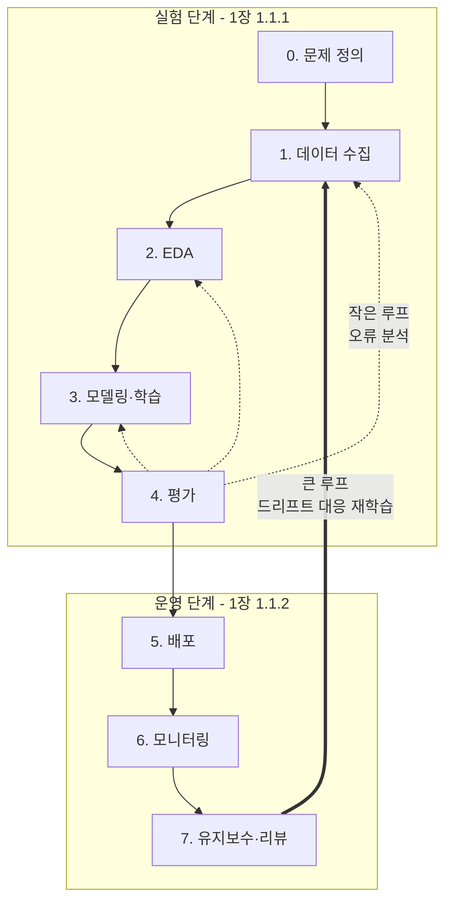

저자는 모델, 데이터, 하이퍼파라미터를 일시적(*ephemeral*)이라고 부릅니다. 오늘 배포한 모델은 석 달 뒤 교체 대상입니다. 모델보다 오래 남는 것은 모델을 만드는 파이프라인입니다.

```
시간 ─────────────────────────────────────────────────▶

모델         [v1] [v2] [v3: 데이터 변화로 교체] [v4] [v5] ...   몇 달 단위
파이프라인   [학습 · 평가 · 배포 파이프라인, 계속 개선      ]   수년
기록         [모든 버전의 계보(lineage)가 쌓임             ]
```

이 관점은 3.3절의 성숙도 Level 1로 이어집니다.

<a id="s2-2"></a>

### 2.2 문제 정의 - 세 이해관계자의 질문

"고객 이탈률을 예측하라"는 문제 정의가 아닙니다. 아래 항목이 하나도 정해지지 않았습니다.

- 이탈의 정의 (30일 미접속인가, 해지인가)
- 예측 시점 (얼마나 미리 알아야 하는가)
- 대상 (전체 고객인가, 유료 고객인가)
- 결과의 쓰임 (쿠폰 발송인가, 상담 연결인가)
- 틀렸을 때의 비용

이 항목이 없으면 평가 지표를 고를 수 없습니다. 저자는 비즈니스, 기술, 법무 세 그룹이 **모델링 전에 함께** 답하라고 합니다. 원문의 질문을 성격별로 묶으면 이렇습니다.

| 성격 | 질문의 방향 | 이어지는 단계 |
|------|-------------|---------------|
| 필요성 | 정말 ML이 필요한가 | 1.2절 |
| 성공의 정의 | 성공 지표, 허용 오차, 오예측의 영향 | 2.6 평가 |
| 데이터 | 저장 위치, 파이프라인, 민감정보 | 2.3 수집, 2.4 EDA |
| 자원과 운영 | 학습·서빙 자원, 배포 전략, 재학습 지표 | 2.7 ~ 2.9 |
| 위험과 규제 | 윤리, 개인정보, 거버넌스 | 3.1 |

- **모델을 만들기 전에 교체 조건을 정한다**
  - 기술 그룹의 질문에 "재학습을 트리거할 지표"가 있습니다.
- **타이밍도 요구사항이다**
  - 경쟁사가 비슷한 기능을 먼저 내면 같은 모델의 가치가 작아집니다.
- **법무 질문을 빠뜨리면 다시 학습해야 한다**
  - 이탈 모델을 다 만든 뒤 상담 녹취에 별도 동의가 필요하다고 밝혀질 수 있습니다.
  - 그러면 해당 피처를 빼고 다시 학습합니다.

<a id="s2-3"></a>

### 2.3 데이터 수집 - 계보를 남긴다

데이터 수집은 루프의 맨 앞입니다. 여기서 생긴 편향은 뒤의 모든 단계로 전파됩니다. 저자는 데이터셋 요구사항 일곱 개를 듭니다. 관련성, 크기, 품질, 편향·누수 방지, 대표성, 다양성, 계보입니다. 저자는 앞의 여섯 개를 대부분 당연하다고 봅니다. 그래서 계보에 지면을 집중합니다.

<aside class="callout">
<p class="eyebrow">(용어) 계보 (lineage)</p>

어떤 산출물이 어떤 입력으로 만들어졌는지 추적할 수 있게 남긴 기록입니다.

- **데이터 계보** - 원본에서 학습 데이터셋까지 단계마다 버전과 메타데이터를 남긴 사슬
- **모델 계보** - 모델 하나를 만든 코드 커밋, 설정, 데이터 버전의 연결

</aside>

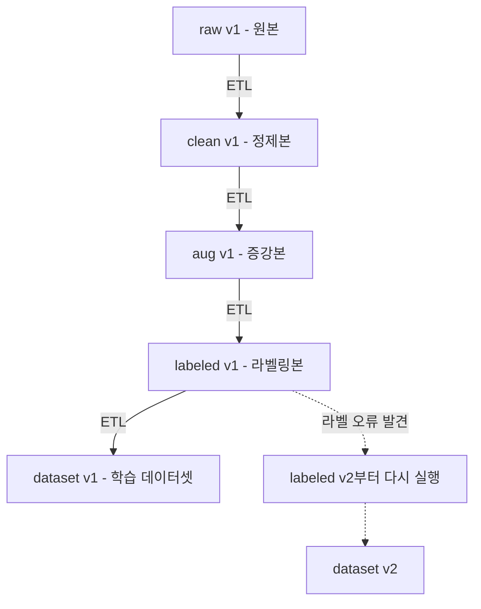

화살표마다 버전 관리되는 ETL 단계와 메타데이터(언제·어디서·어떻게·왜)가 붙습니다. 계보가 있으면 오류가 난 단계부터 다시 실행하면 됩니다.

저자는 계보를 미루는 것을 기술 부채로 봅니다. 초기에는 임시 스크립트로 뽑아 바로 학습하는 쪽이 빠릅니다. 몇 달 뒤 학습 데이터에서 중복이 발견되면 상황이 바뀝니다. 계보가 있으면 쿼리 하나로 원인을 찾습니다. 계보가 없으면 추출 스크립트를 다시 짜야 합니다.

- **첫 데이터셋은 거의 최선이 아니다**
  - 그래서 저자는 고칠 수 있는 데이터셋을 만들라고 합니다.
- **메타데이터는 언제, 어디서, 어떻게, 왜를 남긴다**
  - 가장 자주 빠지는 항목은 "왜"입니다.
  - 사기 탐지용으로 의심 거래만 모은 데이터가 있다고 해봅시다. 이 데이터를 일반 거래 분석에 쓰면 결과가 왜곡됩니다.

대표성도 이 단계에서 깨집니다. 중고차 플랫폼 한 곳에서만 수집하면 그 플랫폼의 고객층에 데이터가 쏠립니다. 그러면 모델이 지방 저가 차량의 가격을 계속 틀립니다. 에러는 나지 않습니다. 버전 관리되는 ETL이 있으면 지방 매물을 더한 v2를 만들어 비교할 수 있습니다.

<a id="s2-4"></a>

### 2.4 EDA - 가정을 리스크로 다룬다

저자는 EDA(탐색적 데이터 분석)를 **첫 번째 방어선**(*first line of defense*)이라고 부릅니다. EDA는 잘못 정의된 문제와 숨은 가정을 잡습니다. 저자는 모든 가정을 검증 전까지 리스크로 다루라고 합니다.

원문의 EDA 질문은 대부분 운영에서 생길 문제를 묻습니다.

| EDA 질문 | 운영에서의 의미 |
|----------|-----------------|
| 스키마가 바뀔 수 있는가 | 상위 시스템이 컬럼을 바꾸면 모델이 망가진다. 입력 검증이 필요하다 |
| 피처 계산 비용이 비싼가 | 실시간 서빙에서 지연 시간이 커진다 |
| 입력이 주기적으로 변하는가 | 계절성과 이벤트가 미래의 드리프트 후보다 |
| 운영 중 이상치는 어떻게 처리하는가 | 운영에서는 이상치 요청에도 응답해야 한다 |

마지막 행에서 학습과 운영이 갈립니다. 학습 데이터의 이상치는 지우면 됩니다. 운영으로 들어온 이상치 요청은 지울 수 없습니다.

- **가정을 목록으로 만들어 자동 검사로 넣는다**
  - `amount` 필드를 원화로 가정했는데 일부가 달러일 수 있습니다.
  - `created_at`을 UTC로 가정했는데 한국 시간일 수 있습니다.
  - 이런 문제는 모델 코드에서 보이지 않습니다. 파이프라인 초반의 검사가 잡습니다.
- **EDA로 공수를 추정한다**
  - 데이터가 지저분할수록 정제와 운영 검증에 시간이 더 듭니다.
- **ML 엔지니어도 EDA를 알아야 한다**
  - EDA에서 본 분포를 아는 엔지니어가 드리프트를 먼저 의심합니다.

<a id="s2-5"></a>

### 2.5 모델링과 학습 - 모델 = 코드 + 설정 + 데이터

1장에서 저자는 학습이 전체 시간의 대부분이 아니라고 말합니다. 이 책은 학습 기법을 다루지 않습니다. 2장의 모델링 절도 **학습 과정을 추적하는 방법**을 다룹니다.

저자가 꼽는 MLOps 도구는 네 가지입니다.

- 모델·데이터 버전 관리
- 실험 추적(*experiment tracking*)
- 학습 파이프라인
- 하이퍼파라미터 탐색

네 도구의 공통 원칙은 계보, 추적, 수작업 제거입니다.

원문은 하이퍼파라미터 탐색 다음에 코드 구조를 다룹니다. 이유는 이렇습니다. 탐색 도구는 설정만 바꿔서 학습을 반복합니다. 값이 코드에 하드코딩되어 있으면 탐색 도구가 값을 바꿀 수 없습니다.

```
하드코딩                              설정 분리

model = Net(layers=6)                 # config.yaml
opt = Adam(lr=0.001)                  layers: 6
# 값이 코드 여기저기에                lr: 0.001

                                      model = build(cfg)

탐색 도구가 값을 못 바꿈              탐색 도구가 config만 바꿔 반복 실행
→ 사람이 매번 코드 수정               → 자동화 + 실행마다 기록
```

설정을 코드 밖으로 빼면 실행마다 설정을 기록할 수 있습니다. 그래서 계보와 재현성도 얻습니다. 저자는 학습된 모델을 **코드에 설정과 데이터를 적용한 산출물**로 정의합니다.

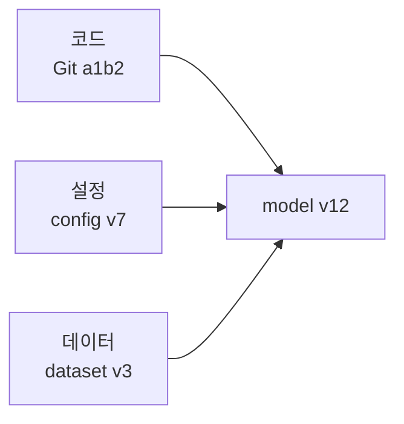

역방향 추적은 model v12에서 a1b2, v7, v3를 찾습니다. "이 모델을 무엇으로 만들었나"에 답합니다. 순방향 추적은 dataset v3로 학습한 모델을 모두 찾습니다. "이 데이터가 어느 모델에 영향을 주나"에 답합니다. 두 방향이 모두 되어야 합니다.

- **실험 추적은 잘못된 결론을 막는다**
  - 팀원 A가 레이어를 6에서 4로 줄였더니 검증 손실이 좋아졌다고 보고합니다.
  - 팀원 B가 추적 서버에서 두 실행을 비교합니다. 데이터셋 버전이 다릅니다.
  - 원인을 가릴 수 없으므로 팀은 다시 실험합니다.
- **설정 항목을 너무 늘리지 않는다**
  - 저자는 과도한 파라미터화(*overparametrization*)를 경계합니다.
  - 모든 값을 설정으로 빼면 설정 파일이 코드만큼 복잡해집니다. 자주 바꾸는 값부터 뺍니다.

<a id="s2-6"></a>

### 2.6 평가와 검증 - 지표 선택과 홀드아웃 버전

1장은 **평가**(*evaluation*)와 **검증**(*validation*)을 구분합니다.

| 구분 | 평가 | 검증 |
|------|------|------|
| 누가 | 모델을 만든 팀 | 비즈니스 이해관계자 |
| 무엇으로 | 학습에 쓰지 않은 데이터와 정량 지표 | 업무 기준과 사례 검토 |
| 묻는 것 | 보지 못한 데이터에서 숫자가 괜찮은가 | 이 모델을 내보내도 되는가 |
| 중고차 예시 | 테스트 세트 평균 오차가 기준 이하인가 | 희귀 차종에 터무니없는 가격이 나오지 않는가 |

평가를 통과해도 검증에서 떨어질 수 있습니다. 지표가 업무 요구를 다 담지 못하기 때문입니다.

2장은 평가를 문제 정의와 연결합니다. 지표를 고르려면 **어떤 오류가 누구에게 어떤 피해를 주는가**를 먼저 정해야 합니다.

```
                 예측: 양성     예측: 음성
실제: 양성         TP             FN (놓침)
실제: 음성         FP (헛경보)    TN

Precision = TP / (TP + FP)   양성이라고 한 것 중 진짜 비율 → 헛경보가 아플 때
Recall    = TP / (TP + FN)   진짜 양성 중 잡아낸 비율     → 놓침이 아플 때
```

원문은 의료가 precision을, 금융이 recall을 중시할 수 있다고 예를 듭니다. 같은 의료라도 암 선별 검사는 recall이 우선입니다. 놓침이 치명적이기 때문입니다.

중고차 모델은 회귀 모델이라서 MAE와 MSE 중에서 고릅니다. 차량 5대의 오차(만 원)로 비교합니다.

| 모델 | 5대 오차 | MAE | MSE |
|------|----------|-----|-----|
| A | 2, 2, 2, 2, 2 | 10 ÷ 5 = 2.0 | 20 ÷ 5 = 4.0 |
| B | 0, 0, 0, 0, 10 | 10 ÷ 5 = 2.0 | 100 ÷ 5 = 20.0 |

MAE는 두 모델을 같게 봅니다. MSE는 한 번 크게 틀린 B를 다섯 배 나쁘게 봅니다. 큰 오차가 더 아프면 MSE 계열을 씁니다.

- **홀드아웃셋도 버전 관리한다**
  - 운영 분포가 바뀌면 오래된 홀드아웃셋은 현실을 대표하지 못합니다.
  - 홀드아웃셋을 바꾸면 이전 모델과 비교하기 어려워집니다.
  - 그래서 점수마다 홀드아웃 버전을 함께 기록합니다.

| 점수(MAE) | 홀드아웃 v1 | 홀드아웃 v2 (전기차 추가) |
|-----------|-------------|---------------------------|
| 모델 v3 | 120 | 180 |
| 모델 v4 | 118 | 135 |

v1에서는 두 모델의 차이가 2입니다. 전기차를 더한 v2에서는 차이가 45입니다. 같은 홀드아웃 버전끼리만 비교합니다.

- **평가 결과는 앞 단계로 돌아간다**
  - 오분류 패턴은 데이터 수집으로 돌아갑니다.
  - 틀린 가정은 EDA로, 구조 문제는 모델링으로 돌아갑니다. 2.1절 그림의 작은 루프가 이것입니다.
- **해석 가능성은 단계적으로 들인다**
  - LIME, SHAP은 규제 산업에서 필수입니다.
  - 다른 곳에서는 버전 관리와 자동 평가를 먼저 갖춥니다.

<a id="s2-7"></a>

### 2.7 배포 - 평가한 모델을 그대로 배포한다

모델은 배포되어야 가치를 만듭니다. 저자는 배포 방식을 둘로 나눕니다.

- API 엔드포인트 뒤에 두는 마이크로서비스
- 하드웨어나 엣지 디바이스에 직접 올리는 방식

두 방식 모두 지연 시간이 중요합니다. 그래서 배포 전에 최적화 단계가 들어갑니다.

저자는 **최적화된 최종 버전으로 성능 테스트를 하라**고 경고합니다. FP32 가중치를 INT8로 양자화하면 크기가 약 1/4로 줄어듭니다. 대신 정확도가 달라질 수 있습니다. 특정 클래스에서만 크게 떨어지기도 합니다. 원본으로 평가하고 양자화 모델을 배포하면, 평가 점수는 운영과 무관해집니다.

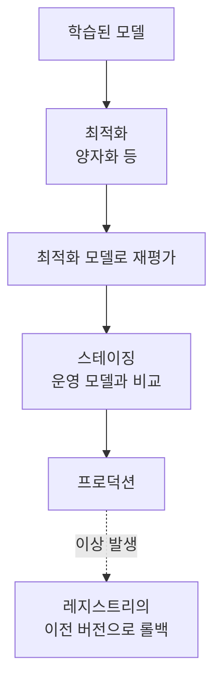

- **ML의 스테이징은 평가 모드다**
  - 스테이징에서 새 모델과 운영 모델을 실제 데이터로 비교합니다.
  - 새 모델이 기준을 통과하면 파이프라인이 자동으로 승격합니다.
  - 전환 기록이 있으므로 롤백은 운영 표시를 이전 버전으로 바꾸는 일입니다.
- **배포 범위는 단계적으로 넓힌다**
  - 섀도 배포는 실제 트래픽을 복제해 스테이징에 흘립니다.
  - 카나리 배포는 사용자 5%에게만 새 모델을 보여 줍니다.
  - 지표가 정상이면 50%, 100%로 넓힙니다. 이상하면 0%로 되돌립니다.

1장은 배포 점검표를 줍니다. REST API로 감싸는 것은 출발점일 뿐입니다(*slapping on a REST API*).

| 점검 항목 | 확인 질문 | 중고차 예시 |
|-----------|-----------|-------------|
| 부하 테스트 | 예상 트래픽을 견디는가 | 매물 등록이 몰리는 주말 저녁 |
| 오토스케일링 | 폭증에 자동으로 늘어나는가 | TV 광고 직후 등록 폭증 |
| 배포 버전 관리 | 지금 떠 있는 것이 어느 모델, 어느 이미지인가 | `price-model v3`, 이미지 태그 기록 |
| 롤백 전략 | 몇 분 안에 이전 버전으로 돌아가는가 | v3 이상 시 v2로 즉시 되돌림 |

책은 BentoML로 모델을 HTTP 엔드포인트로 만듭니다. 그다음 Docker로 패키징하고, Yatai로 Kubernetes에 배포합니다. 그래서 3장이 Kubernetes로 시작합니다.

저자는 데이터 과학자도 배포에 참여하라고 권합니다. 모델을 만든 사람이 지연 시간과 메모리 제약을 알아야 모델을 고칠 수 있습니다.

<a id="s2-8"></a>

### 2.8 모니터링 - 데이터·성능·오류 세 종류

저자는 모델이 운영 데이터를 만나면 대개 성능이 떨어진다고 말합니다(*don't survive first contact*). 그래서 모니터링은 배포와 동시에 갖춥니다.

일반 소프트웨어의 장애는 대부분 에러를 냅니다. ML 모델의 성능 저하는 에러를 내지 않습니다. 모델은 `200 OK`와 함께 틀린 예측값을 돌려줍니다. 1장의 지표를 세 층으로 나누면 이렇습니다.

| 층 | 무엇을 보는가 | 대표 지표 | 중고차 예시 |
|----|---------------|-----------|-------------|
| 시스템 | 서비스가 살아 있고 빠른가 | RPS, HTTP 상태 코드, 지연 시간 | 5xx 비율 급증 |
| ML 고유 | 입력과 예측이 학습 때와 비슷한가 | 데이터 드리프트, 개념 드리프트 | 전기차 비중 급증 |
| 비즈니스 | 모델이 가치를 만드는가 | 이탈률, 전환율 | 추천 가격 수락률 |

시스템 층이 정상이어도 위의 두 층은 나빠질 수 있습니다. BentoML의 기본 Prometheus 지표는 시스템 층만 봅니다.

<aside class="callout">
<p class="eyebrow">(용어) 데이터 드리프트와 개념 드리프트</p>

둘 다 재학습의 신호입니다. 감지 방법이 다릅니다.

- **데이터 드리프트** - 입력의 분포가 학습 때와 달라지는 것. 예를 들어 평균 연식이 6년에서 2년이 됩니다. 입력만 봐도 감지할 수 있습니다.
- **개념 드리프트** - 입력과 정답 사이의 관계가 바뀌는 것. 예를 들어 같은 연식인데 유가 변동으로 디젤차 시세가 떨어집니다. 정답이 도착해야 감지할 수 있습니다.

</aside>

2장은 모니터링을 세 종류로 나눕니다. 표의 순서는 감지가 빠른 순서입니다.

| 종류 | 정답 라벨 | 감지 속도 | 얻는 정보 |
|------|-----------|-----------|-----------|
| 데이터 모니터링 | 불필요 | 가장 빠름 | 입력이 달라졌다 |
| 성능 모니터링 | 필요 | 라벨 도착 후 | 결과가 나빠졌다 |
| 오류 모니터링 | 필요 + 사람 분석 | 가장 느림 | 왜, 어디서 틀리는가 |

중고차 모델에서는 이렇게 이어집니다.

1. 데이터 모니터링이 입력 매물의 평균 연식 하락을 잡습니다.
2. 몇 주 뒤 실거래가가 쌓입니다. 성능 모니터링에서 MAE가 오릅니다.
3. 오류 모니터링이 출고 1년 미만 차량의 과소 예측을 찾습니다.
4. 데이터 수집 단계에서 신차급 매물을 보강합니다. 그다음 모델을 다시 학습합니다.

책은 1번의 분포 비교와 재학습 트리거에 Evidently를 씁니다.

- **모니터링에는 계보가 필요하다**
  - 경보가 울리면 언제부터, 어느 모델 버전에서 나빠졌는지 알아야 합니다. 그 답은 2.3절의 계보에 있습니다.
- **알림이 담당자에게 닿아야 한다**
  - 아무도 보지 않는 대시보드는 지표가 없는 것과 같습니다. 너무 많은 알림도 결과가 같습니다.
  - 수신자, 임계값, 런북을 미리 정합니다.

<a id="s2-9"></a>

### 2.9 유지보수와 재학습 - 루프를 닫는다

유지보수 단계는 모니터링 결과를 행동으로 바꿉니다(*closes the ML loop*). 원문은 행동 세 가지를 듭니다. 버그 수정, 엣지 케이스 데이터 수집, 드리프트 대응 재학습입니다.

재학습 시점에 대해 1장은 "상황에 따라 다르다"(*it depends*)고 답합니다. 그리고 트리거 두 가지를 제시합니다.

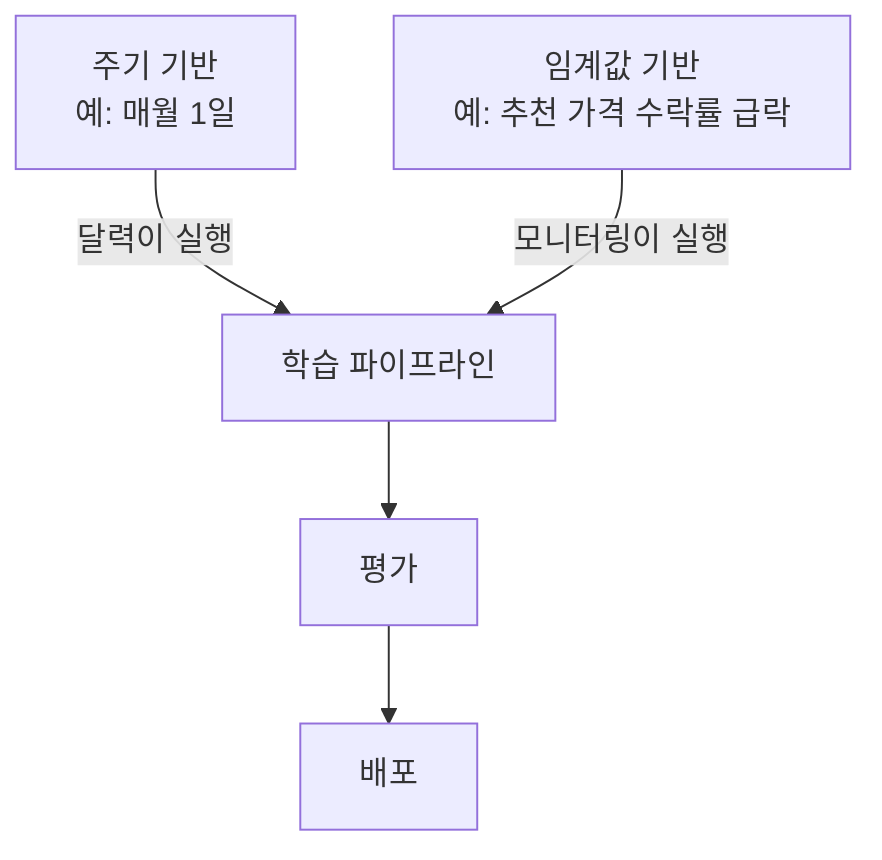

| 구분 | 주기 기반 | 임계값 기반 |
|------|-----------|-------------|
| 장점 | 예측 가능하고 운영 계획이 쉽다 | 필요할 때만 빠르게 대응한다 |
| 단점 | 급변에 늦고, 변화가 없어도 비용이 든다 | 임계값 설계가 어렵고, 라벨이 늦으면 감지도 늦다 |

실무에서는 두 트리거를 함께 씁니다. 저자는 하나를 더 강조합니다. 재학습을 자동화하려면 배포도 자동화해야 합니다. 배포가 수작업이면 새 모델이 운영에 나가는 데 며칠이 걸립니다.

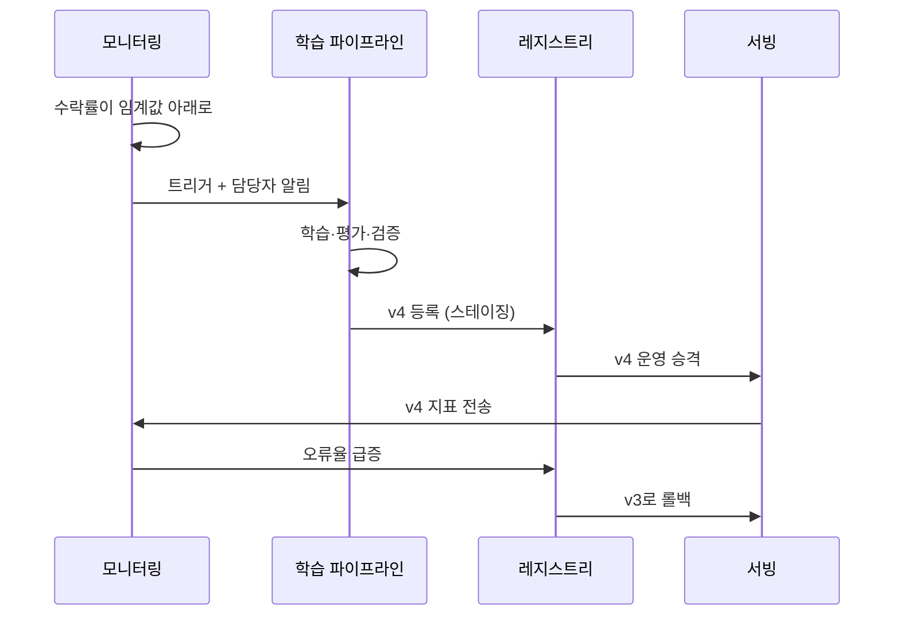

2장은 유지보수를 루프 끝의 단계로만 보지 않습니다. 유지보수는 **루프 전체에 분산**(*distributed through the whole loop*)되어 있습니다.

| 단계 | 그 단계의 유지보수 |
|------|--------------------|
| 데이터 수집 | 상위 시스템 스키마 변경 대응, 드리프트 대응 데이터 보강 |
| EDA | 새 데이터로 가정 재검증 |
| 모델링·학습 | 라이브러리 업그레이드, 새 구조 실험 |
| 평가 | 엣지 케이스 테스트 추가, 홀드아웃셋 갱신 |
| 배포 | 운영 모델 교체, 보안 패치 |
| 모니터링 | 임계값 조정, 런북 갱신 |

그래서 이후 장은 컴포넌트를 하나씩 따로 세웁니다.

1장은 루프를 끝내는 단계도 둡니다. **모델 은퇴**(*model retirement*)입니다. 모델을 은퇴시키면 레지스트리의 운영 표시를 해제합니다. 그 모델을 쓰던 서비스도 정리합니다.

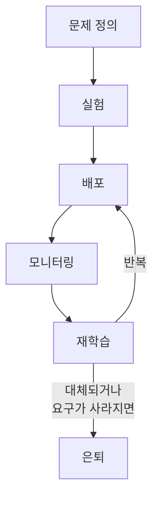

---

## 3부. DevOps와 MLOps

<a id="s3-1"></a>

### 3.1 MLOps가 어려운 일곱 가지 이유

원문 2.2절은 MLOps가 어려운 이유를 나열합니다. 결론은 "어렵다고 건너뛰면 기술 부채가 쌓인다"입니다. 원문 2.3절이 꼽는 이점은 이 어려움과 거의 짝이 맞습니다.

| # | 어려움 (원문 2.2) | 넘었을 때의 이점 (원문 2.3) |
|---|-------------------|-----------------------------|
| 1 | 블록마다 복잡도가 곱해진다 | 실험 가속. 인프라가 추상화된다 |
| 2 | 데이터 관리 실패는 소송으로 이어진다 | 재현성과 추적성 |
| 3 | 시스템 전체의 구조적 결함이 보이지 않는다 | CI/CD로 반복 작업 자동화 |
| 4 | 직군마다 다른 지표로 말한다 | 공통 도구로 협업 |
| 5 | 대규모 트래픽은 다른 문제를 만든다 | 표준 워크플로우로 확장 |
| 6 | 엣지 케이스는 에러 없이 결과만 틀린다 | 모니터링과 롤백 |
| 7 | 도구 생태계가 파편화되어 있다 | 공유 컴포넌트로 중복 투자 제거 |

4번은 같은 사실을 직군마다 다른 지표로 말하는 문제입니다.

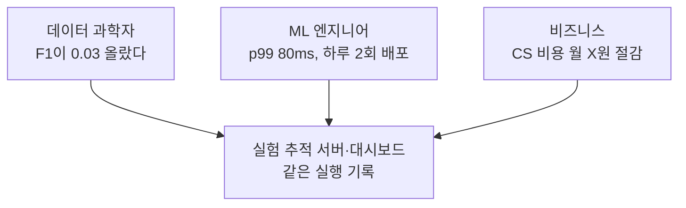

원문 2.3절의 결론은 "좋은 MLOps는 좋은 실천의 진입 장벽을 낮춘다"입니다. 학습 코드에 모델 로깅이 미리 설정되어 있다고 해봅시다. 그러면 데이터 과학자는 따로 노력하지 않아도 버전을 남깁니다. 플랫폼 엔지니어는 **좋은 실천이 기본 설정으로 동작하게** 만듭니다.

수작업의 비용은 모델 수에 비례해 커집니다. 세 명짜리 팀이 첫 모델을 수작업으로 2주 만에 냅니다. 반년 뒤 모델이 다섯 개가 됩니다. 어느 모델이 어느 데이터로 학습됐는지 아무도 모릅니다. 팀이 모델 다섯 개를 다시 만드는 데 석 달이 걸립니다.

<a id="s3-2"></a>

### 3.2 DevOps와 다른 점 - CI/CD에 CT가 붙는다

MLOps와 DevOps는 자동화, CI/CD, 협업을 공유합니다. 그래도 저자는 MLOps를 별도 영역으로 다룹니다. 원문의 차이점 여섯 가지는 대부분 한 사실에서 나옵니다. **ML 시스템의 동작은 데이터가 결정한다.**

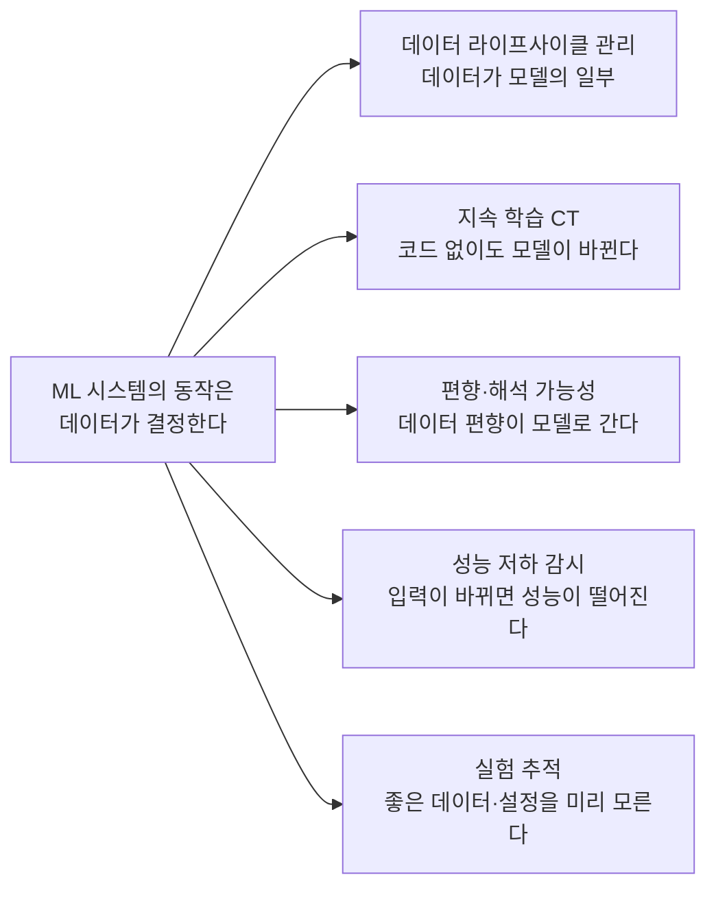

<aside class="callout">
<p class="eyebrow">(용어) CT (Continuous Training, 지속 학습)</p>

데이터 변화를 트리거로 모델을 자동으로 다시 학습시키는 체계입니다.

- **CI/CD의 트리거** - 코드 커밋
- **CT의 트리거** - 새 데이터 도착, 드리프트 감지, 성능 저하. 코드가 바뀌지 않아도 파이프라인이 실행됩니다.

</aside>

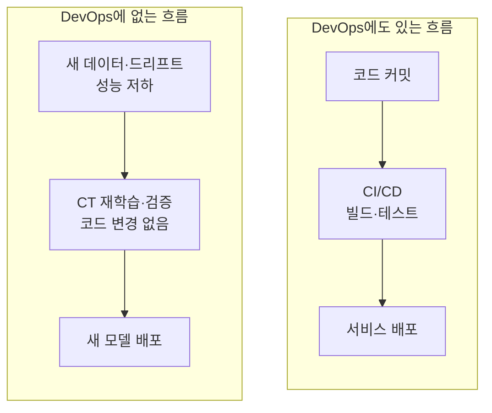

CI/CD만 있는 ML 팀을 생각해 보겠습니다. 석 달 동안 코드가 바뀌지 않으면 파이프라인도 실행되지 않습니다. 그동안 사용자 행동이 바뀌면 모델 성능이 떨어집니다. 테스트는 모두 통과하고 서버도 정상입니다. 이 팀에는 CT와 모델 품질 모니터링이 없습니다.

1장도 같은 내용을 다룹니다. ML 시스템에서는 배포를 시작시키는 변화가 세 가지입니다.

| 무엇이 바뀌었나 | 일반 소프트웨어 | ML 시스템 |
|-----------------|-----------------|-----------|
| 코드 | CI/CD 트리거 | CI/CD 트리거 |
| 데이터 | 해당 없음 | 재학습 후 재배포 |
| 성능 지표 | 장애 대응 위주 | 임계값 도달 시 재학습 |

MLOps는 빌드뿐 아니라 **실험**도 추적합니다. 실패한 실험도 기록합니다. 그래야 팀원이 같은 실험을 반복하지 않습니다.

<a id="s3-3"></a>

### 3.3 성숙도 Level 0 → 1 → 2

2장은 Google의 기준으로 성숙도를 세 레벨로 나눕니다. 기준은 루프의 자동화 정도입니다. 세 레벨을 가르는 질문은 **무엇을 배포하는가**입니다.

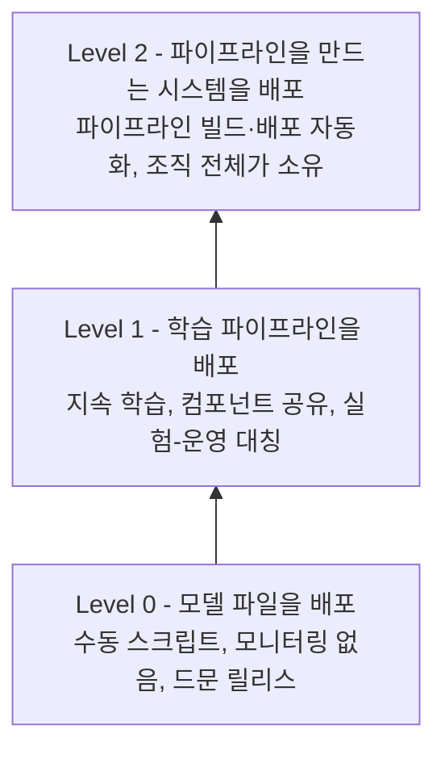

| 루프 단계 | Level 0 | Level 1 | Level 2 |
|-----------|---------|---------|---------|
| 데이터 추출·검증 | 수동 | 자동 | 자동 |
| 데이터·모델 분석 | 수동 | 수동 | 수동 |
| 학습 | 수동 | 자동 | 자동 |
| 평가·검증 | 수동 | 자동 | 자동 |
| 모델 배포 | 수동 | 자동 | 자동 |
| 모니터링·재학습 트리거 | 없음 | 자동 | 자동 |
| 파이프라인 자체의 빌드·배포 | 수동 | 수동 | 자동 |

- **Level 1은 모델 대신 파이프라인을 배포한다**
  - 2.1절에서 저자는 모델을 일시적이라고 했습니다. 그래서 모델을 만드는 파이프라인을 배포합니다.
- **Level 1의 핵심은 실험-운영 대칭성이다**
  - 실험과 운영에서 같은 파이프라인을 씁니다(*experimental-operational symmetry*).
  - 노트북은 결측값을 평균으로 채우고 운영 코드는 0으로 채운다고 해봅시다. 같은 입력이 다른 피처가 됩니다. 이것이 학습-서빙 불일치입니다(4.2절).
  - 같은 컴포넌트를 양쪽에서 쓰면 이 불일치가 생기지 않습니다.
- **Level 1은 사람의 판단을 규칙으로 적는다**
  - 필요조건은 데이터 검증, 모델 검증, 피처 스토어(필요할 때), 파이프라인 모니터링, 계보, 트리거입니다.
  - "이 데이터 괜찮나"는 데이터 검증이 됩니다. "언제 재학습하나"는 트리거가 됩니다.
- **Level 2에서도 분석은 사람이 한다**
  - 데이터 분석과 모델 분석은 자동화되지 않습니다.
  - Level 2에서는 조직 전체가 파이프라인을 소유합니다. 데이터 과학자도 컴포넌트를 기여합니다.

저자는 레벨이 대략적인 가이드라고 말합니다. 레벨 사이의 난이도도 일정하지 않습니다. 레벨은 다음 단계를 계획하는 데 씁니다. 책의 영화 추천 프로젝트는 Level 0에서 시작합니다. 학습을 파이프라인으로 옮기고 드리프트 트리거를 붙여 Level 1로 갑니다.

---

## 4부. ML 플랫폼 지도

<a id="s4-1"></a>

### 4.1 플랫폼을 점진적으로 키운다 - 직접 구축 vs 구매

1장 1.3절은 루프를 받치는 공통 기반으로 ML 플랫폼을 다룹니다. 데이터 웨어하우스와 레이크는 플랫폼 밖에 둡니다. Spark, Flink 같은 처리기는 가장자리(*periphery*)에 둡니다. 플랫폼은 Kubernetes 위의 Kubeflow에서 시작합니다.

저자는 플랫폼을 한 번에 완성하지 않습니다. 부족한 부분이 드러날 때마다 구성 요소를 하나씩 붙입니다.

| 드러난 공백 | 플랫폼에 붙는 것 |
|-------------|------------------|
| 실험을 한곳에서 돌리고 싶다 | Kubernetes + Kubeflow (노트북 환경) |
| 단계를 손으로 잇다 실수한다 | Kubeflow Pipelines |
| 팀마다 같은 피처를 다시 만들고, 학습과 서빙의 값이 다르다 | 피처 스토어 (Feast) |
| 어느 실행이 어떤 모델을 만들었는지 모른다 | 실험 추적·모델 레지스트리 (MLflow) |
| 배포가 수작업이라 느리고 위험하다 | CI/CD, 컨테이너 레지스트리, 서빙 |
| LLM 기능이 필요하다 | 벡터 DB, 가드레일, 비용 관리 (12~13장) |

저자는 모든 조직에 맞는 단일 구조가 없다고 말합니다(*no one-size-fits-all*).

1.3.1절은 매니지드 플랫폼을 쓰는 독자에게 답합니다. 회사가 SageMaker나 Vertex AI를 쓰더라도, 플랫폼을 **최소 한 번**(*at least once*) 직접 조립해 보라고 합니다. 직접 운영하라는 뜻은 아닙니다.

| 기준 | 직접 구축 | 구매 (매니지드) |
|------|-----------|-----------------|
| 초기 속도 | 느림 | 빠름 |
| 맞춤화 | 자유로움 | 벤더가 허용하는 범위 안 |
| 운영 부담 | 팀이 부담 | 상당 부분 벤더가 부담 |
| 이해의 깊이 | 구성 요소 간 연결을 직접 앎 | 추상화 뒤에 가려짐 |
| 한계에 부딪혔을 때 | 원인을 찾아 고침 | 지원 요청이나 기능 대기 |

저자의 근거는 아래 두 행입니다. 매니지드 플랫폼에도 파이프라인, 실험 추적, 레지스트리, 서빙이 있습니다. 직접 조립해 본 사람은 벤더 기능이 어느 블록인지 바로 압니다.

<a id="s4-2"></a>

### 4.2 네 도구가 푸는 문제 - Kubeflow Pipelines·Feast·MLflow·CI/CD

1.3.3절은 도구 네 블록을 출발점으로 제시합니다.

| 도구 블록 | 생애주기 위치 | 없을 때의 문제 | 책의 선택 |
|-----------|---------------|----------------|-----------|
| 파이프라인 자동화 | 전 단계를 연결 | 단계 순서를 틀리고, 무엇을 돌렸는지 잊는다 | Kubeflow Pipelines |
| 피처 스토어 | 데이터 수집과 준비 | 팀마다 같은 피처를 다시 만들고, 학습과 서빙의 값이 어긋난다 | Feast |
| 모델 레지스트리 | 학습·평가 이후 | 어느 실행이 어떤 모델을 만들었는지 모른다 | MLflow |
| 배포 자동화 | 배포·재학습 이후 | 배포가 느리고 사람마다 방식이 다르다 | 컨테이너 + CI/CD + Kubernetes |

- **파이프라인은 단계 사이의 전달을 맡는다**
  - Kubeflow Pipelines에서 각 단계는 컴포넌트입니다. 컴포넌트는 앞 출력을 받아 다음 컴포넌트로 넘깁니다.
  - 실행 순서와 입출력은 정의에 고정됩니다. 실행 기록도 남습니다.
- **피처 스토어의 이점은 두 가지다**
  - 팀끼리 피처를 공유합니다.
  - 학습-서빙 불일치를 막습니다.

<aside class="callout">
<p class="eyebrow">(용어) 학습-서빙 불일치 (training-serving skew)</p>

학습 때 모델이 본 데이터와 추론 때 보는 데이터가 어긋나는 현상입니다. 대표 원인은 학습과 서빙의 데이터 변환 코드가 서로 다른 것입니다. 서버는 정상 응답하므로 놓치기 쉽습니다.

</aside>

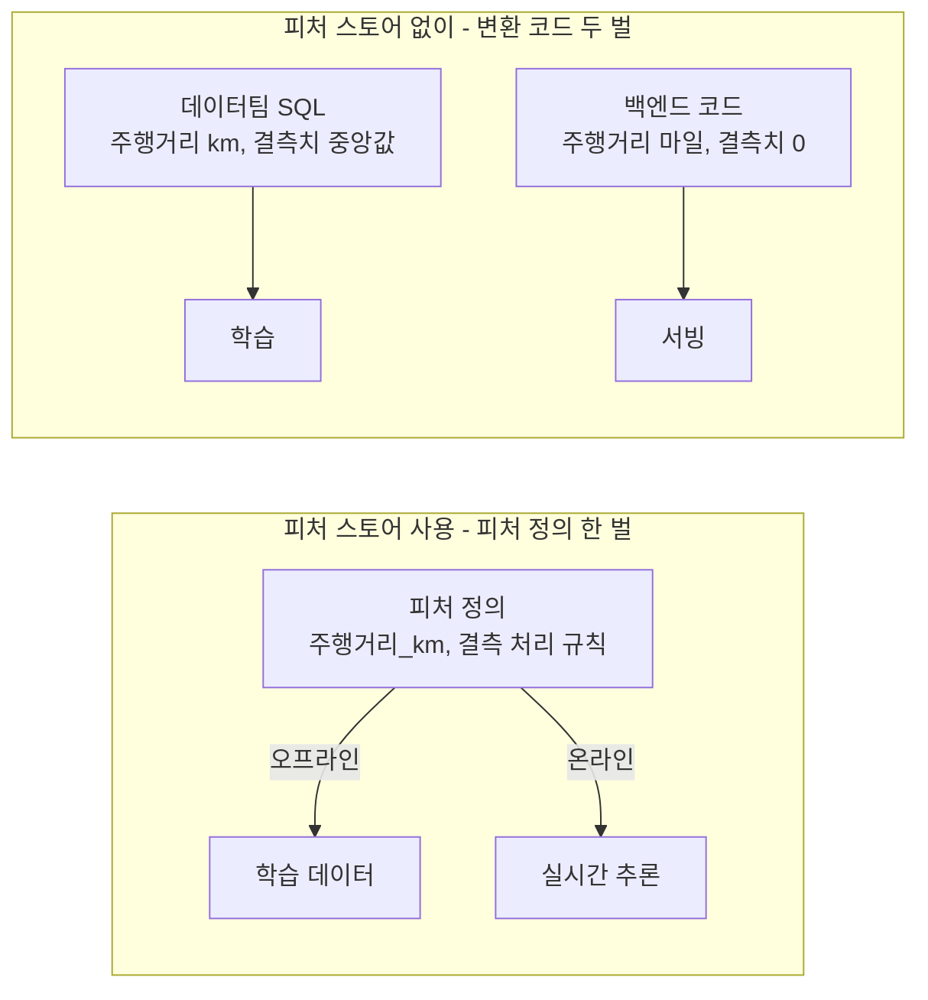

피처 스토어가 없으면 60,000 km 차량이 서빙에서 약 37,000으로 들어갑니다. 주행거리가 짧게 보여 가격이 높게 예측됩니다.

피처 스토어는 두 모드로 피처를 냅니다. 오프라인 모드는 학습용 대량 조회입니다. 온라인 모드는 실시간 추론용 저지연 조회입니다. 두 모드는 같은 정의를 씁니다. 그래서 불일치가 생기지 않습니다.

- **레지스트리는 실행마다 산출물 전부를 남긴다**
  - 산출물은 모델, 그래프, 메타데이터, 하이퍼파라미터, 지표입니다.
  - 승격과 롤백은 운영 표시를 옮기는 일이 됩니다.
- **배포 자동화는 네 단계다**
  - 트리거, 이미지 빌드, 컨테이너 레지스트리 푸시, 매니페스트 적용입니다.
  - 신뢰성은 1장에서 이름만 나옵니다. 4장 *Designing reliable ML systems*가 다룹니다.

네 블록이 있는 팀의 하루는 이렇습니다.

1. 오전에 데이터팀이 "사고 이력 등급" 피처를 피처 스토어에 등록합니다.
2. 가격 모델 담당자가 이 피처로 파이프라인을 실행합니다. MLflow에 실행 기록이 남습니다.
3. 영업팀이 v6를 검증합니다. 담당자가 v6를 운영으로 승격합니다.
4. 서빙 서비스가 레지스트리에서 v6를 다시 읽습니다. 코드 변경이 없으므로 CI/CD는 실행되지 않습니다.
5. 오후에 응답 형식을 바꾸는 코드가 병합됩니다. CI/CD가 새 이미지를 배포합니다.

같은 날 두 배포가 서로 다른 트리거로 일어납니다.

<a id="s4-3"></a>

### 4.3 MLOps에서 LLMOps로, 그리고 책의 세 프로젝트

1.3.2절은 LLMOps가 기존 MLOps 위에 구성 요소를 더한다고 말합니다. 파이프라인, 배포, 모니터링은 LLM 시스템에도 그대로 씁니다.

| MLOps 관심사 | 전통적 ML | LLM 시스템에서 더해지는 것 |
|--------------|-----------|----------------------------|
| 데이터 준비 | 표·이미지 정제와 라벨링 | 문서 수집, 분할, 임베딩 생성 |
| 저장과 조회 | 피처 스토어 | 벡터 데이터베이스, 의미 기반 검색 |
| 평가 | precision, recall, 오차 | 답변의 의미적 품질 평가 |
| 안전 | 입력 검증, 접근 통제 | 가드레일 |
| 비용 | 학습·서빙 자원 | 호출량과 토큰 비용 |
| 변경 관리 | 코드·데이터·모델 버전 | 프롬프트 버전 |

원리는 2.1절과 같습니다. 문서가 바뀌면 검색 결과가 바뀝니다. 프롬프트가 바뀌면 답이 바뀝니다.

같은 절의 사이드바는 도구 선택 원칙을 줍니다.

- 추천 도구는 출발점입니다.
- 며칠짜리 PoC로 치명적 한계(*deal-breakers*)를 일찍 찾습니다.
- 같은 목적에도 사용 사례마다 다른 도구를 씁니다.

책은 프로젝트 세 개를 씁니다.

| 구분 | 1. OCR (신분증 검출) | 2. 영화 추천 | 3. DakkaBot (RAG) |
|------|----------------------|--------------|-------------------|
| 데이터 | 이미지 (MIDV-500, 합성 데이터) | 표 (MovieLens 1M) | 사내 문서 텍스트 |
| 모델 | COCO 사전학습 YOLO 미세 조정 | 노트북 베이스라인에서 재학습 파이프라인으로 | 임베딩 모델 + 벡터 DB + 채팅 UI |
| 드러나는 어려움 | 데이터셋 구축과 라벨링(CVAT) | 피처 관리, 드리프트, 모델 테스트 | 문서 처리, 의미 검색, 프롬프트, 안전 |
| 부각되는 블록 | 파이프라인, 학습, 서빙 | 피처 스토어, 모니터링 | 벡터 DB, 가드레일, Langfuse 관측성, 비용 |

표 데이터는 드리프트를 바로 잴 수 있습니다. 주행거리 열의 평균과 분위수를 계산하면 됩니다. 이미지는 밝기, 해상도, 임베딩 같은 대리 지표부터 설계해야 합니다. 그래서 책은 피처 스토어와 드리프트를 영화 추천 프로젝트로 설명합니다. RAG 프로젝트는 마지막에 둡니다. 앞의 두 프로젝트를 거쳐야 RAG에서 새로운 것을 가릴 수 있습니다.

1.4.1절은 프로젝트로 확인할 관찰 세 가지를 듭니다.

- ML 프로젝트는 반복적입니다.
- 요구사항은 프로젝트가 자라며 바뀝니다.
- 핵심 MLOps 개념은 거의 모든 도메인에 통합니다.

---

## 전체 흐름 정리

```
[1부] ML 모델은 수단이다
      어려움은 모델링이 아니라 간극 → 5가지 질문 (학습·데이터 경로·연동·실행 위치·정확도 유지)
      첫 질문: 휴리스틱으로 풀 수 있는가
              │
              ▼
[2부] 생애주기 = 닫힌 루프
      코드만으로 동작이 정해지지 않는다 → 데이터가 바뀌면 모델이 바뀐다
      실험 단계 (거의 자동, 사람이 실행) / 운영 단계 (완전 자동, 트리거가 실행)

      0 문제 정의   세 이해관계자가 함께, 재학습 지표까지 미리
      1 데이터 수집 계보(lineage) - 고칠 수 있는 데이터셋
      2 EDA        가정 = 리스크, 운영의 이상치까지
      3 모델링     모델 = 코드 + 설정 + 데이터의 산출물
      4 평가·검증   지표는 오류의 피해로 고른다, 홀드아웃도 버전 관리
      5 배포       평가한 모델 = 배포하는 모델, 스테이징은 평가 모드
      6 모니터링   데이터 → 성능 → 오류, 알림이 닿아야 의미
      7 유지보수   주기 + 임계값 트리거, 루프 전체에 분산, 출구는 은퇴
              │
              ▼
[3부] 왜 어렵고 무엇이 다른가
      일곱 가지 어려움 ↔ 성숙한 조직의 이점, 좋은 실천을 기본 설정으로
      DevOps와 차이의 근원: 데이터가 동작을 결정 → CI/CD + CT
      성숙도: 무엇을 배포하는가 - 모델(L0) → 파이프라인(L1) → 파이프라인을 만드는 시스템(L2)
              │
              ▼
[4부] 루프를 받치는 플랫폼
      필요가 드러날 때마다 붙인다: Kubeflow Pipelines → Feast → MLflow → CI/CD
      학습-서빙 불일치는 피처 정의 1벌로 막는다
      LLMOps는 MLOps 위에 구성 요소를 더한다
              │
              ▼
      다음: 3장 Kubernetes 위에 실제 플랫폼을 올린다
```

---

## 출처

- Benjamin Tan Wei Hao, Varun Mallya, Shanoop Padmanabhan, *Machine Learning Platform Engineering*, Manning, 1장 *Getting started with MLOps and ML engineering*, 2장 *What is MLOps?* (O'Reilly Learning에서 읽음)
- 원문 2.5절이 기준으로 삼는 Google의 MLOps 레벨 정의 - Google Cloud, *MLOps: Continuous delivery and automation pipelines in machine learning*
