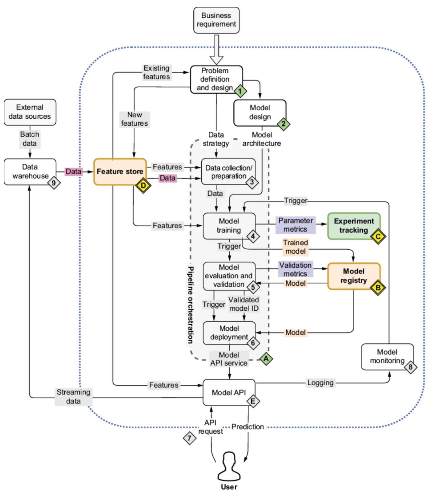
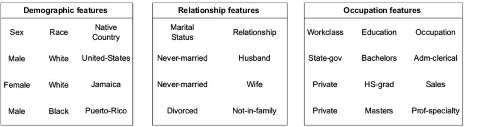
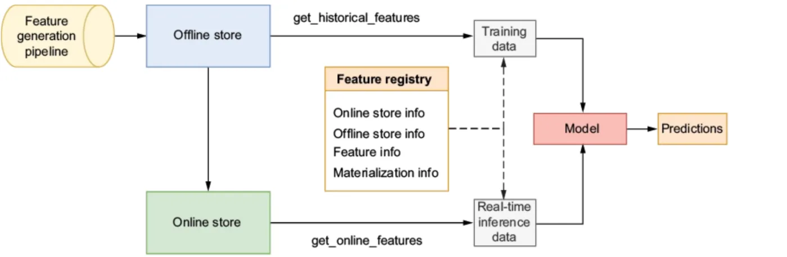
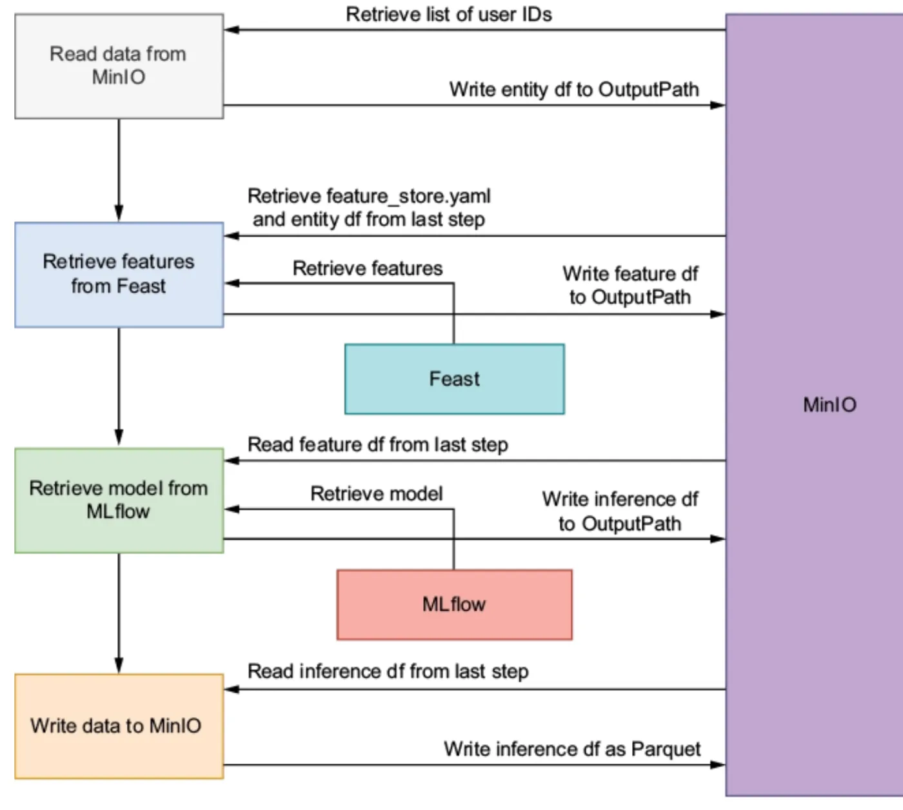

<nav id="manual-toc" class="manual-toc" aria-label="목차">

### 목차

**[1부. 신뢰할 수 있는 ML 시스템의 네 컴포넌트](#section-1)**

- [1.1 플랫폼 지도의 A·B·C·D](#s1-1)
- [1.2 예제 - 소득 50K 이진 분류기](#s1-2)

**[2부. MLflow - 실험 추적과 모델 레지스트리](#section-2)**

- [2.1 추적 서버가 답하는 세 질문](#s2-1)
- [2.2 실험과 실행 - run에 남는 다섯 가지](#s2-2)
- [2.3 자동 로깅 - 한 줄로 켜는 기록과 그 한계](#s2-3)
- [2.4 정확도 대신 AUC로 비교하는 이유](#s2-4)
- [2.5 모델 레지스트리 - 쿼리로 고르고 이름으로 등록](#s2-5)

**[3부. Feast - 피처 스토어](#section-3)**

- [3.1 흩어진 피처와 조인 로직 - 세 범주로 나눈 파일](#s3-1)
- [3.2 시점 정합 조회 - 5월 22일에는 5월 21일 값](#s3-2)
- [3.3 오프라인 스토어와 온라인 스토어 - 구체화](#s3-3)
- [3.4 Entity·DataSource·FeatureView와 피처 레지스트리](#s3-4)
- [3.5 조회 인터페이스 - SDK 메서드 두 개와 피처 서버](#s3-5)

**[4부. Kubeflow Pipelines - 배치 추론 오케스트레이션](#section-4)**

- [4.1 배치 추론 파이프라인의 공통 구조 - 4단계](#s4-1)
- [4.2 컴포넌트 = 코드 + 이미지 + 명세](#s4-2)
- [4.3 파이프라인 = DAG - 출력 참조가 의존성이 된다](#s4-3)
- [4.4 컴포넌트 설계 원칙 네 가지와 이점 세 가지](#s4-4)
- [4.5 배치 추론과 실시간 추론](#s4-5)

**[전체 흐름 정리](#section-5)** · **[출처](#section-6)**

</nav>

---

## 1부. 신뢰할 수 있는 ML 시스템의 네 컴포넌트

<a id="s1-1"></a>

### 1.1 플랫폼 지도의 A·B·C·D

1편 4.2절은 ML 플랫폼의 도구 블록 네 개를 "없을 때 무엇이 문제인가"로 정리했습니다. 책의 4장과 5장은 그 블록을 실제 도구로 하나씩 채웁니다.

<figure>
  
  <figcaption>1편 4.1절의 플랫폼 지도를 4장은 이렇게 다시 그립니다. 4장은 주황·초록으로 칠한 <strong>D(피처 스토어), C(실험 추적), B(모델 레지스트리)</strong>를 채우고 5장은 가운데 점선 상자 <strong>A(파이프라인 오케스트레이션)</strong>를 채웁니다. 화살표 이름을 보면 각 블록이 주고받는 것이 정해져 있습니다. 학습(4)은 C에 파라미터와 지표를, B에 학습된 모델을 넘기고 D는 학습과 모델 API(E) 양쪽에 피처를 보냅니다. (출처: Benjamin Tan Wei Hao 외, <em>Machine Learning Platform Engineering</em>, Manning, Figure 4.1)</figcaption>
</figure>

| 블록 | 도구 | 이 편에서 보는 것 |
|------|------|-------------------|
| C 실험 추적 | MLflow Tracking | 실행마다 무엇을 남기고, 남긴 것으로 무엇을 비교하는가 |
| B 모델 레지스트리 | MLflow Model Registry | 어떤 실행의 모델을 어떤 이름과 단계로 내보내는가 |
| D 피처 스토어 | Feast | 같은 피처를 학습과 추론에 같은 시점 기준으로 주는 방법 |
| A 파이프라인 | Kubeflow Pipelines(KFP) | 위 세 도구를 사람 손 없이 순서대로 잇는 방법 |

4장 정리에서 저자는 MLflow와 Feast만으로는 부족하다고 씁니다. 새 데이터로 재학습하거나 피처를 갱신할 때 여전히 사람이 손으로 돌려야 하기 때문입니다. 5장의 KFP가 그 수동 단계를 맡습니다.

<a id="s1-2"></a>

### 1.2 예제 - 소득 50K 이진 분류기

세 도구는 한 예제를 공유합니다. 미국 성인 인구조사(Adult/Census Income) 데이터로 소득이 50K 이하인지 초과인지 맞히는 이진 분류기입니다.

| 항목 | 값 |
|------|----|
| 행 수 | 30,162 |
| 입력 컬럼 | 범주형 8개 - Workclass, Education, Marital-Status, Occupation, Relationship, Race, Sex, Native_country |
| 타깃 | `<=50K` 22,654행, `>50K` 7,508행 (7,508 ÷ 30,162 = 24.9%) |
| 원-핫 인코딩 뒤 | 범주 값 98개 - 컬럼마다 첫 범주 1개씩 8개 제거 = 90개 컬럼 |

입력이 전부 범주형이라 모델에 넣기 전에 원-핫 인코딩을 합니다. 이때 만들어진 **90개 컬럼의 순서**는 모델의 일부입니다. 추론 때 같은 순서로 컬럼을 맞추지 못하면 모델이 다른 피처를 읽습니다. 그래서 책은 컬럼 목록을 `column_list.pkl`로 저장해 모델과 함께 기록합니다. 4.2절의 추론 컴포넌트가 이 파일을 다시 꺼내 씁니다.

탐색 단계에서 그린 막대그래프 한 장은 Workclass별 고소득 비율을 비교합니다. Self-emp-inc(법인 자영업)의 50K 초과 비율이 가장 높습니다. 이런 그래프도 추적 대상입니다. 2.2절의 탐색 실행에 아티팩트로 남깁니다.

---

## 2부. MLflow - 실험 추적과 모델 레지스트리

<a id="s2-1"></a>

### 2.1 추적 서버가 답하는 세 질문

1편 2.5절은 모델을 **코드 + 설정 + 데이터의 산출물**로 정의하고 추적 기록이 잘못된 결론을 막는 사례를 들었습니다. 4장은 무엇을 왜 추적하는지를 세 가지로 나눕니다.

- **재현성** - 동료가 같은 결과를 다시 만들 수 있어야 합니다.
- **모델 선택** - 구조와 지표가 서로 다른 후보 여러 개 중에서 하나를 골라야 합니다.
- **성능 추적** - 고른 모델을 새 데이터로 재학습한 뒤 이전 반복과 비교해야 합니다.

추적 대상 파라미터에는 학습·테스트 데이터, 모델 가중치, 정확도 지표가 들어갑니다. 책은 먼저 기록 방법 두 가지를 검토하고 아래 문제 때문에 쓰지 않습니다.

| 방법 | 문제 |
|------|------|
| 버전 관리 시스템에 커밋하고 태그 달기 | 실험할 때마다 커밋과 태그를 붙여야 하고, 나중에 원하는 커밋을 찾기 번거롭다 |
| 파라미터를 파일에 저장해 노트북과 함께 공유 | 받은 사람이 자기 환경에서 재현하려면 파일 사용법을 따로 설명해야 한다 |

MLflow는 실험 파라미터를 받아 두는 **추적 서버**를 둡니다. 노트북은 서버 주소와 실험 이름만 지정하고 기록을 보냅니다.

```python
mlflow.set_tracking_uri("http://localhost:5000")
mlflow.set_experiment("income-classifier")
```

추적 서버는 아래 세 질문에 답해야 합니다.

```
지금 운영에 배포된 모델 버전은 무엇인가     → 2.5 레지스트리의 단계(stage)
어떤 파라미터가 최고 결과를 냈는가         → 2.2 실행 기록 + 2.5 쿼리
6개월 전의 결과를 재현할 수 있는가          → 2.2 데이터셋·모델 아티팩트
```

<a id="s2-2"></a>

### 2.2 실험과 실행 - run에 남는 다섯 가지

MLflow의 기록 단위는 **실험**(experiment)과 **실행**(run) 두 층입니다. 실험은 같은 문제를 푸는 실행의 묶음이고 여기서는 `income-classifier` 하나입니다. 실행은 `with mlflow.start_run():` 블록 하나이고 한 번의 작업 단위입니다. 책은 탐색 분석 한 번과 모델 학습 한 번을 서로 다른 실행으로 나눕니다. 탐색 단계의 범주별 막대그래프 8장은 `eda-`로 시작하는 탐색 실행에 따로 남습니다.

모델 학습 실행 하나에 남는 것은 다섯 종류입니다.

| 종류 | API | 소득 분류기에서 남긴 것 |
|------|-----|-------------------------|
| 파라미터 | `log_params` | 모델 하이퍼파라미터 |
| 지표 | `log_metric` | `roc_auc_score_train`, `roc_auc_score_test`, `training_accuracy`, `test_accuracy` |
| 아티팩트 | `log_artifact` | 원-핫 컬럼 순서를 담은 `column_list.pkl` |
| 데이터셋 | `log_input` | 학습·테스트·참조 데이터셋 |
| 모델 | `sklearn.log_model` | 학습된 결정 트리 |

데이터셋 기록은 두 단계입니다. 먼저 판다스 데이터프레임을 객체 스토리지에 저장합니다. 그다음 `mlflow.data.from_pandas`로 그 데이터프레임과 저장 경로를 묶어 **MLflow 데이터셋**을 만들고 `log_input`으로 실행에 연결합니다.

```python
with mlflow.start_run() as run:
    training_dataset = mlflow.data.from_pandas(
        train_df, source=f"{BUCKET_NAME}/{train_df_path}")
    mlflow.log_input(training_dataset, context="training")
    mlflow.log_input(test_dataset, context="testing")
    mlflow.log_input(feature_dataset, context="reference")

    tree.fit(X_train, y_train.ravel())
    mlflow.log_metric("roc_auc_score_test", roc_auc_score_test)
    mlflow.sklearn.log_model(tree, "income-classifier")
```

`context`는 그 데이터셋이 실행에서 맡은 역할입니다. **참조(reference) 데이터셋**은 학습과 테스트에 쓰인 사용자를 모두 포함한 전체 피처 데이터입니다.

MLflow는 데이터프레임 내용 자체가 아니라 **메타데이터**를 기록합니다. 컬럼 이름과 타입, 행 수, 그리고 원본이 저장된 경로입니다. 실제 파일은 객체 스토리지에 있고 실행은 그 위치를 가리킵니다. 6개월 뒤에 같은 학습을 재현하려면 이 경로에서 같은 데이터를 다시 받으면 됩니다.

모델도 같은 원리입니다. `log_model`은 모델 파일과 함께 실행에 필요한 의존성 목록을 저장합니다. MLflow는 scikit-learn, XGBoost, TensorFlow, PyTorch 같은 프레임워크마다 저장·로드 메서드를 따로 제공합니다. 그래서 4.2절의 추론 컴포넌트는 모델 종류에 맞는 로더만 고르면 됩니다.

<a id="s2-3"></a>

### 2.3 자동 로깅 - 한 줄로 켜는 기록과 그 한계

결정 트리와 랜덤 포레스트는 지표를 하나씩 `log_metric`으로 남겼습니다. XGBoost 실행은 **자동 로깅**(autologging)을 씁니다.

```python
with mlflow.start_run():
    mlflow.xgboost.autolog()
    model = xgb.train(params, dtrain, n_round)
```

`autolog()` 한 줄을 학습 호출 앞에 두면 학습 함수 호출을 MLflow가 가로채 파라미터, 학습 중 지표, 모델, 피처 중요도 그래프를 자동으로 남깁니다. 다만 자동 로깅에는 한계가 두 가지 있습니다.

- **커스텀 지표는 남지 않는다**
  - 자동 로깅은 라이브러리가 아는 지표만 기록합니다. 테스트 AUC처럼 직접 계산한 값은 `log_metric`으로 따로 남겨야 합니다.
  - 자동 로깅을 켠 실행 안에서도 다른 `log_*` 메서드를 함께 써도 됩니다.
- **데이터셋은 데이터프레임이 아닌 배열로 기록된다**
  - XGBoost는 `DMatrix`라는 자체 배열 구조로 학습합니다. 자동 로깅은 이 배열을 기록하므로 컬럼 이름 같은 정보가 빠집니다.

한 실행에는 모델 하나를 담는 것이 원칙입니다. 목적 함수가 다른 모델은 실행을 나눠야 각각 비교할 수 있습니다.

<a id="s2-4"></a>

### 2.4 정확도 대신 AUC로 비교하는 이유

책은 세 모델의 비교 지표로 정확도와 함께 **AUC**를 남기고 레지스트리에 올릴 모델도 테스트 AUC로 고릅니다.

정확도만으로 고르기 어려운 원인은 데이터의 불균형입니다. 50K 초과가 24.9%뿐이므로 모든 사람을 `<=50K`라고 찍어도 정확도가 75.1%입니다. 아무것도 배우지 않은 모델의 정확도가 이미 75.1%라서, 모델 사이의 차이가 정확도에 잘 드러나지 않습니다.

#### ROC 곡선과 AUC

분류 모델은 보통 클래스가 아니라 **확률**을 냅니다. 예를 들어 "이 사람이 고소득일 확률 0.73"입니다. 몇 이상을 고소득이라고 부를지는 기준값(threshold)이 정합니다. 1편 2.6절의 혼동행렬로 쓰면 다음과 같습니다.

```
TPR (진짜 양성 비율) = TP / (TP + FN)   실제 고소득 중 고소득이라고 맞힌 비율
FPR (가짜 양성 비율) = FP / (FP + TN)   실제 저소득 중 고소득이라고 잘못 부른 비율

기준값을 낮춘다 → 고소득을 더 많이 잡는다(TPR↑), 저소득도 더 많이 잘못 부른다(FPR↑)
기준값을 높인다 → 반대
```

기준값을 1에서 0까지 내리며 (FPR, TPR) 점을 찍어 이은 선이 **ROC 곡선**이고 그 아래 넓이가 **AUC**(Area Under the Curve)입니다. 곡선이 왼쪽 위 모서리에 붙을수록 넓이가 1에 가까워집니다.

AUC에는 더 쓰기 쉬운 해석이 있습니다. **고소득자 한 명과 저소득자 한 명을 무작위로 뽑았을 때, 모델이 고소득자에게 더 높은 점수를 줄 확률**입니다. AUC가 0.8이면 이런 쌍의 약 80%에서 순서를 맞게 매긴다는 뜻입니다. 1.0은 완벽한 구분이고 0.5는 동전 던지기 수준입니다.

정답이 `[0, 0, 1, 1]`이고 모델 점수가 `[0.1, 0.4, 0.35, 0.8]`이라고 해봅시다. 양성 2개와 음성 2개로 만들 수 있는 쌍은 2 × 2 = 4개입니다.

| 양성 점수 | 음성 점수 | 양성이 더 높은가 |
|-----------|-----------|------------------|
| 0.35 | 0.1 | 예 |
| 0.35 | 0.4 | 아니요 |
| 0.8 | 0.1 | 예 |
| 0.8 | 0.4 | 예 |

네 쌍 중 세 쌍이 맞으므로 `roc_auc_score`는 3 ÷ 4 = 0.75를 돌려줍니다. 기준값을 하나도 정하지 않았는데 값이 나옵니다. **AUC는 기준값이 아니라 점수의 순서를 평가합니다.** 그래서 불균형 데이터에서는 AUC가 정확도보다 믿을 만한 지표입니다.

#### hinge 모델의 AUC가 낮게 나오는 이유

XGBoost를 `binary:hinge`로 학습하면 확률이 아니라 0 또는 1을 바로 냅니다. 점수가 두 값뿐이므로 기준값을 어디에 두어도 결과가 한 가지입니다. ROC 곡선은 점 하나를 지나는 꺾은선이 되고 넓이가 작아집니다. 이때 AUC가 낮게 나와도 모델이 약하다는 뜻이 아닐 수 있습니다. **지표에 0/1 출력을 넣었기 때문**일 수 있습니다. AUC로 비교할 모델은 확률을 내도록 학습해야 합니다. 4.2절의 추론 컴포넌트도 `predict_proba`로 확률을 받습니다.

AUC가 높다고 해서 어떤 기준값에서든 정확도가 좋다는 뜻은 아닙니다. 운영에서는 AUC로 모델을 고른 뒤, 1편 2.6절처럼 **어떤 오류의 피해가 더 큰가**를 따져 기준값을 따로 정합니다.

<a id="s2-5"></a>

### 2.5 모델 레지스트리 - 쿼리로 고르고 이름으로 등록

모든 실행의 지표를 남겨 두었으므로 최고 모델은 검색 한 번으로 고릅니다. 저자는 MLflow 모델 레지스트리를 **모델의 생애주기를 관리하는 저장소**로 정의합니다. 1편 4.2절에서 "승격과 롤백은 운영 표시를 옮기는 일"이라고 했는데 MLflow에서 그 운영 표시는 아래에서 볼 단계(stage)입니다.

레지스트리에 모델을 올리는 방법은 두 가지입니다.

- **MLflow UI** - 실행 목록의 검색창에 `metrics.roc_auc_score_test > 0.8`을 넣으면 테스트 AUC가 0.8을 넘는 실행만 남습니다. 차트 보기로 바꾸면 실행별 지표를 막대로 비교할 수 있습니다. 책의 화면에서는 랜덤 포레스트가 1등입니다.
- **MLflow 클라이언트** - 같은 필터를 코드로 실행하고 결과를 바로 레지스트리에 등록합니다.

```python
mlflow_client = MlflowClient()
experiment = mlflow_client.get_experiment_by_name("income-classifier")

run_object = mlflow_client.search_runs(
    experiment_ids=experiment.experiment_id,
    filter_string="metrics.roc_auc_score_test > 0.8",
    max_results=1,
    order_by=["metrics.roc_auc_score_test DESC"],
)[0]

model_uri = f"runs:/{run_object.info.run_id}/income-classifier"
mlflow.register_model(model_uri, "random-forest-classifier")
```

코드가 하는 일은 네 단계입니다.

1. 실험 이름으로 실험 ID를 찾습니다.
2. 조건(`> 0.8`)으로 거르고 테스트 AUC 내림차순으로 정렬해 1개만 받습니다.
3. 그 실행의 ID와 `log_model` 때 쓴 경로로 **모델 URI**를 만듭니다. `runs:/<실행 ID>/<저장 경로>` 형식입니다.
4. 모델 URI와 등록 이름으로 레지스트리에 올립니다. 첫 등록은 버전 1이고 같은 이름으로 다시 등록하면 버전 2, 3이 쌓입니다.

등록된 모델은 **단계**(stage)를 가집니다. 코드를 스테이징에서 테스트한 뒤 운영으로 옮기듯, 모델도 Staging과 Production 단계로 승격합니다. 소비하는 쪽은 실행 ID를 몰라도 됩니다. `models:/random-forest-classifier/Production`처럼 이름과 단계로 모델을 불러옵니다. 그래서 새 버전을 Production으로 올리면 소비자는 코드를 고치지 않고도 다음 실행부터 새 모델을 씁니다. 4.2절의 추론 컴포넌트가 이 방식을 씁니다.

2.1절의 첫 질문 "지금 운영에 배포된 모델 버전은 무엇인가"의 답이 여기서 나옵니다. Production 단계가 붙은 버전이 그 답입니다.

---

## 3부. Feast - 피처 스토어

<a id="s3-1"></a>

### 3.1 흩어진 피처와 조인 로직 - 세 범주로 나눈 파일

소득 분류기의 피처는 파일 하나에 모두 들어 있습니다. 현실에서는 피처가 여러 테이블과 파일에 흩어져 있고 학습 데이터셋을 만들려면 복잡한 피처 처리와 조인 로직을 짜야 합니다. 책은 이 상황을 흉내 내려고 파일 하나를 세 개로 나눕니다.

<figure>
  
  <figcaption>한 파일의 8개 컬럼이 성격에 따라 세 묶음으로 갈라졌습니다. 각 파일에는 이 피처 외에 <strong>사용자 ID와 타임스탬프</strong>가 붙습니다. 이 두 열이 있어야 흩어진 파일을 "누구의, 언제의 값"으로 다시 맞출 수 있고 3.2절의 시점 정합 조회가 이 두 열을 씁니다. (출처: Benjamin Tan Wei Hao 외, <em>Machine Learning Platform Engineering</em>, Manning, Figure 4.9)</figcaption>
</figure>

| 범주 | 피처 | FeatureView 이름 |
|------|------|------------------|
| 인구통계(demographic) | Sex, Race, Native_country | `demographic` |
| 관계(relationship) | Marital-Status, Relationship | `relationship` |
| 직업(occupation) | Workclass, Education, Occupation | `occupation` |

이 묶음이 3.4절의 FeatureView 세 개가 됩니다. 1편 4.2절이 말한 피처 공유도 이 묶음 단위로 합니다. 다른 팀은 `occupation` 묶음만 가져다 쓸 수 있습니다.

<a id="s3-2"></a>

### 3.2 시점 정합 조회 - 5월 22일에는 5월 21일 값

1편 4.2절은 시점 기준 조회가 미래 정보 누수를 막는다고 짚었습니다. 책은 이 규칙을 피처 파일 기준으로 설명합니다. 피처 파일을 정의한 다음에는 추론이나 재학습 시점에 **적합한 피처**를 가져올 방법이 필요합니다. 책은 적합한 피처를 예로 정의합니다. 5월 22일 기준으로 어떤 사용자의 피처를 가져온다고 해봅시다. 이 사용자의 피처는 세 시점에 기록되어 있습니다.

| 기록 시점 | 5월 22일 기준으로 쓸 수 있는가 |
|-----------|-------------------------------|
| 1월 7일 | 쓸 수 있지만 오래된 값 |
| 5월 21일 | **조회 시점 이전 중 가장 최근 값 - 이것을 쓴다** |
| 12월 4일 | 쓸 수 없다. 5월 22일에는 아직 일어나지 않은 미래 값 |

12월 4일 값을 학습에 쓰면 모델은 예측 시점에 알 수 없는 정보로 학습합니다. 1편 2.3절 누수 표의 **미래 정보** 줄에 해당합니다. 반대로 1월 7일 값을 쓰면 5월 21일에 바뀐 사실이 빠집니다.

이 규칙을 **시점 정합(point-in-time) 조회**라고 합니다. 조회하는 시점에 맞춰 그 이전 값 중 가장 최근 값을 고르는 것입니다. 스크립트나 SQL로 직접 짤 수도 있지만 그러면 유지보수하고 디버깅할 코드가 하나 더 늘어납니다. Feast는 이 로직을 추상화 계층으로 제공합니다. 저자는 그 덕분에 데이터 과학자가 조인 로직이 아니라 피처 엔지니어링에 집중할 수 있다고 씁니다.

<aside class="callout">
<p class="eyebrow">(용어) TTL (time to live)</p>

Feast가 과거 데이터셋을 만들 때 **조회 시점에서 얼마나 이전 값까지 참조할지** 정하는 한도입니다. 5월 22일 기준 데이터셋을 만들고 TTL이 이틀이면 Feast는 5월 20일 이전에 기록된 값을 고려하지 않습니다. 너무 오래된 값이 최신 값처럼 쓰이는 것을 막는 장치입니다. 책은 TTL이 너무 짧아 피처가 빠지는 일을 피하려고 365일로 잡습니다.

</aside>

TTL까지 넣으면 시점 정합 조회의 규칙은 한 줄로 정리됩니다.

```
조회 시점 T, TTL d 일 때:
    [T − d, T] 구간에 기록된 값 중 가장 최근 값
    구간에 값이 없으면 → 빈 값(null)
```

<a id="s3-3"></a>

### 3.3 오프라인 스토어와 온라인 스토어 - 구체화

1편 4.2절은 오프라인 스토어와 온라인 스토어의 목적, 데이터 양, 응답 속도를 비교했습니다. 책의 Feast 설계도에서는 두 저장소가 이렇게 이어집니다.

<figure>
  
  <figcaption>피처 생성 파이프라인은 <strong>오프라인 스토어에만</strong> 피처를 씁니다. 온라인 스토어는 가운데 세로 화살표로 오프라인 스토어에서 주기적으로 값을 받습니다. 그래서 학습 데이터와 실시간 추론 데이터가 같은 원본에서 나옵니다. 가운데 피처 레지스트리는 두 저장소의 위치, 피처 정의, 마지막 구체화 정보를 보관하고 점선은 양쪽 조회가 모두 이 정의를 거친다는 뜻입니다. (출처: Benjamin Tan Wei Hao 외, <em>Machine Learning Platform Engineering</em>, Manning, Figure 4.10)</figcaption>
</figure>

| 구분 | 오프라인 스토어 | 온라인 스토어 |
|------|-----------------|---------------|
| 책의 선택 | 객체 스토리지(MinIO)의 parquet 파일 | Redis |
| 채우는 쪽 | 피처 생성 파이프라인 | 구체화(materialize) |
| 조회 메서드 | `get_historical_features` | `get_online_features` |

Redis가 일반적인 선택이지만 Feast는 요구사항에 따라 DynamoDB, Google Cloud Datastore 같은 다른 온라인 데이터베이스도 지원합니다.

1편 4.2절의 주기적 복사(*materialize*)를 이 글에서는 구체화라고 부릅니다. Feast에서는 `feast materialize <시작 시각> <종료 시각>` 명령 하나로 실행합니다. Feast는 오프라인 스토어에서 두 시각 사이의 데이터를 읽어 엔티티마다 가장 최근 값을 온라인 스토어에 씁니다.

1편 4.2절은 피처 스토어가 **피처 정의 하나**로 학습-서빙 불일치를 막는다고 했습니다. Feast에서는 레지스트리가 그 정의를 보관하고 데이터 원본도 오프라인 스토어 하나입니다. 온라인 스토어는 원본의 사본일 뿐입니다.

사본이므로 주의할 점이 두 가지 생깁니다.

- **구체화하지 않으면 온라인 조회가 빈 값을 돌려준다**
  - 엔티티가 오프라인 스토어에 있어도 온라인 스토어가 비어 있으면 값은 None입니다.
- **온라인 값은 "마지막 구체화 시점의 최신 값"이다**
  - 피처 파일이 갱신되어도 다시 구체화하기 전까지 온라인 스토어에는 반영되지 않습니다. 그래서 구체화는 한 번이 아니라 주기적으로 돌리는 작업입니다.

<a id="s3-4"></a>

### 3.4 Entity·DataSource·FeatureView와 피처 레지스트리

Feast에 피처를 등록하려면 정의 세 가지와 설정 파일 하나를 씁니다.

<aside class="callout">
<p class="eyebrow">(용어) 엔티티 (entity)</p>

피처를 모으는 대상을 식별하는 키입니다. 소득 분류기는 사용자에 대한 피처를 모으므로 `user_id`가 엔티티입니다. 상품에 대한 피처라면 `product_id`가 엔티티가 됩니다. 3.1절 파일마다 붙은 사용자 ID 열이 이 엔티티 값입니다.

</aside>

```python
# 1. 엔티티 - 이름, 설명, 타입
user = Entity(name="user_id", description="A user")

# 2. 데이터 소스 - 피처 파일의 형식과 위치
demo_features_parquet_file_source = FileSource(
    file_format=ParquetFormat(),
    path="s3://feature-data-sets/demographic_features.parquet",
    s3_endpoint_override="http://localhost:9000",
)

# 3. FeatureView - 피처의 논리적 묶음
demo_features = FeatureView(
    name="demographic",
    entities=[user],
    schema=[
        Field(name="Native_country", dtype=String),
        Field(name="Sex", dtype=String),
        Field(name="Race", dtype=String),
    ],
    ttl=timedelta(days=365),
    source=demo_features_parquet_file_source,
    tags={"description": "User Demographics",
          "used_by": "Income_Calculation_Team"},
)
```

- **DataSource는 위치만 가리킨다**
  - 피처 값을 복사하지 않습니다. parquet 파일의 경로와 객체 스토리지 엔드포인트만 기록합니다.
- **FeatureView가 이름과 시간 규칙을 붙인다**
  - 어떤 엔티티의 피처인지, 컬럼 목록과 타입, TTL을 정합니다. 3.2절의 시점 정합 조회는 이 TTL을 씁니다.
  - 태그는 선택 사항입니다. 작성자, 설명, 사용 팀을 적어 두면 다른 팀이 피처를 찾을 때 근거가 됩니다.

남은 하나는 피처 스토어 설정 파일 `feature_store.yaml`입니다.

```yaml
project: my_feature_repo
registry: s3://feature-registry/registry_local.db   # 피처 레지스트리 위치
provider: local                                      # 클라우드 공급자 또는 로컬
offline_store:
  type: file                                         # 객체 스토리지의 파일
online_store:
  type: redis
  connection_string: "localhost:6379"
```

**피처 레지스트리는 모든 피처와 엔티티 정의를 보관하는 공통 저장소**입니다. 책에서는 객체 스토리지 버킷에 있는 `registry_local.db` 파일 하나가 그 역할을 합니다. 정의를 코드로 쓴 다음에는 `feast apply`로 레지스트리에 반영합니다.

```
feast apply
Created entity user_id
Created feature view relationship
Created feature view occupation
Created feature view demographic
Deploying infrastructure for relationship
Deploying infrastructure for occupation
Deploying infrastructure for demographic
```

출력의 `Deploying infrastructure` 줄에서 Feast는 Redis를 세 FeatureView의 온라인 저장소로 설정합니다. 이 시점에는 정의만 올라갔고 값은 아직 온라인 스토어에 없습니다. 값은 3.3절의 구체화가 채웁니다.

<a id="s3-5"></a>

### 3.5 조회 인터페이스 - SDK 메서드 두 개와 피처 서버

피처는 `"<FeatureView 이름>:<피처 이름>"` 형식으로 가리킵니다. 인구통계 묶음의 성별은 `"demographic:Sex"`입니다.

#### 오프라인 조회 - get_historical_features

인자는 두 개입니다. 첫째는 **엔티티 데이터프레임**입니다. 열 이름은 엔티티 이름(`user_id`)과 `event_timestamp`여야 합니다. 둘째는 가져올 피처 목록입니다.

```python
entity_df = pd.DataFrame.from_dict({
    "user_id": ["9f2ac416-06e1-44a0-87bd-d4787c85bf66"],
    "event_timestamp": [datetime(2023, 1, 30, 10, 59, 42)],
})
store = FeatureStore(repo_path=".")
training_df = store.get_historical_features(
    entity_df=entity_df,
    features=["demographic:Sex"],
).to_df()
```

엔티티 데이터프레임의 각 행이 "이 사용자의, 이 시점의 값을 달라"는 요청입니다. Feast는 행마다 3.2절의 규칙으로 값을 골라 붙입니다. 결과는 `user_id`, `event_timestamp`, `Sex` 세 열입니다. 학습 데이터셋을 만들 때는 이 데이터프레임에 사용자 수만큼 행을 넣습니다.

#### 온라인 조회 - get_online_features

```python
online_features = store.get_online_features(
    features=["demographic:Sex"],
    entity_rows=[{"user_id": "9f2ac416-06e1-44a0-87bd-d4787c85bf66"}],
)
```

입력에 시각이 없습니다. 온라인 스토어에는 엔티티마다 최신 값 하나만 있기 때문입니다.

| 비교 | `get_historical_features` | `get_online_features` |
|------|---------------------------|------------------------|
| 시점 | 요청한 `event_timestamp` 이전의 가장 최근 값 | 마지막 구체화로 올라간 현재 값 |
| 입력 | 엔티티 데이터프레임(`user_id` + `event_timestamp`) | 딕셔너리 목록(`user_id`만) |
| 출력 | `event_timestamp` 열 포함 | `event_timestamp` 열 없음 |
| 데이터 출처 | 오프라인 스토어 | 온라인 스토어 |
| 용도 | 학습, 배치 추론 | 실시간 추론 |

#### 피처 서버 - feast serve

Feast SDK는 파이썬 패키지입니다. 피처를 쓰려는 애플리케이션이 다른 언어로 작성되어 있으면 SDK를 쓸 수 없습니다. 그래서 Feast는 **피처 서버**도 제공합니다. `feast serve`를 실행하면 HTTP 서버가 뜨고 `POST /get-online-features` 요청 하나로 온라인 조회를 할 수 있습니다.

```bash
curl -X POST "http://localhost:6566/get-online-features" -d '{
  "features": ["demographic:Sex"],
  "entities": {"user_id": ["9f2ac416-06e1-44a0-87bd-d4787c85bf66"]}
}'
```

피처 서버는 피처 이름 목록, 값, 상태(`PRESENT` 등), 값이 기록된 시각을 함께 돌려줍니다. 엔티티 목록에 사용자 여러 명을 넣으면 한 번에 조회합니다. `feast ui`는 레지스트리에 등록된 FeatureView, 엔티티, 데이터 소스를 목록으로 보여 주고 태그로 FeatureView를 거를 수 있습니다.

---

## 4부. Kubeflow Pipelines - 배치 추론 오케스트레이션

<a id="s4-1"></a>

### 4.1 배치 추론 파이프라인의 공통 구조 - 4단계

4장까지의 결과물은 레지스트리에 등록된 모델과 Feast에 등록된 피처입니다. 5장은 이 둘로 배치 추론을 자동화합니다. 책에 따르면 추론 파이프라인은 대부분 구조가 같습니다.

```
어딘가에서 데이터를 가져온다   (객체 스토어, 데이터 웨어하우스, 파일시스템)
        ↓
전처리하고 피처를 붙인다
        ↓
모델을 조회하거나 로드해 추론한다
        ↓
결과를 데이터베이스나 클라우드 스토리지에 쓴다

+ 주기적으로 실행한다
+ 날짜·시간, 피처 테이블 이름 같은 값을 실행할 때마다 파라미터로 받는다
```

소득 분류기에 대입하면 네 단계가 됩니다.

1. 객체 스토리지에서 사용자 ID 목록을 읽습니다.
2. 그 사용자들의 피처를 Feast에서 조회합니다.
3. MLflow 레지스트리에서 모델을 불러와 추론합니다.
4. 결과를 객체 스토리지에 다시 씁니다.

<figure>
  
  <figcaption>왼쪽 상자 사이의 세로 화살표는 실행 순서만 나타냅니다. 단계 사이에 넘기는 데이터는 모두 오른쪽 객체 스토리지의 <strong>OutputPath</strong>를 거칩니다. 각 단계가 결과를 거기 쓰고 다음 단계가 그 경로에서 읽습니다(<code>from last step</code>). 외부 시스템은 필요한 단계에만 붙습니다. Feast는 두 번째 단계에, MLflow는 세 번째 단계에만 연결됩니다. 그래서 단계를 하나씩 떼어 다른 파이프라인에 다시 쓸 수 있습니다. (출처: Benjamin Tan Wei Hao 외, <em>Machine Learning Platform Engineering</em>, Manning, Figure 5.2)</figcaption>
</figure>

KFP가 풀어야 할 문제는 워크플로의 반복 가능성, 서로 다른 모델 사이의 단계 표준화, 단계 사이의 안정적인 데이터 흐름입니다. KFP의 답은 작업 단계를 같은 형식으로 묶는 **컴포넌트**입니다.

<a id="s4-2"></a>

### 4.2 컴포넌트 = 코드 + 이미지 + 명세

1편 4.2절은 "Kubeflow Pipelines에서 각 단계는 컴포넌트이고 파이프라인 정의가 실행 순서와 입출력을 고정한다"고 정리했습니다. 5장은 그 컴포넌트가 무엇으로 이루어지는지 보여 줍니다.

**컴포넌트 하나는 쿠버네티스 Pod 하나에서 실행됩니다.** Pod는 컨테이너 이미지로 뜨므로 컴포넌트를 만들려면 코드가 든 이미지가 필요합니다. 그래서 컴포넌트 하나를 만드는 작업은 세 단계입니다.

```
1. 파이썬 파일     src/read_data/read_data.py        할 일 + argparse로 인자 받기
2. 컨테이너 이미지  Dockerfile → docker build/push    의존성과 코드를 담은 실행 환경
3. 컴포넌트 명세   components/read_data/component.yaml  입력·출력·실행 명령
```

각 컴포넌트가 격리된 환경에서 실행되므로 한 단계의 의존성이 다른 단계와 충돌하지 않습니다.

#### component.yaml의 구조

데이터 읽기 컴포넌트의 명세입니다. 쿠버네티스 객체를 YAML로 정의하는 방식과 비슷합니다.

```yaml
name: Read Data From MinIO
description: Fetches data from MinIO and outputs as a Dataset.
inputs:
- {name: minio_host,  type: String}
- {name: access_key,  type: String}
- {name: secret_key,  type: String}
- {name: bucket_name, type: String}
- {name: file_name,   type: String}
outputs:
- {name: data_output, type: Dataset}
implementation:
  container:
    image: 'varunmallya/read-minio-data:latest'
    command:
    - python3
    - /app/src/read_data/read_data.py
    - --minio_host
    - {inputValue: minio_host}
    # ... access_key, secret_key, bucket_name, file_name 같은 방식
    - --data_output_path
    - {outputPath: data_output}
```

`inputs`와 `outputs`는 이 컴포넌트가 받는 값과 내는 데이터를 정의합니다. KFP는 `command`의 중괄호 자리표시자를 실제 명령줄 인자로 바꿉니다. 자리표시자는 세 가지입니다.

| 자리표시자 | 명령줄에 들어가는 것 | 쓰는 곳 |
|------------|----------------------|---------|
| `{inputValue: x}` | 값 자체 (문자열) | 호스트 주소, 버킷 이름, 피처 목록 |
| `{inputPath: x}` | 앞 단계가 쓴 데이터의 **파일 경로** | 피처 조회의 `entity_df`, 추론의 `input_data` |
| `{outputPath: x}` | 이 단계가 데이터를 **쓸 파일 경로** | 각 단계의 `data_output` |

`outputs`의 `data_output`은 `Dataset` 타입입니다. 이 선언으로 KFP는 `data_output`이 컴포넌트의 출력을 담는다는 것을 압니다. 파이썬 코드는 KFP가 넘겨준 경로에 파일을 쓰기만 하면 됩니다.

```python
Path(data_output_path).parent.mkdir(parents=True, exist_ok=True)
df.to_parquet(data_output_path)
```

컴포넌트는 출력이 객체 스토리지의 어디에 저장되는지 모릅니다. KFP가 경로를 정해 주고 다음 단계에는 같은 경로를 `inputPath`로 넘깁니다. 4.1절 그림의 `OutputPath` 화살표가 이 동작입니다.

#### 나머지 세 컴포넌트

| 컴포넌트 | 입력 | 하는 일 | 출력 |
|----------|------|---------|------|
| 피처 조회 | `entity_df`(Dataset), `feature_list` | 객체 스토리지에서 `feature_store.yaml`을 받아 피처 스토어를 초기화하고 `get_historical_features` 호출 | 피처가 붙은 데이터프레임 |
| 추론 | `input_data`(Dataset), 모델 이름·종류·단계, `mlflow_host` | 레지스트리에서 모델과 `column_list.pkl`을 받아 원-핫 인코딩 후 `predict_proba` | `Predicted_Income_Class` 열이 붙은 데이터프레임 |
| 데이터 쓰기 | `input_data` | 결과를 parquet으로 객체 스토리지에 저장 | 없음 |

추론 컴포넌트는 2부에서 MLflow에 남긴 것을 세 가지 방식으로 씁니다.

- **레지스트리의 단계로 모델을 찾는다**
  - `search_model_versions`로 등록 이름의 버전들을 훑고 `current_stage`가 파라미터로 받은 단계(예: Production)와 같은 버전을 고릅니다. 없으면 `No model found in stage ...` 오류로 멈춥니다.
- **학습 때의 컬럼 순서에 다시 맞춘다**
  - 같은 실행에서 `column_list.pkl`을 받아 `get_dummies` 결과를 `reindex`합니다. 추론 데이터에 없는 범주 컬럼은 0으로 채웁니다. 1.2절에서 컬럼 순서를 모델과 함께 저장한 것도 이 단계 때문입니다.
- **모델 종류마다 로더를 고른다**
  - `model_type`이 sklearn, xgboost, tensorflow 중 무엇인지에 따라 `mlflow.<프레임워크>.load_model`을 고르고 `models:/<이름>/<단계>` URI로 로드합니다.

피처 조회 컴포넌트에는 주소 문제가 하나 있습니다. 4장에서 로컬에서 `feast apply`를 실행할 때 데이터 소스의 엔드포인트는 `localhost`였습니다. 그런데 Pod 안의 `localhost`는 Pod 자신입니다. 그래서 5장은 엔드포인트를 클러스터 내부 서비스 주소로 바꾼 정의를 쿠버네티스 Job으로 클러스터 안에서 `feast apply`합니다. 레지스트리에 적힌 주소가 **그 레지스트리를 읽는 쪽에서 닿는 주소**여야 한다는 뜻입니다.

<a id="s4-3"></a>

### 4.3 파이프라인 = DAG - 출력 참조가 의존성이 된다

<aside class="callout">
<p class="eyebrow">(용어) DAG (directed acyclic graph, 방향성 비순환 그래프)</p>

간선에 방향이 있고 순환이 없는 그래프입니다. 노드가 작업이고 간선이 "이 작업이 끝나야 저 작업을 시작한다"는 의존 관계입니다. 순환이 없으므로 실행 순서가 항상 정해집니다.

</aside>

KFP 파이프라인은 전체 ML 워크플로를 기술하고 컴포넌트를 DAG로 엮습니다. 파이프라인도 파이썬 파일로 정의합니다.

#### 1. 컴포넌트 불러오기

```python
fetch_data_op = kfp.components.load_component_from_file(
    "components/read_data/component.yaml")
retrieve_features_op = kfp.components.load_component_from_file(
    "components/retrieve_features/component.yaml")
# run_inference_op, write_data_op 같은 방식
```

`load_component_from_file`은 4.2절의 명세 파일 경로를 받아 컴포넌트 객체를 만듭니다.

#### 2. 파이프라인 함수와 파라미터

```python
@dsl.pipeline(name="income-classifier-pipeline",
              description="A Kubeflow pipeline to classify income categories using KFP v2")
def income_classifier_pipeline(
    minio_host: str, access_key: str, secret_key: str,
    entity_df_bucket: str, entity_df_filename: str,
    feature_store_bucket_name: str, feature_store_config_file_name: str,
    feature_list: str,
    model_name: str, model_type: str, model_stage: str, mlflow_host: str,
    output_bucket: str, output_file_name: str,
):
```

`@dsl.pipeline` 애노테이션이 이 함수를 파이프라인 정의로 표시합니다. 함수의 인자 14개는 **파이프라인 파라미터**입니다. 실행할 때마다 값을 바꿀 수 있고 기본값을 지정할 수도 있습니다. 4.1절의 "날짜·시간, 피처 테이블 이름을 파라미터로 받는다"가 이 인자들입니다. 같은 파이프라인으로 모델 이름만 바꿔 다른 모델을 돌리거나, 출력 버킷만 바꿔 다른 환경에 쓸 수 있습니다.

#### 3. 태스크 연결

```python
fetch_data_task = fetch_data_op(
    minio_host=minio_host, bucket_name=entity_df_bucket, ...)
retrieve_features_task = retrieve_features_op(
    entity_df=fetch_data_task.outputs["data_output"], ...)
run_inference_task = run_inference_op(
    input_data=retrieve_features_task.outputs["data_output"], ...)
write_data_task = write_data_op(
    input_data=run_inference_task.outputs["data_output"], ...)
```

컴포넌트에 인자를 채우면 **태스크**가 됩니다. 태스크를 잇는 별도 API는 없습니다. 앞 태스크의 `outputs["data_output"]`을 다음 태스크의 입력으로 넘기면 KFP는 다음 태스크가 앞 태스크의 완료에 의존한다고 인식합니다. 출력 참조 하나가 데이터 전달과 실행 순서를 동시에 정합니다.

```
fetch_data_task ──data_output──▶ retrieve_features_task ──data_output──▶ run_inference_task ──data_output──▶ write_data_task
   (entity_df)                     (entity_df → 피처)                     (피처 → 예측)                      (예측 → parquet)
```

#### 4. 컴파일과 실행

```python
Compiler().compile(income_classifier_pipeline, "income_classifier_pipeline.yaml")
```

컴파일러가 파이프라인 함수를 YAML 파일 하나로 바꿉니다. 이 파일을 KFP UI에 올리면 파이프라인이 등록됩니다. 실행은 세 단계입니다.

1. 파이프라인을 업로드합니다(Upload pipeline).
2. 실행을 묶을 실험을 만듭니다(Create experiment). MLflow의 실험처럼 KFP도 실험 안에 실행을 쌓습니다.
3. 실행을 만들고 파라미터 14개를 채운 뒤 시작합니다(Create run).

실행이 끝나면 UI에 4.1절 그림과 같은 순서의 그래프가 그려지고 노드마다 성공 표시와 로그가 남습니다. 저자는 실험 안에서 여러 실행을 추적하는 기능 덕분에 팀이 구성, 하이퍼파라미터, 데이터셋을 체계적으로 바꿔 가며 실험할 수 있다고 씁니다.

<a id="s4-4"></a>

### 4.4 컴포넌트 설계 원칙 네 가지와 이점 세 가지

1편 3.1절은 도구 생태계가 파편화되는 문제의 해법으로 공유 컴포넌트를 꼽았습니다. 5장은 공유할 수 있는 컴포넌트의 설계 원칙을 네 가지로 듭니다.

| 원칙 | 내용 | 소득 분류기에서 |
|------|------|-----------------|
| 모듈성 | 단일 책임 원칙 - 컴포넌트 하나는 기능 하나만 수행한다 | 추론과 데이터 쓰기를 별도 컴포넌트로 나눴다 |
| 입출력 명시 | 필요한 데이터와 생성하는 아티팩트를 상세히 정의한다 | 모든 컴포넌트가 `component.yaml`에 입력과 출력을 적는다 |
| 파라미터화 | 코드를 고치지 않고 동작을 바꿀 수 있게 한다 | `mlflow_host`, `bucket_name`, `minio_host`를 하드코딩하지 않고 파라미터로 받는다 |
| 문서화 | 기능, 입출력, 사용법을 다른 팀원이 읽을 수 있게 적는다 | 명세의 `description`, 그림과 사용 안내 |

잘 설계된 컴포넌트는 세 가지 이점을 줍니다.

- **재사용성** - 한 번 정의하면 여러 파이프라인에서 씁니다. 데이터 읽기와 쓰기 컴포넌트는 소득 분류기와 무관하게 어떤 parquet 파일에도 쓸 수 있습니다.
- **협업** - 데이터 과학자, ML 엔지니어, 도메인 전문가가 서로 다른 컴포넌트를 맡아 병렬로 개발합니다.
- **테스트** - 컴포넌트를 따로 테스트할 수 있어 디버깅이 쉬워집니다. 문제가 특정 컴포넌트로 격리되면 전체 파이프라인에서 원인을 추적하는 복잡도가 줄어듭니다.

4.1절 그림에서 단계 사이에 데이터 화살표가 없던 이유가 이 원칙들입니다. 단계가 서로를 모르고 객체 스토리지의 경로만 알기 때문에, 한 단계를 교체해도 나머지 단계는 바꿀 필요가 없습니다.

<a id="s4-5"></a>

### 4.5 배치 추론과 실시간 추론

1편 1.1절은 간극을 묻는 질문을 중고차 예제에 대입하면서 "데이터를 배치로 받는가, 실시간으로 받는가"를 첫 항목으로 꼽았습니다. 이 편의 도구들은 그 질문에 따라 쓰는 경로가 갈립니다.

| 경로 | 피처 조회 | 모델 실행 | 책의 도구 |
|------|-----------|-----------|-----------|
| 배치 추론 | `get_historical_features` (오프라인 스토어) | 파이프라인의 추론 컴포넌트 | KFP |
| 실시간 추론 | `get_online_features` 또는 피처 서버 (온라인 스토어) | 항상 실행 중인 모델 API | BentoML (6장) |

KFP는 정해진 시각에 한 번에 많은 사용자를 처리하는 배치 추론에 맞습니다. 요청이 올 때마다 바로 응답해야 하는 실시간 추론과 운영 배포는 다음 장의 BentoML이 맡습니다. 두 경로 모두 같은 레지스트리의 모델과 같은 피처 정의를 쓰므로 경로 사이의 불일치도 막습니다.

---

## 전체 흐름 정리

```
[1부] 플랫폼 지도의 네 칸을 실제 도구로 채운다
      C 실험 추적·B 레지스트리 = MLflow / D 피처 스토어 = Feast / A 파이프라인 = KFP
      예제: Adult 30,162행, 범주형 8컬럼 → 원-핫 90컬럼, >50K 24.9%
              │
              ▼
[2부] MLflow - 남기고, 비교하고, 이름 붙여 내보낸다
      실험 > 실행, 실행마다 파라미터·지표·아티팩트·데이터셋·모델
      데이터셋은 메타데이터 + 저장 경로로 기록 → 재현
      autolog: 한 줄로 켜지만 커스텀 지표는 직접, 한 실행 = 한 모델
      불균형 데이터에서는 전부 <=50K로 찍어도 정확도 75.1% → AUC = 순서를 맞게 매기는 확률
      레지스트리: 쿼리(AUC > 0.8)로 1등 → runs:/ URI로 등록 → 버전 → 단계
      소비자는 models:/<이름>/<단계>로 로드
              │
              ▼
[3부] Feast - 같은 피처를 같은 시점 기준으로
      흩어진 파일 → FeatureView 3개 (demographic·relationship·occupation)
      시점 정합 조회: [T − TTL, T] 중 가장 최근 값, 미래 값은 누수
      오프라인(parquet, 모든 시점) ──구체화──▶ 온라인(Redis, 최신 값)
      레지스트리 = 정의 한 벌 → 학습-서빙 불일치 방지
      조회: get_historical_features / get_online_features / 피처 서버(HTTP)
              │
              ▼
[4부] KFP - 세 도구를 사람 손 없이 잇는다
      읽기 → 피처 조회(Feast) → 추론(MLflow) → 쓰기
      컴포넌트 = 파이썬 파일 + 이미지 + component.yaml, Pod 하나에서 실행
      inputValue(값) / inputPath(앞 단계 파일) / outputPath(쓸 파일)
      outputs["data_output"] 참조 = 데이터 전달 + 실행 순서 → DAG
      파라미터 14개 → 컴파일 YAML → 업로드 → 실험 → 실행
      설계 원칙: 모듈성·입출력 명시·파라미터화·문서화
              │
              ▼
      다음: 실시간 추론은 BentoML이 모델 API로 서빙한다
```

---

## 출처

- Benjamin Tan Wei Hao, Varun Mallya, Shanoop Padmanabhan, *Machine Learning Platform Engineering*, Manning, 4장 *Designing reliable ML systems*, 5장 *Orchestrating ML pipelines* - 본문의 그림 4장(Figure 4.1, 4.9, 4.10, 5.2)은 이 책의 영문판 원본입니다
- 예제 코드 - [practical-mlops/chapter-4](https://github.com/practical-mlops/chapter-4), [practical-mlops/chapter-5](https://github.com/practical-mlops/chapter-5)
- CloudNet@ ML 플랫폼 엔지니어링 스터디 4·5장 정리 자료
- Feast 공식 문서 - [docs.feast.dev](https://docs.feast.dev/)
