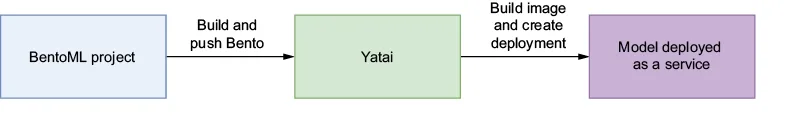
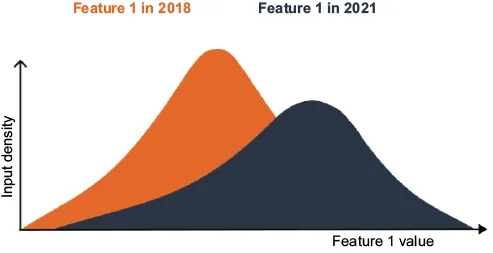
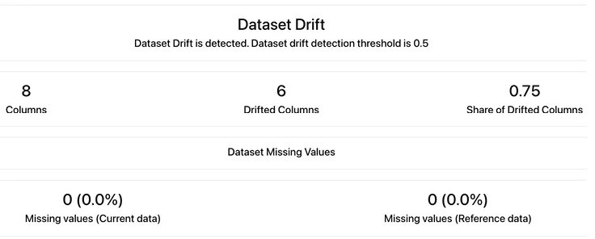
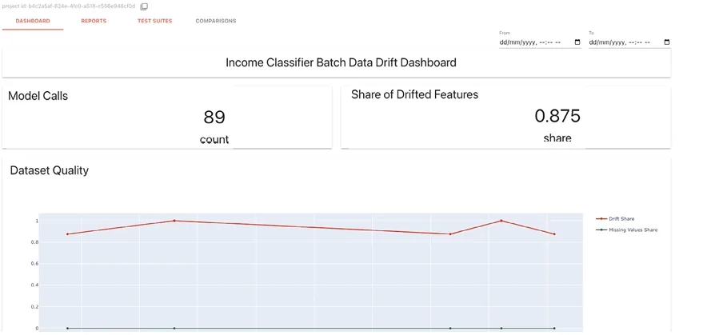
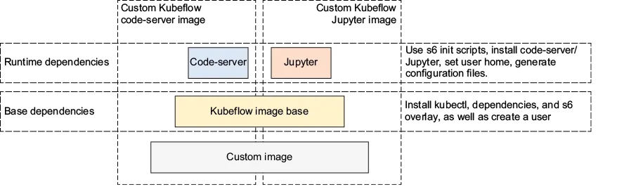

<nav id="manual-toc" class="manual-toc" aria-label="목차">

### 목차

**[1부. BentoML - 모델을 API 서비스로 묶기](#section-1)**

- [1.1 배치 추론 다음은 API 엔드포인트](#s1-1)
- [1.2 Bento 빌드 4단계](#s1-2)
- [1.3 서비스와 러너 - 요청 처리와 추론의 분리](#s1-3)
- [1.4 bentofile.yaml - Dockerfile 대신 쓰는 패키징 명세](#s1-4)

**[2부. Yatai - Bento를 쿠버네티스에 배포](#section-2)**

- [2.1 Yatai 스택의 세 컴포넌트와 CRD](#s2-1)
- [2.2 배포 절차 - Bento 푸시부터 파드 생성까지](#s2-2)
- [2.3 배포 결과 - API 서버 파드, 러너 파드, /metrics](#s2-3)

**[3부. Evidently - 데이터 드리프트 모니터링](#section-3)**

- [3.1 데이터 드리프트의 네 유형](#s3-1)
- [3.2 통계 검정과 두 단계 판정 - 0.1과 0.5](#s3-2)
- [3.3 리포트·워크스페이스·대시보드 패널](#s3-3)
- [3.4 배치 탐지 - KFP 파이프라인의 detect_drift 단계](#s3-4)
- [3.5 실시간 탐지 - 마이크로배치 윈도와 0.875의 해석](#s3-5)
- [3.6 드리프트를 찾은 뒤의 네 단계](#s3-6)

**[4부. Kubeflow Notebooks - 플랫폼이 제공하는 분석 환경](#section-4)**

- [4.1 노트북을 클러스터 안에서 띄우는 이유](#s4-1)
- [4.2 워크스페이스 볼륨과 PodDefault](#s4-2)
- [4.3 어피니티·톨러레이션과 메뉴 커스터마이징](#s4-3)
- [4.4 커스텀 노트북 이미지의 계층](#s4-4)

**[5부. KFP 데이터 전달 - 값과 경로](#section-5)**

- [5.1 경량 컴포넌트의 실행 코드와 출력 파라미터](#s5-1)
- [5.2 값 전달의 한계와 경로 전달](#s5-2)

**[전체 흐름 정리](#section-6)** · **[출처](#section-7)**

</nav>

---

## 1부. BentoML - 모델을 API 서비스로 묶기

<a id="s1-1"></a>

### 1.1 배치 추론 다음은 API 엔드포인트

2편 4부는 소득 분류기를 Kubeflow Pipelines 배치 파이프라인으로 돌렸습니다. 6장은 같은 모델을 요청 하나에 응답 하나를 돌려주는 API 엔드포인트로 배포하는데, 플랫폼 지도에서는 E(모델 API) 블록에 해당합니다.

3장은 hello-joker 앱을 FastAPI 엔드포인트로 배포하면서 아래 작업을 전부 손으로 했습니다.

- 도커 이미지 빌드
- 쿠버네티스 매니페스트 여러 개 작성
- 모니터링 코드 추가
- CI/CD 구성

시간도 많이 들고, 팀의 데이터 과학자가 모두 이 기술을 갖추고 있지도 않습니다. BentoML은 모델과 서빙 코드, 의존성을 Bento라는 파일 아카이브 하나로 묶고 배포 단계를 자동화하며, 배포와 운영은 Yatai가 맡습니다.

<figure>
  
  <figcaption>개발자는 로컬에서 Bento를 빌드해 Yatai에 푸시합니다. <strong>이미지 빌드와 쿠버네티스 배포는 Yatai가 클러스터 안에서</strong> 합니다. 2부의 이미지 빌더와 배포 컨트롤러가 오른쪽 화살표 하나를 나눠 맡습니다. (출처: Benjamin Tan Wei Hao 외, <em>Machine Learning Platform Engineering</em>, Manning, Figure 6.2)</figcaption>
</figure>

<aside class="callout">
<p class="eyebrow">(용어) BentoML과 BentoCloud</p>

- **BentoML** - 오픈소스 서빙 프레임워크입니다. 서비스 코드 작성, Bento 패키징, 로컬 서빙, 컨테이너 빌드를 합니다. 인프라는 사용자가 준비합니다.
- **BentoCloud** - BentoML 팀이 운영하는 관리형 배포 플랫폼입니다. 같은 Bento를 받아 빌드·배포·스케일링을 대신 합니다.

</aside>

책은 서빙을 BentoML·Yatai로 구성하지만, 직접 실습은 KServe로 진행하고 있어 그 결과는 다음 글에서 이어 갑니다.

<a id="s1-2"></a>

### 1.2 Bento 빌드 4단계

Bento는 ML 애플리케이션을 담는 배포 형식으로, 도커 컨테이너와 쓰임새는 비슷하지만 실체는 tar 아카이브입니다. 빌드는 4단계로 진행합니다.

```
1. 모델 등록       MLflow Production 모델 → BentoML 로컬 스토어
2. 서비스 정의     API 엔드포인트 + 추론을 맡는 러너(runner)
3. bentofile.yaml  포함할 파일, 의존성, 환경 변수
4. 빌드·푸시       bentoml build → bentoml push (Yatai)
```

1단계는 `bentoml.mlflow.import_model` 한 줄이고, 모델 URI는 버전 번호 대신 이름 + 단계로 지정합니다. 2편 2.5절의 레지스트리 단계가 여기서 소비자 쪽 인터페이스가 됩니다.

```python
mlflow.set_tracking_uri("http://localhost:5000")
bentoml.mlflow.import_model(
    "random-forest-classifier",
    model_uri="models:/random-forest-classifier/Production",
)
```

BentoML은 MLflow와 기본 통합되어 있어서, 가져온 모델은 `bentoml models list`의 Module 열에 `bentoml.mlflow`로 표시됩니다. 이 표시로 모델이 MLflow에서 왔음을 알 수 있습니다.

<a id="s1-3"></a>

### 1.3 서비스와 러너 - 요청 처리와 추론의 분리

BentoML 코드는 두 객체로 나뉩니다.

- **서비스(service)** - 서빙 로직을 정의합니다. 여기서는 Feast에서 피처를 조회하고 모델에 넣는 흐름입니다.
- **러너(runner)** - 원격 파이썬 워커에서 실행되는 연산 단위입니다. 모델 예측을 맡고 **서비스와 따로 확장**됩니다.

요청을 받는 쪽과 모델을 들고 있는 쪽은 부하가 달라서 복제본 수를 따로 정해야 하고, 그래서 러너를 분리합니다. 2.3절에서 이 둘은 서로 다른 파드로 배포됩니다.

```python
income_clf_runner = bentoml.mlflow.get(
    "random-forest-classifier:latest").to_runner()
svc = bentoml.Service("income_classifier_service",
                      runners=[income_clf_runner])
```

러너는 둘 이상 둘 수도 있습니다. 여러 모델을 함께 띄워 비교할 때 쓰는 구성이고, 소득 분류기는 러너 하나만 씁니다.

서비스가 시작될 때 한 번 실행할 일은 `@svc.on_startup` 함수에 둡니다. 이 함수는 세 가지를 준비해 `context.state`에 저장합니다.

| 저장 키 | 내용 | 가져오는 곳 |
|---------|------|-------------|
| `store` | Feast 피처 스토어 객체 | MinIO의 피처 레지스트리 버킷 |
| `col_list` | 학습 때의 원-핫 컬럼 순서 | Production 모델 실행의 `column_list.pkl` 아티팩트 |
| `feature_list` | 조회할 피처 8개 | `demographic:Sex` 등 |

2편 2.2절에서 실행에 아티팩트로 남긴 컬럼 순서를 서빙에서 그대로 내려받으므로 학습 입력과 서빙 입력의 컬럼 배치가 같아집니다.

엔드포인트 본문은 2편 3.5절의 `get_online_features` 호출에 매핑 두 번을 더한 것입니다.

```python
@svc.api(input=JSON(pydantic_model=IncomeClassifierUsers),
         output=JSON(), route="/predict")
def predict(inputs, ctx: bentoml.Context):
    feature_df = ctx.state["store"].get_online_features(
        features=ctx.state["feature_list"],
        entity_rows=[inputs.dict()]).to_df()
    feature_df.drop(columns=["user_id"], inplace=True)
    input_df = InputMapper(feature_df, ctx.state["col_list"]).generate_pandas_dataframe()
    pred = income_clf_runner.predict.run(input_df)[0]
    return {"income_category": OutputMapper(pred).map_prediction(),
            "user_id": inputs.user_id}
```

입력은 Feast 용어로 엔티티인 `user_id` 하나입니다. `InputMapper`는 범주형 피처를 학습 때의 더미 컬럼에 맞추고, `OutputMapper`는 `0`을 `<=50K`로, `1`을 `>50K`로 바꿉니다.

<a id="s1-4"></a>

### 1.4 bentofile.yaml - Dockerfile 대신 쓰는 패키징 명세

`bentofile.yaml`은 Dockerfile과 역할이 비슷하지만 더 짧습니다.

```yaml
service: "service:svc"          # 파일명:서비스 객체명
labels:
  owner: ml-engineering-team
include: ["service.py", "production.env", "src/*.py",
          "requirements.txt", "*.env"]
python:
  requirements_txt: requirements.txt
docker:
  env: [ENV_NAME=local, AWS_ACCESS_KEY_ID=..., AWS_SECRET_ACCESS_KEY=...]
```

- **labels** - 담당자 같은 키-값 메타데이터입니다.
- **include** - 설정 변수를 담은 `production.env`와 파이썬 파일을 Bento에 넣습니다.
- **docker.env** - `ENV_NAME`은 앱이 읽을 설정 파일을 고르고, AWS 변수는 Feast가 MinIO에서 피처 레지스트리를 읽을 때 씁니다.

`bentoml build -f bento/bentofile.yaml`로 빌드한 Bento는 로컬 Bento 스토어에 저장됩니다. `bentoml list`는 크기를 Size(애플리케이션)와 Model Size(모델) 두 칸으로 나눠 보여 줍니다.

로컬에서 확인하려면 `bentoml containerize`로 이미지를 만들어 띄우고, `/predict`에 `user_id`를 보냅니다. 서비스는 Feast 온라인 스토어(Redis)에서 피처를 읽고 Production 모델로 예측합니다.

```bash
curl -s -X POST localhost:3000/predict -H "Content-Type: application/json" \
  -d '{"user_id":"9f2ac416-06e1-44a0-87bd-d4787c85bf66"}'
# {"income_category": "<=50K", "user_id": "9f2ac416-…"}
```

---

## 2부. Yatai - Bento를 쿠버네티스에 배포

<a id="s2-1"></a>

### 2.1 Yatai 스택의 세 컴포넌트와 CRD

Yatai 1.1.x는 컴포넌트 세 개로 나뉩니다.

| 컴포넌트 | 하는 일 |
|----------|---------|
| Yatai | 모델과 Bento를 객체 스토리지에 보관하는 레지스트리 + 대시보드 |
| yatai-image-builder | Bento를 받아 kaniko로 OCI 이미지를 빌드 |
| yatai-deployment | 빌드된 이미지를 쿠버네티스에 서비스로 배포 |

MLflow가 어떤 모델 버전이 승인됐는지 정하면, Bento는 그 버전을 서빙 코드와 함께 배포 단위로 고정하고, Yatai가 Bento를 이미지로 만들어 배포합니다.

UI에서 배포 버튼을 누르면 Yatai는 BentoRequest와 BentoDeployment를 만듭니다. image-builder가 BentoRequest를 보고 이미지를 빌드한 뒤 Bento를 만들고, yatai-deployment가 Bento와 BentoDeployment로 파드를 띄웁니다.

```
배포 요청 ─┬→ BentoRequest ──(image-builder, kaniko 빌드)──→ Bento ─┐
           │   "이 Bento 태그를 이미지로"                 이미지 위치  │
           │                                              + 러너 구성  ├→ 파드 구성
           └→ BentoDeployment ─────────────────────────────────────────┘
               복제본 수, CPU·메모리, 오토스케일링   (yatai-deployment)
```

Yatai 자체는 Postgres에 메타데이터를, 객체 스토리지에 모델과 Bento 파일을 둡니다. image-builder가 만든 이미지는 도커 레지스트리에 올라가고, 노드는 그 레지스트리에서 이미지를 받아 파드를 띄웁니다. 그래서 Yatai 스택을 설치할 때는 웹훅 인증서용 cert-manager와 도커 레지스트리가 함께 필요합니다.

<a id="s2-2"></a>

### 2.2 배포 절차 - Bento 푸시부터 파드 생성까지

배포는 Bento를 원격 Bento 스토어인 Yatai에 올리는 데서 시작합니다. Yatai UI에서 발급한 API 토큰으로 로그인한 뒤 `bentoml push`를 실행하면 애플리케이션과 모델이 함께 올라갑니다.

```bash
bentoml yatai login --api-token <api_token> --endpoint http://127.0.0.1:8080
bentoml push income_classifier_service
```

올린 결과는 Yatai UI의 Models 탭과 Bentos 탭에서 확인합니다. 배포는 Deployments 탭에서 Create를 눌러 시작하고, 화면에서 정하는 값은 다음과 같습니다.

- **어디에** - 클러스터, 쿠버네티스 네임스페이스, 배포 이름, Bento 저장소와 태그
- **몇 개를** - 복제본 수의 최솟값과 최댓값. 책의 화면은 최소 1, 최대 2입니다.
- **얼마나** - CPU와 메모리의 requests·limits. 책의 화면은 CPU 500m/1000m, 메모리 500Mi/1024Mi입니다. Runners 탭에서 러너에도 따로 정합니다.

Submit을 누르면 image-builder가 빌더 파드를 띄워 도커 이미지를 빌드합니다. 책의 화면에서는 `yatai-bento-image-builder-income-classifier` 파드가 이 빌드를 맡고, 빌드가 끝나면 서비스 파드가 만들어집니다.

<a id="s2-3"></a>

### 2.3 배포 결과 - API 서버 파드, 러너 파드, /metrics

배포가 끝나면 1.3절의 서비스와 러너가 각각 파드가 되어 두 종류가 생깁니다.

- **API 서버 파드** - 프런트엔드입니다. 사용자와 다른 앱의 요청을 받고, 러너 파드와 통신해 예측 결과를 얻습니다.
- **러너 파드** - 백엔드입니다. 모델을 들고 추론합니다.

두 종류는 복제본 수와 오토스케일링을 따로 정합니다. 책의 화면은 API 서버 1개에 러너 2개이고, 추론이 무거우면 러너만 늘리면 됩니다.

Yatai는 외부 요청을 서비스로 연결할 Ingress 리소스도 만듭니다. 실제로 밖에서 접속하려면 이를 처리하는 Ingress 컨트롤러와 주소 설정이 따로 있어야 합니다.

배포된 서비스는 Swagger UI로 엔드포인트 명세를 보여 주고, `/metrics`에서 Prometheus 형식 지표를 냅니다. 요청 수와 요청 지연 시간 같은 표준 지표가 나오며, `bentoml_api_server_request_duration_seconds` 히스토그램이 엔드포인트별로 기록됩니다.

개발자는 서비스 코드와 의존성을 준비하고 `bentofile.yaml`에 패키징 조건을 적습니다. BentoML과 Yatai는 이를 바탕으로 Dockerfile과 서비스 배포 리소스를 만들고 기본 메트릭을 제공하므로, 3장에서 손으로 하던 작업이 표준화됩니다.

---

## 3부. Evidently - 데이터 드리프트 모니터링

<a id="s3-1"></a>

### 3.1 데이터 드리프트의 네 유형

배치와 API 두 방식으로 배포한 지 몇 달 뒤 성능이 떨어졌다고 해봅시다. 원인을 찾아보니 모델이 참조하는 피처 일부가 학습 때의 값에서 벗어나 있는데, 이것이 **데이터 드리프트**입니다. 모델은 입력과 출력의 관계가 유지되고 입력 분포가 크게 변하지 않는다고 가정하지만, 현실의 운영 데이터에서는 이 가정이 깨집니다.

| 유형 | 무엇이 변하나 | 예 |
|------|---------------|-----|
| 레이블 드리프트 | 정답 자체의 정의 | 제조 공정에서 '불량'의 기준이 바뀜 |
| 사전 확률 이동 | 클래스 비율 | 사기 거래의 양성 비율이 바뀜 |
| 공변량 이동 | 입력 피처 분포 | 사용자 인구통계·지역·행동 양식이 바뀜 |
| 급격한 드리프트 | 외부 사건으로 한꺼번에 | 팬데믹, 시장 충격 |

<figure>
  
  <figcaption>2021년 분포(남색)는 2018년 분포(주황)보다 봉우리가 오른쪽에 있고 폭도 넓습니다. 모델은 주황 분포로 학습했으므로 남색 분포의 오른쪽 꼬리 값에서 틀릴 가능성이 커집니다. Evidently의 통계 검정은 <strong>두 곡선이 얼마나 다른지</strong>를 숫자 하나로 바꿉니다. (출처: Benjamin Tan Wei Hao 외, <em>Machine Learning Platform Engineering</em>, Manning, Figure 6.13)</figcaption>
</figure>

<a id="s3-2"></a>

### 3.2 통계 검정과 두 단계 판정 - 0.1과 0.5

Evidently는 참조 데이터(모델이 학습한 때의 정상 데이터)와 현재 데이터(지금 들어오는 데이터)에 통계 검정을 돌립니다. 검정은 직접 지정할 수 있고, 지정하지 않으면 컬럼 타입과 참조 데이터 행 수, 고유값 수를 보고 Evidently가 고릅니다.

| 참조 데이터 (0.5.0 기본값) | 수치형(고유값 5개 초과) | 범주형 | 드리프트 판정 |
|-------------|--------|--------|---------------|
| 1,000행 이하 | KS 검정 | 카이제곱(이진이면 Z 검정) | p-value < 0.05 |
| 1,000행 초과 | 정규화 바서슈타인 거리 | Jensen-Shannon 거리 | 거리 ≥ 0.1 |

수치형이라도 참조·현재 데이터를 합친 고유값이 5개 이하이면 범주형처럼 다룹니다. 1,000행 이하에서는 카이제곱 또는 Z 검정, 초과에서는 Jensen-Shannon 거리를 씁니다.

p-value 기반 검정은 값이 작을 때, 거리 기반 검정은 값이 클 때 드리프트입니다. 방향이 반대라서 리포트를 읽을 때 Stat Test 열을 먼저 봐야 합니다.

정규화 바서슈타인은 두 분포 사이 거리를 참조 데이터의 표준편차로 나눈 값입니다.

소득 분류기의 피처 8개는 모두 범주형이고 참조 데이터가 1,000행을 넘으므로, 기본값이라면 Jensen-Shannon 거리가 쓰입니다. 실제 검정 이름은 리포트의 Stat Test 열에서 확인합니다.

판정은 두 단계입니다. 컬럼마다 드리프트 여부를 먼저 정하고, 드리프트 컬럼의 비율이 데이터셋 임곗값 이상이면 데이터셋 전체를 드리프트로 판정합니다. 0.5.0 소스의 조건은 `share_drifted_columns >= drift_share`이고 기본값은 0.5입니다.

<figure>
  
  <figcaption>DataDriftPreset 리포트의 요약 패널입니다. 컬럼 8개 중 6개가 컬럼 단위 판정에서 드리프트로 나왔고 6 ÷ 8 = <strong>0.75</strong>가 데이터셋 임곗값 <strong>0.5</strong> 이상이므로 "Dataset Drift is detected"가 됩니다. 컬럼 단위 판정은 컬럼 타입과 참조 행 수에 따라 검정이 달라지고, 데이터셋 임곗값 0.5는 그 위 단계의 값입니다. (출처: Benjamin Tan Wei Hao 외, <em>Machine Learning Platform Engineering</em>, Manning, Figure 6.16)</figcaption>
</figure>

<a id="s3-3"></a>

### 3.3 리포트·워크스페이스·대시보드 패널

리포트는 검사 항목(Metric)을 담은 묶음이고, 지표는 데이터셋 수준(`DatasetMissingValuesMetric`)과 컬럼 수준(`ColumnDriftMetric`)으로 나뉩니다. 자주 쓰는 묶음은 `DataDriftPreset`, `DataQualityPreset`, `RegressionPreset` 같은 프리셋으로 제공됩니다.

```python
report = Report(metrics=[DataDriftPreset()])
report.run(reference_data=reference_data, current_data=current_data)
report.save_html("drift_report.html")
```

리포트 하나는 한 시점의 스냅샷이라서, 시간에 따른 변화를 보려면 리포트를 쌓아 두고 이어 봐야 합니다. 이 일은 `evidently ui` 웹 서버가 맡고, 저장 구조는 두 층입니다.

```
workspace/                  ← 모든 스냅샷을 담는 디렉터리
└── income-classifier/      ← 프로젝트
    ├── snapshot_1.json     ← 리포트 한 번 = 스냅샷 하나
    └── snapshot_2.json
```

코드에서는 `RemoteWorkspace`로 UI 서버에 붙어 프로젝트를 만듭니다. 대시보드는 스냅샷에서 값을 꺼내 그리는 패널로 구성하며, 숫자 하나를 보여 주는 `DashboardPanelCounter`와 선·막대 그래프를 그리는 `DashboardPanelPlot`이 있습니다. 아래 패널은 3.2절 그림의 0.75 자리에 있는 값을 꺼냅니다.

```python
DashboardPanelCounter(
    title="Share of Drifted Features",
    value=PanelValue(metric_id="DatasetDriftMetric",
                     field_path="share_of_drifted_columns", legend="share"),
    agg=CounterAgg.LAST, size=1)
```

`metric_id`와 `field_path`는 스냅샷 안의 주소라서, 리포트에 `DatasetDriftMetric`이 들어 있지 않으면 패널은 빈 값이 됩니다.

`agg=CounterAgg.LAST`는 쌓인 스냅샷 중 가장 최근 값을 고릅니다. 카운터는 숫자 하나만 보여 주므로 지금의 드리프트 상태를 보이게 하는 선택입니다. 호출 수 패널은 `CounterAgg.SUM`으로 행 수를 더합니다.

패널을 추가한 뒤 `project.save()`를 부르지 않으면 UI에 반영되지 않습니다.

<a id="s3-4"></a>

### 3.4 배치 탐지 - KFP 파이프라인의 detect_drift 단계

2편 4.1절의 배치 추론 파이프라인에서 피처 조회와 추론 사이에 단계 하나를 끼웁니다.

```
read-data → retrieve-features ─┬→ detect-drift ─(.after)─→ model-inference → write-data
                               └──────────(피처 파일)────→ model-inference
```

`detect_drift` 컴포넌트는 참조 데이터를 MLflow에서 찾습니다.

1. `search_model_versions`로 Production 단계 모델의 `run_id`를 찾습니다.
2. 그 실행의 `dataset_inputs`에서 태그 값이 `reference_features`인 데이터셋을 찾아 `source` URI를 읽습니다.
3. URI를 버킷과 객체 이름으로 나눠 MinIO에서 내려받습니다.
4. 앞 단계의 피처 파일을 현재 데이터로 읽어 리포트를 돌리고 Evidently 워크스페이스에 추가합니다.

이 태그는 학습 코드의 `log_input(feature_dataset, context="reference_features")`가 남긴 것으로, 2편 2.2절에서 본 `log_input`의 `context`가 여기서 검색 키가 됩니다.

저자의 학습 노트북은 모델마다 이 값을 다르게 남깁니다.

- **랜덤 포레스트** - `context="reference_features"`입니다. Production으로 올리는 모델이라 이 값으로 찾으면 됩니다.
- **결정 트리** - `context="reference"`입니다. 2편 2.2절의 예시 코드가 이 실행의 것이며, 이 모델을 쓴다면 `reference_dataset_name`을 `reference`로 맞춥니다.
- **XGBoost** - `log_input`을 부르지 않아 `context` 태그가 붙은 데이터셋 기록이 없습니다. 설정값만 바꿔서는 찾을 수 없고, 참조 데이터와 `context`를 그 실행에 먼저 기록해야 합니다.

값이 다르면 컴포넌트는 `ValueError`로 멈춥니다.

source 값도 확인해야 합니다. 랜덤 포레스트 셀은 전체 피처 데이터(`feature_df`)로 데이터셋을 만들면서 source에는 `test_df_path`를 적습니다. 컴포넌트는 source URI로 파일을 내려받으므로, 이 기록만 보면 참조 데이터 대신 테스트 데이터를 받게 됩니다.

다만 MLflow는 이름과 내용 해시(digest)가 같은 데이터셋을 하나로 묶고 먼저 기록된 source를 유지합니다. 노트북은 두 셀 모두 이름 없이 `from_pandas`를 부르고 결정 트리 셀이 같은 `feature_df`를 `feature_df_path`로 먼저 기록하므로, 순서대로 돌리면 이 버그가 드러나지 않을 수 있습니다. 재사용 여부에 기대지 않도록 랜덤 포레스트 셀의 source를 `feature_df_path`로 고쳐 두어야 합니다.

MLflow는 데이터 본문 대신 source URI와 내용 해시를 기록하고, 컴포넌트는 그중 URI로 참조 데이터를 다시 받습니다. 그래서 같은 객체 키에 파일을 덮어쓰면 URI는 같아도 내용이 바뀝니다. 같은 데이터를 보장하려면 객체를 덮어쓰지 않거나 객체 버전을 함께 고정해야 합니다.

컴포넌트에 넘기는 Evidently 주소는 컴포넌트 파드에서 접근할 수 있어야 합니다. 같은 클러스터에 배포했다면 `http://evidently-ui.evidently.svc.cluster.local:8000` 같은 Service DNS 이름을 씁니다. `localhost`는 컴포넌트 파드 자신을 가리키므로 다른 파드의 Evidently 서버에 닿지 않습니다.

책은 드리프트가 탐지되면 파이프라인을 중단한다고 설명합니다. 그러나 `model-inference`는 `.after(detect_drift_task)`로만 연결돼 있습니다.

`.after`는 실행 순서만 보장하므로 드리프트가 탐지돼도 추론은 그대로 진행됩니다. `detect_drift`가 예외로 실패할 때만 뒤 단계가 멈춥니다.

탐지 결과로 분기하려면 드리프트 여부를 출력값으로 내보내고 `dsl.If`로 받는 구조가 필요합니다.

같은 입력으로 다시 실행하면 KFP가 이전 결과를 캐시에서 재사용해 `detect_drift`를 건너뛸 수 있습니다. 코드는 `fetch_data`만 캐시를 꺼 두었으므로, 리포트를 매번 새로 쌓으려면 실행할 때 `enable_caching=False`를 줍니다.

<a id="s3-5"></a>

### 3.5 실시간 탐지 - 마이크로배치 윈도와 0.875의 해석

API로 배포한 모델에는 요청이 하나씩 들어오는데, 통계 검정은 분포를 비교합니다. 샘플 한 개로는 분포를 만들 수 없으니 요청마다 참조 데이터와 비교해서는 의미가 없고, 대신 최근 N개 요청을 모은 **마이크로배치**를 참조 데이터와 비교합니다.

```
요청 1 ~ 49    "Not enough data for measurement: 49 of 50. Waiting more data"
요청 50        첫 리포트
요청 51        가장 오래된 1건을 버리고 최근 50건으로 다시 리포트
```

이 일을 `MonitoringService` 클래스가 합니다. `/predict`가 Feast에서 받은 피처 행을 `iterate()`에 넘기면 윈도에 붙이고, 윈도 크기를 넘는 행은 앞에서 잘라 냅니다.

리포트 객체 하나를 계속 다시 쓰므로 실행 전에 시각을 현재로 바꿔 둡니다. 그래야 스냅샷이 시간순으로 쌓입니다.

```python
def iterate(self, new_rows):
    self.current = pandas.concat([self.current, new_rows], ignore_index=True)
    if self.current.shape[0] > self.window_size:
        self.current = self.current.iloc[-self.window_size:]
    if self.current.shape[0] < self.window_size:
        return                                   # 최소 윈도 크기 미달
    self.report.timestamp = datetime.datetime.now()
    self.report.run(reference_data=self.reference, current_data=self.current)
    self.workspace.add_report(project_id=self.project_id, report=self.report)
```

서비스는 시작 함수에서 3.4절과 같은 방법으로 참조 데이터를 받아 이 객체를 `context.state`에 둡니다. 책은 테스트용으로 윈도 크기를 50으로 잡았습니다.

윈도는 프로세스 메모리에 있습니다. 그래서 API 서버 워커가 여럿이면 워커마다 윈도를 따로 쌓고, 요청이 워커에 나뉘어 들어가는 만큼 리포트가 늦게 생깁니다.

<figure>
  
  <figcaption>윈도 50으로 89건을 호출한 대시보드입니다. 요청은 <strong>학습 데이터셋에서</strong> 만들었지만 드리프트 비율은 0.875로, 컬럼 8개 중 7개가 탐지됐습니다. 책은 <strong>표본 50개가 작은 것</strong>을 가능한 원인으로 듭니다. (출처: Benjamin Tan Wei Hao 외, <em>Machine Learning Platform Engineering</em>, Manning, Figure 6.21)</figcaption>
</figure>

선 그래프의 점 하나가 리포트 하나이고, 값은 0.87과 1.0 사이를 오갑니다.

표본이 작으면 우연한 쏠림만으로도 분포가 달라 보일 수 있습니다. 다만 0.875는 관측값일 뿐이고 원인을 가리는 실험은 책에 없습니다. 요청을 뽑은 방식이나 전처리 차이도 함께 확인해야 합니다.

경보가 너무 잦으면 아래 방법을 씁니다.

- **윈도를 키운다** - 200이나 500으로 키워 경보 빈도를 비교합니다. 대신 드리프트를 알아차리는 데 요청이 더 많이 필요합니다.
- **임곗값을 조정한다** - 방향은 검정마다 다릅니다. p-value 검정은 임곗값을 낮추고, 거리 기반 검정은 높여야 경보가 줄어듭니다. 데이터셋 임곗값 0.5는 높입니다.
- **연속으로 넘을 때만 알린다** - 책에는 없지만 운영에서 흔히 쓰는 방법입니다. 리포트 한 번이 아니라 여러 번 연속 초과할 때 알림을 보냅니다.

어느 쪽이든 바꾼 뒤에는 정상 데이터와 일부러 분포를 바꾼 데이터를 넣어 탐지 결과를 확인합니다.

<a id="s3-6"></a>

### 3.6 드리프트를 찾은 뒤의 네 단계

책은 드리프트를 확인한 뒤의 대응을 네 단계로 정리합니다.

1. **드리프트를 조사한다** - 유형과 심각도를 파악하고 공정성과 예측 정확도에 미치는 영향을 봅니다.
2. **업스트림 데이터 파이프라인을 고친다** - 원인이 수집이나 전처리 오류라면 거기서 고칩니다.
3. **모델을 재학습한다** - 성능에 영향이 크면 최신 데이터로 학습합니다.
4. **피처 선택을 바꾼다** - 피처 중요도가 바뀐 것이 원인이면 피처를 더하거나 뺍니다.

3.5절의 0.875처럼 탐지 결과만으로는 원인을 알 수 없으므로 조사가 1단계입니다.

---

## 4부. Kubeflow Notebooks - 플랫폼이 제공하는 분석 환경

<a id="s4-1"></a>

### 4.1 노트북을 클러스터 안에서 띄우는 이유

7장부터 책의 3부가 시작됩니다. 캡스톤 프로젝트 세 개 중 앞의 둘(신분증 객체 탐지, MovieLens 영화 추천)을 플랫폼 위에서 만듭니다. 7장은 그 첫 단계인 데이터 분석과 준비를 다룹니다.

데이터 분석에는 제약이 셋 있습니다.

- **데이터 가까이에서 분석해야 한다** - 대용량 데이터를 노트북 PC로 옮기면 느리고 위험합니다.
- **GPU 같은 큰 자원을 대화식으로 써야 한다** - 객체 탐지 모델을 불러 임시 추론을 돌려 보는 일이 그 예입니다.
- **수시로 켜고 꺼야 한다** - 분석은 상시 서비스가 아닙니다.

Kubeflow Notebooks는 브라우저에서 Jupyter, VS Code, RStudio를 클러스터 파드로 띄웁니다.

노트북 이미지를 파이프라인 이미지와 같은 베이스에서 만들면 두 환경의 의존성을 맞추기 쉽습니다. 같은 베이스라도 나중에 설치한 패키지가 버전을 바꿀 수 있으므로 추가 패키지도 버전을 고정해야 합니다. 노트북 이미지를 파이프라인 이미지와 같은 CI에서 빌드하면 버전 관리도 함께 됩니다.

<a id="s4-2"></a>

### 4.2 워크스페이스 볼륨과 PodDefault

노트북 서버를 만들면 워크스페이스 볼륨이 `/home/jovyan`에 마운트됩니다. 기본 스토리지 클래스로 만든 PVC이고 책 화면의 기본값은 5Gi, ReadWriteOnce입니다. 파드를 지워도 이 볼륨은 남으므로, 이미지를 바꿔 노트북을 다시 만들어도 작업 파일은 유지됩니다.

데이터셋처럼 이미 있는 PVC는 데이터 볼륨으로 추가 마운트합니다.

**PodDefault**는 파드가 만들어질 때 환경 변수나 볼륨을 끼워 넣는 Kubeflow 리소스입니다. 노트북 생성 화면의 Configurations 목록이 네임스페이스에 있는 PodDefault입니다.

```yaml
apiVersion: kubeflow.org/v1alpha1
kind: PodDefault
metadata: {name: add-proxy-vars, namespace: kubeflow}
spec:
  desc: add proxy variables
  env:
    - name: http_proxy
      value: http://192.168.1.1:3128
    - name: https_proxy
      value: http://192.168.1.1:3128
    - name: no_proxy
      value: .svc,.local,127.0.0.0/8
    - name: MLFLOW_TRACKING_URI
      value: http://mlflow.kubeflow.svc.cluster.local:5000
  selector:
    matchLabels: {add-proxy-vars: "true"}
```

사용자가 Configurations에서 이 PodDefault를 고르면 노트북에 `add-proxy-vars: "true"` 레이블이 붙습니다. 그러면 웹훅이 파드 생성 요청을 가로채 레이블이 맞는 PodDefault의 변수를 넣고, 노트북 안에서 `mlflow`가 추적 서버 주소 없이 바로 동작합니다.

자격 증명이나 특정 볼륨도 같은 방식으로 주입합니다. 사용자가 경로를 몰라도 관리자가 정한 PVC가 붙습니다.

<a id="s4-3"></a>

### 4.3 어피니티·톨러레이션과 메뉴 커스터마이징

- **어피니티** - 파드를 특정 레이블이 있는 노드로 끌어당깁니다.
- **톨러레이션** - 테인트가 걸린 노드에 파드가 들어갈 수 있게 허용합니다. 톨러레이션이 없는 파드는 그 노드에서 배제됩니다.

GPU 노드가 대표적인 사용처입니다. 노트북이 GPU를 잡으면 오버프로비저닝이 꺼진 환경에서는 다른 파드가 그 GPU를 쓰지 못합니다. 그래서 노트북에 GPU를 줄 때는 유휴 노트북을 종료하는 수명주기 규칙이 함께 있어야 합니다.

사용자에게 보이는 선택지는 `kubeflow` 네임스페이스의 `jupyter-web-app-config` ConfigMap으로 관리자가 정합니다.

```yaml
spawnerFormDefaults:
  image:
    value: kubeflownotebookswg/jupyter-scipy:v1.6.1     # 기본값
    options:                                            # 드롭다운 목록
      - asia.gcr.io/kubeflow-notebook-servers/jupyter-tensorflow:2.6.0
      - asia.gcr.io/kubeflow-notebook-servers/jupyter-pytorch:1.9.0
  affinityConfig:
    value: ""
    options:
      - configKey: "small-cpu-selector"   # compute=small 노드
      - configKey: "xl-cpu-selector"      # compute=xl 노드
```

항목마다 `readOnly`를 걸 수 있습니다. 이미지 필드를 읽기 전용으로 두면 사용자는 목록에 있는 이미지만 고릅니다. 이미지 목록을 배포 파이프라인이 갱신하게 하면 노트북 환경도 CD에 묶입니다.

어피니티만으로는 고성능 노드를 지키지 못합니다. 예제의 `requiredDuringScheduling…` 어피니티는 노트북을 `compute=small` 노드에만 놓고, 그 노드에 자리가 없으면 파드는 Pending으로 남습니다.

문제는 어피니티 설정이 없는 다른 파드입니다. 그 파드들은 고성능 노드에도 자유롭게 들어갑니다.

고성능 노드를 비워 두려면 노드에 `NoSchedule` 테인트를 걸고 허용할 노트북에만 톨러레이션을 줘야 합니다.

<a id="s4-4"></a>

### 4.4 커스텀 노트북 이미지의 계층

아무 이미지나 Kubeflow 노트북으로 쓸 수는 없습니다. 노트북 컨트롤러가 기대하는 사용자, 홈 디렉터리, 실행 방식을 갖춰야 합니다.

<figure>
  
  <figcaption>맨 아래 조직의 커스텀 이미지 위에 Kubeflow 베이스 층이 kubectl, 프로세스 관리자 s6 overlay, 사용자를 더합니다. 그 위 런타임 층이 code-server나 Jupyter를 설치하고 노트북 서버 설정을 만듭니다. <strong>파이프라인 이미지를 맨 아래에 두면</strong> 노트북과 파이프라인이 같은 베이스에서 출발합니다. (출처: Benjamin Tan Wei Hao 외, <em>Machine Learning Platform Engineering</em>, Manning, Figure 7.6)</figcaption>
</figure>

책의 저장소는 베이스 이미지를 빌드 인수로 받는 멀티스테이지 Dockerfile을 제공합니다. 조직에 도입할 때는 Dockerfile을 검토하고 이미지 크기를 줄여야 합니다.

---

## 5부. KFP 데이터 전달 - 값과 경로

<a id="s5-1"></a>

### 5.1 경량 컴포넌트의 실행 코드와 출력 파라미터

KFP의 컴포넌트는 각각 별도 파드에서 실행됩니다. 메모리를 공유하지 않으므로 한 단계의 결과를 다음 단계에 넘기는 장치가 따로 필요합니다. 책은 농담을 생성하고 단어 수를 세는 3단계 파이프라인으로 이 장치를 봅니다.

```python
@dsl.component(packages_to_install=["pyjokes"], base_image="python:3.11")
def generate_joke() -> str:
    import pyjokes                       # import는 함수 안에
    return pyjokes.get_joke()

@dsl.pipeline(name="joke-pipeline-values")
def pipeline():
    generate_joke_op = generate_joke()
    count_word_op = count_words(input=generate_joke_op.output)
    output_result_op = output_result(count=count_word_op.output)
```

import는 함수 안에 둡니다. KFP는 이 함수의 소스 코드만 떼어 컨테이너로 옮기므로 파일 맨 위의 import는 따라가지 않습니다.

표준 라이브러리 밖의 패키지는 세 방법 중 하나로 준비합니다.

- **베이스 이미지에 미리 설치** - `base_image`로 지정합니다.
- **`packages_to_install`에 나열** - requirements.txt와 비슷한 목록이고, 위 코드가 이 방법입니다.
- **함수 안에서 subprocess로 pip install** - 설치가 실행 로직에 섞이고 컴포넌트의 패키지 명세에서 빠지므로 권하지 않습니다.

책의 Listing 7.5는 그대로 실행되지 않습니다.

- `count_word = ...`로 받고 `count_word_op`로 참조해 NameError가 납니다.
- `output_result = output_result(...)`로 함수 이름을 변수로 덮어씁니다.

위 코드는 변수 이름을 `*_op`로 맞춘 수정본입니다.

컴파일한 YAML의 `deploymentSpec.executors` 아래에 컴포넌트마다 컨테이너 명령이 들어 있습니다. 아래는 책의 컴파일 결과(kfp 2.11.0)에서 구조만 남긴 발췌입니다.

```yaml
command:
  - sh
  - -c
  - |    # 첫 셸: 패키지를 설치한 뒤 "$0" "$@"로 다음 셸을 실행
    PIP_DISABLE_PIP_VERSION_CHECK=1 python3 -m pip install --quiet \
      --no-warn-script-location 'kfp==2.11.0' '--no-deps' ... \
      && python3 -m pip install --quiet --no-warn-script-location 'pyjokes' \
      && "$0" "$@"
  - sh
  - -ec
  - |    # 두 번째 셸: 받은 함수 소스($0)를 파일에 쓰고 executor_main 실행
    program_path=$(mktemp -d)
    printf "%s" "$0" > "$program_path/ephemeral_component.py"
    _KFP_RUNTIME=true python3 -m kfp.dsl.executor_main \
      --component_module_path "$program_path/ephemeral_component.py" "$@"
  - |    # 함수 소스 문자열: import kfp ... def generate_joke() -> str: ... (생략)
args:
  - --executor_input
  - '{{$}}'
  - --function_to_execute
  - generate_joke
```

책은 이 구조를 "코드 인젝션"이라고 부릅니다. 정확히는 함수 소스를 컨테이너 명령에 넣어 실행하는 경량 Python 컴포넌트의 포장 방식입니다. 5.2절의 경로 전달 컴포넌트도 똑같이 포장됩니다.

값 전달은 그 위에서 따로 일어납니다. 반환값은 출력 파라미터로 기록되고, 다음 태스크는 DAG의 `taskOutputParameter: {outputParameterKey: Output, producerTask: generate-joke}`로 그 값을 참조합니다.

책의 컴파일 결과에서는 `base_image`를 지정하지 않은 컴포넌트가 `python:3.9`를 씁니다. 기본 이미지는 SDK 버전마다 다르므로, 재현이 중요하면 컴포넌트마다 `base_image`를 적어 둡니다.

<a id="s5-2"></a>

### 5.2 값 전달의 한계와 경로 전달

책은 값 전달이 간단한 함수와 작은 값에 맞는 방식이라고 정리합니다. 반환값은 JSON으로 직렬화되어 다음 태스크의 실행 정보에 실려 가므로, 수백 GB짜리 데이터셋을 이렇게 넘길 수는 없습니다.

큰 데이터는 값이 아니라 경로로 넘깁니다. 아래는 책 7.2.2절 Listing 7.7의 구조를 따른 예시로, 컴포넌트는 `Output[Artifact]`나 `Output[Dataset]` 인자를 받아 그 `.path`에 파일을 씁니다.

```python
@dsl.component(base_image="python:3.11", packages_to_install=["pyjokes"])
def generate_joke(num_of_jokes: int, output_jokes: Output[Artifact]):
    import os, pyjokes
    os.makedirs(output_jokes.path, exist_ok=True)
    with open(os.path.join(output_jokes.path, "jokes.txt"), "w") as f:
        for _ in range(num_of_jokes):
            f.write(pyjokes.get_joke() + "\n")
```

파일을 다음 단계로 옮기는 일은 KFP 런처가 합니다.

1. 컴포넌트가 `.path`에 파일이나 디렉터리를 씁니다.
2. 런처가 그 내용을 객체 저장소의 파이프라인 아티팩트 버킷에 올립니다.
3. 다음 태스크의 런처가 같은 위치에서 내려받아 `Input[Artifact]`의 `.path`로 넘깁니다.

DAG에는 `taskOutputParameter` 대신 `taskOutputArtifact`가 기록됩니다. 실행 정보에는 URI와 메타데이터만 들어가고 데이터 본문은 객체 저장소에 남으므로, 크기가 커져도 전달 경로는 같습니다.

아티팩트 타입의 종류와 7.3절의 캡스톤 데이터 준비 파이프라인은 다음 글에서 이어 갑니다.

---

## 전체 흐름 정리

```
      2편까지: MLflow(모델) · Feast(피처) · KFP(배치 추론)
              │
              ▼
[1부] BentoML - 모델을 API 서비스로 묶는다
      models:/random-forest-classifier/Production → BentoML 로컬 스토어
      서비스(요청 처리) + 러너(추론, 따로 확장)
      on_startup: Feast 스토어 + column_list.pkl + 피처 8개를 context.state에
      bentofile.yaml → Bento(앱 + 모델) → 로컬 스토어 → push
              │
              ▼
[2부] Yatai - 클러스터 안에서 빌드하고 배포한다
      Yatai(레지스트리·대시보드) / image-builder(kaniko) / deployment
      배포 요청 → BentoRequest → 이미지 빌드 → Bento, BentoDeployment와 합쳐 파드 구성
      API 서버 파드 + 러너 파드, 따로 확장, Ingress 리소스·Swagger·/metrics
              │
              ▼
[3부] Evidently - 입력 분포가 변했는지 감시한다
      참조 vs 현재, 1,000행 이하 KS·카이제곱(p < 0.05) / 초과 바서슈타인·JS(≥ 0.1)
      컬럼 판정 → 드리프트 비율 ≥ 0.5 → 데이터셋 드리프트 (6/8 = 0.75)
      배치: retrieve-features와 inference 사이 detect-drift, .after는 순서만
      실시간: 최근 N건 윈도, N=50에서 0.875 → 원인 확인, 윈도·임곗값 조정
      대응: 조사 → 업스트림 수정 → 재학습 → 피처 선택
              │
              ▼
[4부] Kubeflow Notebooks - 분석 환경도 플랫폼이 준다
      파이프라인과 같은 베이스 이미지, 워크스페이스 PVC /home/jovyan
      PodDefault: 레이블 매칭으로 MLFLOW_TRACKING_URI 등 주입
      ConfigMap으로 이미지·어피니티 선택지 제한, 노드 보호는 테인트까지
              │
              ▼
[5부] KFP 데이터 전달 - 작은 값은 값으로, 큰 데이터는 경로로
      경량 컴포넌트 = 함수 소스를 명령에 넣어 실행, 반환값은 출력 파라미터
      경로 전달: .path에 쓰면 런처가 객체 저장소로 옮김, 실행 정보에는 URI만
              │
              ▼
      다음: 직접 실습(KServe 서빙, 드리프트 연결, 데이터 전달), 아티팩트 타입, 캡스톤 데이터 준비
```

---

## 출처

- Benjamin Tan Wei Hao, Varun Mallya, Shanoop Padmanabhan, *Machine Learning Platform Engineering*, Manning, 6장 *Productionizing ML models*, 7장 *Data analysis and preparation* - 본문의 그림 5장(Figure 6.2, 6.13, 6.16, 6.21, 7.6)은 이 책의 영문판 원본입니다
- 예제 코드 - [practical-mlops/chapter-4](https://github.com/practical-mlops/chapter-4), [practical-mlops/chapter-6](https://github.com/practical-mlops/chapter-6)
- CloudNet@ ML 플랫폼 엔지니어링 스터디 6·7장 정리 자료
- BentoML 문서 - [docs.bentoml.com](https://docs.bentoml.com/)
- Evidently 문서 - [docs.evidentlyai.com](https://docs.evidentlyai.com/), v0.5.0 소스 [evidentlyai/evidently](https://github.com/evidentlyai/evidently/tree/v0.5.0)
