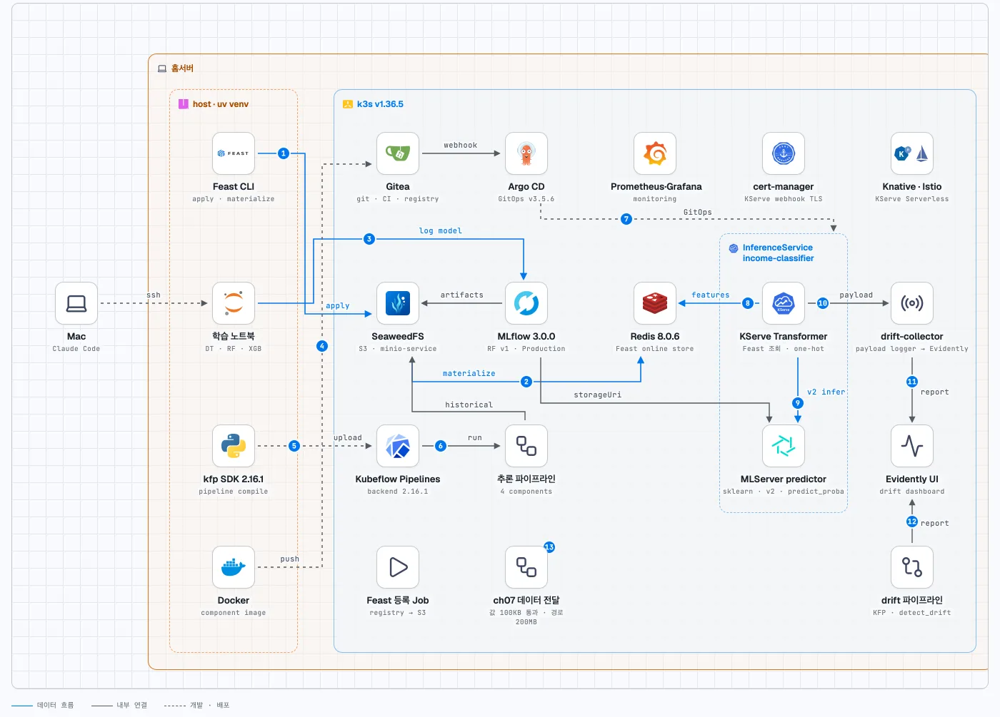
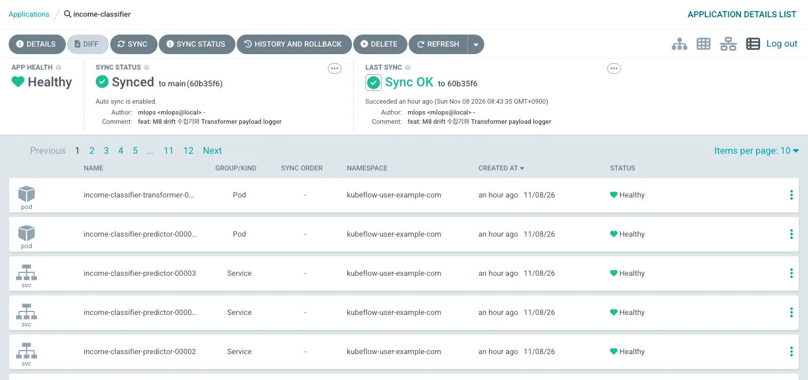
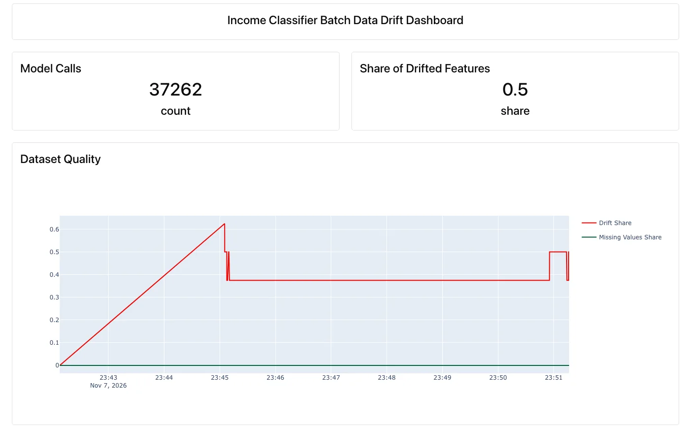
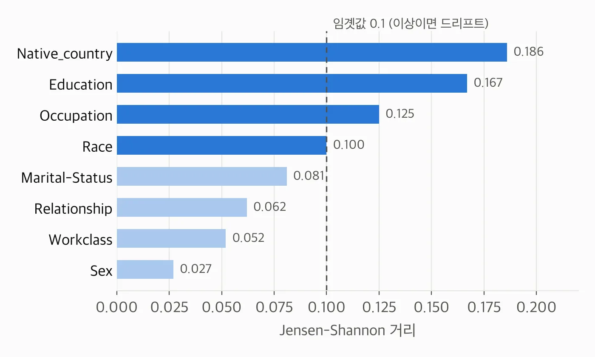

<nav id="manual-toc" class="manual-toc" aria-label="목차">

### 목차

**[1부. 실습 환경과 책과 다른 선택](#section-1)**

- [1.1 홈서버 k3s 위의 플랫폼 구성](#s1-1)
- [1.2 책과 다르게 간 네 가지](#s1-2)

**[2부. KServe로 모델 API 만들기](#section-2)**

- [2.1 런타임 호환 확인 - 1.7.2 모델과 1.5.2·1.7.0 런타임](#s2-1)
- [2.2 InferenceService - Transformer와 MLServer predictor](#s2-2)
- [2.3 책 InputMapper의 drop_first 버그 - 한 행이면 입력이 전부 0](#s2-3)
- [2.4 막힌 지점 다섯 가지](#s2-4)

**[3부. GitOps 배포 - Yatai 대신 Argo CD](#section-3)**

- [3.1 Gitea 저장소와 Argo CD 앱 - push 후 4초](#s3-1)

**[4부. 드리프트 모니터링](#section-4)**

- [4.1 Evidently UI - pandas 3에서 죽는 0.5.0](#s4-1)
- [4.2 KFP 드리프트 파이프라인과 참조 데이터의 출처](#s4-2)
- [4.3 실시간 드리프트 - payload logger와 수집기](#s4-3)
- [4.4 창 100에서도 0.375~0.625 - 같은 모집단의 드리프트 판정](#s4-4)
- [4.5 Grafana 대시보드와 메트릭 수집 지점](#s4-5)

**[5부. KFP 데이터 전달 실험](#section-5)**

- [5.1 KFP 2.16.1에서 다시 잰 값 전달 - 100KB 통과, 10MB는 3MiB 한도](#s5-1)
- [5.2 np.save의 확장자 - FileNotFoundError](#s5-2)

**[전체 흐름 정리](#section-6)** · **[출처](#section-7)**

</nav>

---

## 1부. 실습 환경과 책과 다른 선택

<a id="s1-1"></a>

### 1.1 홈서버 k3s 위의 플랫폼 구성

4·5장(2편)을 실습한 홈서버 k3s 클러스터에서 6·7장을 이어서 실행했습니다.

| 구성 요소 | 버전 | 역할 |
|-----------|------|------|
| k3s | v1.36.5 | 쿠버네티스 |
| Kubeflow (KCD) | 26.03.1, KFP 백엔드 2.16.1 | 파이프라인, 프로필 네임스페이스 |
| KServe | v0.18.0 (Serverless, Knative·Istio 1.30.1) | 모델 서빙 |
| MLflow | 3.0.0 | 실험 추적, 모델 레지스트리 |
| Feast | 0.40.1 (Redis 온라인 스토어) | 피처 스토어 |
| SeaweedFS | `minio-service` 별칭 | S3 호환 객체 저장소 |
| Evidently | 0.5.0 | 드리프트 리포트, 대시보드 |
| Argo CD · Gitea | v3.5.6 · 1.22.6 | GitOps, Git 저장소와 이미지 레지스트리 |

모델은 2편에서 Production으로 올린 `random-forest-classifier` v1입니다. 이 실습에서는 테스트 AUC가 0.853이었습니다.

<figure>
  
  <figcaption>실습 전체 구성도입니다. 파란 실선이 데이터 흐름, 검은 실선이 클러스터 안 연결, 점선이 개발·배포 경로이고, 번호는 아래 흐름 순서와 같습니다. 왼쪽 Mac은 노트북을 실행한 작업 단말입니다. (출처: 직접 작성한 구성도)</figcaption>
</figure>

화살표 번호 순서대로 보면 다음과 같습니다.

1. Feast CLI가 feature view 3개를 레지스트리에 등록하고 parquet 원본을 SeaweedFS에 둡니다(4장).
2. `feast materialize`가 최신 피처 30162행을 Redis 온라인 스토어에 씁니다(4장).
3. 학습 노트북이 모델 3개를 학습하고, 랜덤 포레스트를 MLflow에 Production으로 등록합니다(4장).
4. Docker가 컴포넌트 이미지를 빌드해 Gitea 레지스트리에 push합니다(5장).
5. kfp SDK 2.16.1이 파이프라인을 컴파일해 KFP에 올립니다(5장).
6. KFP가 추론 파이프라인(read → features → inference → write)을 실행합니다. 피처는 Feast의 historical 조회로 SeaweedFS의 오프라인 데이터에서 읽고, 30162행의 예측을 씁니다(5장).
7. Argo CD가 Gitea 저장소 `income-serving`의 InferenceService 매니페스트를 배포합니다(3부).
8. KServe Transformer가 `user_id`로 Redis에서 피처 8개를 읽고 원-핫으로 바꿉니다(2부).
9. Transformer가 MLServer predictor에 v2 요청을 보내 `predict_proba`를 받습니다. predictor는 `storageUri`로 MLflow 모델 폴더를 읽습니다(2부).
10. payload logger가 Transformer 요청을 drift-collector로 보냅니다(4.3절).
11. drift-collector가 100행 창이 찰 때마다 Evidently에 드리프트 리포트를 올립니다(4.3절).
12. KFP 드리프트 파이프라인이 배치 데이터의 드리프트 리포트를 Evidently에 올립니다(4.2절).
13. KFP 데이터 전달 실험에서 값 전달은 100KB까지 통과했고, 큰 데이터는 Artifact 경로로 200MB까지 넘겼습니다(5부).

1~6은 2편에서 만든 부분이고, 이 글은 7~13을 다룹니다.

<a id="s1-2"></a>

### 1.2 책과 다르게 간 네 가지

책의 도구를 그대로 쓰지 않은 곳이 네 군데 있습니다.

| 책 | 이 실습 | 비고 |
|----|---------|------|
| BentoML 서비스 | KServe InferenceService (Transformer + predictor) | 클러스터에 KServe v0.18.0이 이미 설치돼 있음 |
| Yatai 배포 | Argo CD GitOps | 3장에서 만든 Gitea → Argo CD 경로 재사용 |
| BentoML 안의 MonitoringService | KServe payload logger → 별도 수집기 | 서빙과 드리프트 계산을 분리 |
| Kubeflow Notebooks (7.1) | 생략 | 7.2 데이터 전달만 진행 |

나머지인 Evidently UI, KFP 드리프트 파이프라인, KFP 데이터 전달 실험은 책과 같은 구조로 돌렸습니다.

---

## 2부. KServe로 모델 API 만들기

<a id="s2-1"></a>

### 2.1 런타임 호환 확인 - 1.7.2 모델과 1.5.2·1.7.0 런타임

KServe는 모델 형식별 표준 런타임(ClusterServingRuntime)을 제공합니다. 모델은 scikit-learn 1.7.2로 저장했는데, 런타임 이미지 안의 버전을 직접 실행해 보니 둘 다 더 낮았습니다.

| ClusterServingRuntime | 이미지 | Python | scikit-learn |
|-----------------------|--------|--------|--------------|
| kserve-sklearnserver | kserve/sklearnserver:v0.18.0 | 3.11.15 | 1.5.2 |
| kserve-mlserver | seldonio/mlserver:1.7.1 | 3.10.12 | 1.7.0 |

두 이미지 안에서 `model.pkl`(약 39MB)을 열고 배치 파이프라인 결과 500행을 다시 예측했습니다. 둘 다 로드에 성공했고, 배치 결과와의 최대 차이는 0.0이었습니다.

다만 두 런타임 모두 `InconsistentVersionWarning`을 냈습니다. scikit-learn은 다른 버전에서 만든 pickle을 지원하지 않는다고 경고하므로, 이 결과는 이 RandomForest 모델에서만 확인한 것입니다. 운영이라면 학습과 런타임의 버전을 맞춰야 합니다.

커스텀 predictor 이미지 없이 표준 런타임으로 갈 수 있다는 결론을 얻었고, `predict_proba` 출력을 받을 수 있는 `kserve-mlserver`를 골랐습니다.

<a id="s2-2"></a>

### 2.2 InferenceService - Transformer와 MLServer predictor

책의 BentoML 서비스는 Feast 조회, 원-핫 변환, 예측을 한 프로세스에서 합니다. KServe에서는 이 일을 두 컴포넌트로 나눕니다.

```
POST /v1/models/income-classifier:predict  {"instances": [{"user_id": "..."}]}
        │
        ▼
Transformer (직접 만든 이미지)
  preprocess : Feast 온라인 조회 → 원-핫 → 학습 열 순서로 맞춤 → v2 요청
        │                                      (outputs = predict_proba)
        ▼
Predictor (kserve-mlserver, 표준 런타임)
  storageUri : MLflow Production 모델의 아티팩트 폴더
        │
        ▼
Transformer
  postprocess: {"user_id", "income_probability", "income_category"}
```

predictor는 MLflow 레지스트리의 Production 모델 폴더를 `storageUri`로 직접 가리킵니다. Yatai처럼 모델을 다른 저장소로 옮기지 않고, MLflow 레지스트리를 모델의 정본으로 둔 셈입니다.

```yaml
spec:
  predictor:
    serviceAccountName: kserve-s3-sa
    model:
      modelFormat: {name: sklearn}
      runtime: kserve-mlserver
      protocolVersion: v2
      storageUri: s3://mlflow-artifacts/2/models/<model_id>/artifacts
  transformer:
    containers:
    - name: kserve-container
      image: <gitea-registry>/mlops/income-transformer@sha256:...
      args: ["--predictor_protocol", "v2"]
```

S3 접근은 ServiceAccount에 연결한 Secret으로 합니다. Secret에는 `serving.kserve.io/s3-endpoint`와 `serving.kserve.io/s3-usehttps: "0"` 어노테이션을 붙여 SeaweedFS를 가리킵니다.

Transformer의 `load()`는 책 `on_startup`과 같은 일을 합니다. Feast 스토어를 열고, Production 실행의 `column_list.pkl`을 객체 저장소에서 읽어 학습 열 목록을 들고 있습니다.

```python
def load(self) -> bool:
    self.store = FeatureStore(repo_path=os.environ.get("FEAST_REPO", "/app/feast"))
    s3 = boto3.client("s3", endpoint_url=os.environ["AWS_ENDPOINT_URL"])
    body = s3.get_object(Bucket=os.environ["COLUMN_LIST_BUCKET"],
                         Key=os.environ["COLUMN_LIST_KEY"])["Body"].read()
    self.col_list = pickle.loads(body)
    self.ready = True
    return self.ready
```

열 목록의 위치는 환경 변수 `COLUMN_LIST_KEY`로 받으므로, 모델 버전을 바꾸면 이 값도 함께 바꿔야 합니다. 동시에 들어온 요청의 `user_id`가 섞이지 않도록, preprocess에서 요청 ID별로 `user_id` 목록을 저장해 두고 postprocess에서 꺼내 응답에 붙입니다.

검증 결과는 다음과 같습니다.

- **predictor 단독** - 500행을 넣어 배치 결과와 비교했고 최대 차이는 0.0입니다.
- **Transformer부터 끝까지** - 사용자 20명을 넣어 로컬 모델 예측과 비교했고 최대 차이는 0.0, 응답은 약 40ms입니다.
- **없는 user_id** - Feast에 피처가 없으면 Transformer가 400을 돌려줍니다.

세 결과가 맞아 이 구성을 그대로 GitOps 저장소에 올렸습니다(3부).

<a id="s2-3"></a>

### 2.3 책 InputMapper의 drop_first 버그 - 한 행이면 입력이 전부 0

옮기는 중에 책 코드의 버그를 하나 찾았습니다. 책의 `InputMapper`는 피처 데이터프레임을 `pd.get_dummies(..., drop_first=True)`로 원-핫 변환한 뒤 학습 열 목록에 맞춥니다.

`drop_first=True`는 범주형 컬럼마다 첫 번째 범주의 더미 열을 지웁니다. 요청마다 따로 인코딩하면 학습 때와 다른 범주가 지워질 수 있고, API 요청처럼 한 행만 들어오면 문제가 극단으로 드러납니다. 한 행에서는 컬럼마다 범주가 하나뿐이라 그 하나가 지워지고, 학습 열에 맞추면 입력이 전부 0이 됩니다.

```
한 행 입력   Sex=Male, Race=White, ...   (컬럼마다 범주 1개)
drop_first   컬럼마다 첫 범주 삭제 → 남는 더미 열 0개
reindex      학습 열 90개를 0으로 채움 → 모든 사용자가 같은 입력
```

실측으로도 확인했습니다. 책 방식은 남는 더미 열이 0개였고, 수정 후에는 7개가 1로 켜졌습니다. 책 방식대로면 모든 사용자가 같은 예측을 받습니다.

수정은 `drop_first`를 빼고 학습 열 목록으로 `reindex`하는 것입니다. 학습 때 빠진 기준 범주는 학습 열 목록에 없으므로 `reindex`가 알아서 버립니다.

```python
x = (pd.get_dummies(feats.drop(columns=["user_id"]), dtype=float)
       .reindex(columns=self.col_list, fill_value=0.0))
```

<a id="s2-4"></a>

### 2.4 막힌 지점 다섯 가지

InferenceService가 응답하기까지 다섯 군데에서 막혔습니다.

- **kserve SDK와 Feast의 protobuf 충돌**
  - kserve SDK 0.18은 protobuf 6을, Feast 0.40.1은 protobuf 4를 요구합니다.
  - Transformer 이미지의 kserve SDK를 0.15.2로 낮췄습니다. 컨트롤러 0.18과 프로토콜이 같아 동작했습니다. pyarrow는 20.0.0으로 고정했습니다.
- **Knative의 이미지 digest 조회**
  - Knative는 이미지 태그를 HTTPS로 조회해 digest로 바꿉니다. HTTP로만 열린 Gitea 레지스트리에서는 이 조회가 실패합니다.
  - Transformer 이미지를 태그 대신 `@sha256:...` digest로 적었습니다.
- **프로필 네임스페이스의 AuthorizationPolicy**
  - Kubeflow 프로필 네임스페이스의 `ns-owner-access-istio`는 같은 네임스페이스와 ingress만 허용해서, Knative 경로를 거치는 호출을 막습니다.
  - ISVC 파드에만 `knative-serving`·`istio-system` 출처를 허용하는 AuthorizationPolicy를 더했습니다. Istio의 selector는 `matchLabels`만 받습니다.
- **activator 경유 호출의 503**
  - Transformer에서 predictor로 가는 호출이 Knative activator에서 `503 UF`(connection refused)로 실패했습니다. 원인은 확인하지 못했습니다.
  - `autoscaling.knative.dev/min-scale: "1"`과 `target-burst-capacity: "0"`으로 activator를 요청 경로에서 빼서 해결했습니다.
- **MLServer의 메트릭 폴더**
  - MLServer는 시작 폴더에 `.metrics`를 씁니다. 읽기 전용 볼륨에서 로컬로 시험할 때는 `MLSERVER_METRICS_DIR`를 따로 줍니다.

다섯 가지 중 activator 503만 원인을 모른 채 우회했고, 나머지는 원인을 확인하고 고쳤습니다.

---

## 3부. GitOps 배포 - Yatai 대신 Argo CD

<a id="s3-1"></a>

### 3.1 Gitea 저장소와 Argo CD 앱 - push 후 4초

책은 Yatai UI에서 배포를 만들지만, 이 실습은 매니페스트를 Git에 두고 Argo CD가 클러스터에 맞추게 했습니다. 3장에서 만든 Gitea → Argo CD 경로를 그대로 씁니다.

```
Gitea 저장소 mlops/income-serving
  income-classifier/   sa.yaml, isvc-income.yaml, authz-kserve.yaml
  evidently/           evidently-ui.yaml, drift-collector.yaml
        │ push → Gitea 웹훅
        ▼
Argo CD 앱 income-classifier, evidently   (automated prune·selfHeal)
        │
        ▼
클러스터
```

Secret 세 개는 값이 들어 있어 저장소에 두지 않고 클러스터에 따로 만들었습니다. Argo CD 앱의 `repoURL`은 Gitea의 ROOT_URL과 같은 주소로 맞췄습니다. 웹훅 payload의 저장소 주소와 앱의 `repoURL`이 다르면 Argo CD가 이벤트를 받고도 무시하기 때문입니다(3장에서 겪은 문제).

ISVC에 레이블 하나를 추가해 push했더니 4초 만에 클러스터에 반영되고 앱이 Synced가 됐습니다. 레이블만 바꿔도 Knative가 새 revision을 만들어 파드가 교체됐고, 교체가 끝난 뒤 호출은 200이었습니다.

Argo CD는 InferenceService의 health를 표시하지 않았습니다(빈 값). ISVC가 준비됐는지는 `kubectl get isvc`로 따로 확인합니다.

<figure>
  
  <figcaption>Argo CD의 <code>income-classifier</code> 앱입니다. 앱은 Synced·Healthy이고 마지막 동기화는 4부의 payload logger를 추가한 커밋입니다. 목록의 Pod와 Service는 Healthy로 보이지만, 이 화면에서 InferenceService 자체의 준비 상태는 알 수 없어 <code>kubectl get isvc</code>로 따로 확인했습니다. (출처: 직접 실습한 클러스터 화면)</figcaption>
</figure>

---

## 4부. 드리프트 모니터링

<a id="s4-1"></a>

### 4.1 Evidently UI - pandas 3에서 죽는 0.5.0

Evidently UI 0.5.0을 이미지로 만들 때 버전을 직접 고정해야 했습니다.

```dockerfile
FROM python:3.11-slim-bookworm
RUN pip install --no-cache-dir evidently==0.5.0 litestar==2.12.1 sniffio \
    pandas==2.2.3 numpy==1.26.4
```

pandas를 고정하지 않으면 pandas 3이 설치되고, 0.5.0이 쓰는 내부 함수가 없어 `infer_dtype_from_object` ImportError로 죽습니다. litestar와 sniffio도 0.5.0이 고정하지 않아 직접 맞췄습니다.

배포는 GitOps 저장소의 `evidently/`(Namespace, PVC 1Gi, Deployment, Service)로 했습니다. 책의 `build_evidently_dashboard.py`로 `income-classifier` 프로젝트와 패널 12개를 만들었습니다.

같은 태그로 이미지를 다시 올리면 노드가 캐시된 이미지를 그대로 써서 새 이미지를 받지 않았습니다. 태그를 `0.5.0-r2`로 바꿔 Git으로 반영했습니다. selfHeal이 켜진 앱에 `kubectl rollout restart`를 하면 Argo CD가 되돌릴 수 있으므로, 바꿀 것은 Git으로 바꿉니다.

<a id="s4-2"></a>

### 4.2 KFP 드리프트 파이프라인과 참조 데이터의 출처

책의 5단계 파이프라인(fetch → retrieve_features → detect_drift → run_inference → write)을 그대로 옮겼습니다. 컴포넌트 이미지는 하나로 합쳐 2편의 bookworm 이미지에 evidently 0.5.0, mlflow 3.0.0(책은 2.7.0), scikit-learn 1.7.2를 더했습니다.

kfp 2.16.1로 컴파일한 run `ch06-drift-1`은 SUCCEEDED였습니다.

- **추론 결과** - `inference-datasets/income_predictions_with_drift.parquet`, 30162행 × 91열입니다. 예측 확률 0.5 이상이 21.8%로 2편 배치 결과와 같습니다.
- **드리프트** - Evidently 프로젝트에 리포트 1건이 올라갔고, 드리프트 컬럼 비율은 0.0이었습니다. 현재 데이터가 참조 데이터와 같은 30162행이라 분포가 같으니 0.0이 맞습니다.
- **분기** - 책 그대로 `.after`만 쓰므로 드리프트 결과와 상관없이 추론이 진행됩니다. 분기하려면 `dsl.If`가 필요합니다(3편 3.4절).

3편 3.4절에서 본 대로, 저자 노트북의 랜덤 포레스트 셀은 `reference_features` 데이터셋의 source에 테스트 파일 경로를 적습니다. 그런데 `detect_drift`가 실제로 받은 파일은 원래 피처 파일 `feature_df-523942a8….csv`(피처 8열)였습니다.

```
결정 트리 셀      feature_df → source = feature_df 경로   (먼저 기록)
랜덤 포레스트 셀  feature_df → source = test 경로         (버그)
                  └ 이름(기본값)과 내용 해시(digest)가 같은 데이터셋
MLflow            같은 데이터셋으로 묶어 먼저 기록된 source를 유지
결과              detect_drift는 원래 피처 파일을 받음 → 버그가 드러나지 않음
```

MLflow는 이름과 digest가 같은 데이터셋을 하나로 묶고 먼저 기록된 source를 유지합니다. 노트북은 두 셀 모두 이름 없이 `from_pandas`를 부르므로 이름이 같고, 노트북을 처음부터 순서대로 돌려 결정 트리 셀이 먼저 기록했습니다.

그래서 이 환경에서는 잘못된 source가 드러나지 않았습니다. 기존 기록이 없는 환경에서는 잘못된 source가 그대로 등록될 수 있으므로 랜덤 포레스트 셀의 source를 `feature_df_path`로 고쳐 두어야 합니다.

<a id="s4-3"></a>

### 4.3 실시간 드리프트 - payload logger와 수집기

책은 BentoML 서비스 안의 `MonitoringService`가 요청을 모아 리포트를 만듭니다. KServe에서는 서빙 파드에 드리프트 계산을 넣지 않고, 요청을 밖으로 흘려 별도 수집기가 계산하게 했습니다.

```
클라이언트 → Transformer ── logger: {mode: request} ──→ KServe agent
                                                          │ CloudEvents
                                                          ▼
                                  drift-collector (evidently 네임스페이스)
                                    user_id로 Feast 원 피처를 다시 조회
                                    창 100행을 채우면 리포트 생성
                                          │
                                          ▼
                                  Evidently UI 프로젝트 income-classifier
```

Transformer에 `logger: {mode: request, url: http://drift-collector...}`를 달면, KServe agent가 요청 본문을 CloudEvents로 수집기에 보냅니다. 요청에는 `user_id`만 있으므로 수집기가 Feast에서 원 피처 8개를 다시 읽어 창에 쌓습니다. 창의 동작은 책 `MonitoringService`와 같습니다.

수집기는 Feast와 SeaweedFS에 접근해야 해서 Secret 두 개를 evidently 네임스페이스에 복사했고, SeaweedFS가 있는 kubeflow 네임스페이스에 evidently 네임스페이스의 접근을 허용하는 NetworkPolicy를 하나 더 만들었습니다.

payload logger는 Transformer 파드의 queue-proxy(8012)를 지나는 요청만 기록합니다. 컨테이너 포트 8080으로 바로 보내면 agent를 건너뛰어 기록이 남지 않습니다.

<a id="s4-4"></a>

### 4.4 창 100에서도 0.375~0.625 - 같은 모집단의 드리프트 판정

요청 120건과 50건을 보냈고 모두 200이었습니다. 창 100이 찬 뒤부터 요청마다 리포트를 만들어 수집기 로그에 "Running report"가 71회 찍혔고, Evidently에도 실시간 리포트 71건이 쌓였습니다.

Evidently API로 71건의 `share_of_drifted_columns`를 집계하면 0.5가 53건, 0.375가 17건, 0.625가 1건입니다. 요청은 학습 데이터와 같은 모집단에서 무작위로 뽑은 사용자인데도 피처 8개 중 3~5개가 드리프트로 판정됐습니다.

데이터셋 판정 조건이 "0.5 이상"이므로(3편 3.2절), 71건 중 54건이 데이터셋 전체 드리프트로 판정됐습니다.

<figure>
  
  <figcaption>배치와 실시간 리포트가 함께 쌓인 대시보드입니다. Model Calls 37262는 KFP 드리프트 파이프라인의 30162행에 실시간 리포트 71회 × 창 100행을 더한 값입니다. 최근 값 패널(<code>CounterAgg.LAST</code>)은 마지막 실시간 리포트의 0.5를 보여 주고, 선 그래프는 첫 점 0.0(배치 리포트) 뒤로 실시간 리포트가 0.625에서 시작해 0.375와 0.5 사이를 오갑니다. (출처: 직접 실습한 클러스터 화면)</figcaption>
</figure>

마지막 실시간 리포트를 열어 컬럼별 결과를 확인했습니다. 피처 8개 모두 Jensen-Shannon 거리로 판정됐고, 임곗값 0.1 이상인 4개가 드리프트였습니다.

<figure>
  
  <figcaption>마지막 실시간 리포트(창 100행)의 컬럼별 드리프트 점수입니다. 3편 3.2절의 기본 선택대로 범주형 8개 모두 Jensen-Shannon 거리가 쓰였고, 0.5.0은 거리가 0.1 이상이면 드리프트로 판정합니다. 화면에 0.1로 표시된 Race도 드리프트여서 8개 중 4개, 즉 0.5가 데이터셋 임곗값에 닿았고, 그래프에는 화면 표시값을 그대로 썼습니다. (출처: Evidently 리포트 값을 직접 그린 그래프)</figcaption>
</figure>

책은 창 50에서 0.875가 나온 것을 표본 크기 탓일 수 있다고 봤습니다. 창을 100으로 키우자 비율은 대부분 0.375~0.5로 내려갔지만, 여전히 데이터셋 임곗값 0.5에 닿는 리포트가 나왔습니다.

점수가 높은 `Native_country`와 `Education`은 범주가 많은 컬럼이라, 100행 안에서 희귀 범주의 비율이 흔들렸을 가능성이 있습니다. 다만 이번 기록은 리포트 하나의 컬럼별 값이라 원인을 확정하지는 못했습니다.

경보로 쓰려면 창 크기와 임곗값을 바꿔 가며 같은 모집단의 요청으로 경보 빈도를 비교한 뒤 조건을 정해야 합니다. 연속으로 넘을 때만 알리는 규칙도 후보입니다.

<a id="s4-5"></a>

### 4.5 Grafana 대시보드와 메트릭 수집 지점

운영 지표는 Grafana 대시보드 "ML Study - income-classifier (KServe)"로 봅니다. 패널은 요청 수, 단계별(preprocess·predict·postprocess) p95 지연, 누적 요청 수입니다.

메트릭을 긁을 수 있는 지점은 네 곳을 시험했습니다.

| 후보 | 결과 |
|------|------|
| Istio 표준 메트릭 `istio_requests_total` | 이 클러스터에서 생성되지 않음 |
| queue-proxy 9091 | 사이드카를 거치며 503 |
| MLServer 8082 `/metrics` | 호스트에서는 응답하지만 PodMonitor 대상에 잡히지 않음(원인 미확인) |
| Transformer(KServe Python 서버) 8080 `/metrics` | 수집 성공 |

결국 PodMonitor `kserve-isvc`가 Transformer의 8080 `/metrics`를 긁도록 했습니다. 단계별 지연이 Transformer 서버의 지표에 들어 있어서 대시보드 패널은 이것으로 채웠습니다.

---

## 5부. KFP 데이터 전달 실험

<a id="s5-1"></a>

### 5.1 KFP 2.16.1에서 다시 잰 값 전달 - 100KB 통과, 10MB는 3MiB 한도

3편 5.2절의 값 전달과 경로 전달을 이 클러스터에서 실험했습니다. 스터디 자료의 실험(KFP 2.4.1, SDK 2.9.0)과 같은 코드로, `size_kb × 1,024`바이트 문자열을 반환값과 아티팩트 파일로 각각 넘겼습니다.

```python
@dsl.component
def make_value(size_kb: int) -> str:
    return "x" * (size_kb * 1024)

@dsl.component
def make_file(size_kb: int, out: Output[Artifact]):
    with open(out.path, "w") as f:
        f.write("x" * (size_kb * 1024))
```

| 전달 방식 · size_kb | KFP 2.16.1 (이 실습) | KFP 2.4.1 (스터디 자료) |
|---------------------|----------------------|-------------------------|
| 값 · 10, 60 | 성공 | 성공 |
| 값 · 100 | **성공** | 실패 - argument list too long |
| 값 · 1,000 | 실패 - Argo가 템플릿을 ConfigMap으로 옮기려다 권한 오류 | 실패 - annotations 262,144바이트 초과 |
| 값 · 10,000 | 실패 - `Request entity too large: limit is 3145728` | 실패 - MLMD gRPC 4MB 한도 |
| 경로 · 10,000, 200,000 | 성공 | 성공 |

큰 데이터는 값이 아니라 경로로 넘긴다는 결론은 같고, 달라진 것은 한도 지점과 메시지입니다.

1MB 실패는 KFP 화면에 메시지가 남지 않아 workflow-controller 로그로 원인을 찾았습니다.

```
Argo는 단계 템플릿(입력값 포함)을 init 컨테이너 환경 변수 ARGO_TEMPLATE에 넣음
  ├─ 템플릿이 128KiB(131,072바이트) 이하 → 환경 변수로 전달 → 100KB 값 통과
  └─ 초과 → 파드 이름의 ConfigMap으로 옮겨(offload) 마운트
            └─ kubeflow:argo 서비스 계정에 사용자 네임스페이스의
               ConfigMap 생성 권한 없음 → 드라이버가 Pending에서 멈춤 → 1MB 값 실패
```

100KB(102,400자)가 통과한 것도 같은 기준 때문입니다. 템플릿을 합쳐도 128KiB 아래라 환경 변수로 넘어갔습니다.

권한을 줘도 다음 한도는 ConfigMap의 데이터 합계 1MiB(1,048,576바이트)입니다. 서버 측 dry-run에서 1,000KB는 허용되고 1,100KB는 거부됐으므로, 1MB 값(1,024,000바이트)은 템플릿 몫을 더하면 경계에 걸립니다. 권한을 주고 다시 돌리지는 않았습니다.

10MB 값은 use-value 드라이버가 쿠버네티스 API 서버에 객체를 쓰는 단계에서 API 서버의 요청 본문 한도 3MiB(3,145,728바이트)에 막혔습니다.

값 전달은 파드 환경 변수, ConfigMap, API 요청처럼 크기 한도가 있는 관리 경로를 지나고, 그 지점은 백엔드 버전과 클러스터 권한에 따라 달라집니다. 경로 전달은 데이터 본문을 객체 저장소에 두고 짧은 URI만 이 경로로 보내므로 200MB도 통과했습니다.

아티팩트는 SeaweedFS `mlpipeline` 버킷의 사용자별 접두사 `private-artifacts/<네임스페이스>/` 아래에 저장됐습니다. 멀티유저 KFP에서는 실행도 SA 토큰으로 사용자 네임스페이스에 제출했습니다.

kfp 2.16.1의 기본 `base_image`는 `python:3.11`이었습니다(스터디 자료의 SDK 2.9.0은 `python:3.8`). 2027-10-01부터 3.12로 바뀐다는 경고도 나왔습니다.

<a id="s5-2"></a>

### 5.2 np.save의 확장자 - FileNotFoundError

NumPy 배열을 경로로 넘기는 실험은 스터디 자료의 A3 항목을 재현한 것입니다. 자료에 코드가 없어 `np.save(out.path, arr)`로 직접 다시 썼고, 이 방식은 실패했습니다.

```python
np.save(out.path, arr)      # 실제 파일은 out.path + ".npy"
```

`np.save`는 경로가 `.npy`로 끝나지 않으면 확장자를 붙여 저장합니다. 런처는 원래 경로 `.../out`에서 파일을 찾으므로 다음 단계가 `FileNotFoundError`로 실패했습니다.

파일 핸들을 열어 넘기면 확장자가 붙지 않습니다. 이 수정본에는 아티팩트 메타데이터도 함께 남겼습니다.

```python
with open(out.path, "wb") as f:
    np.save(f, arr)
out.metadata["samples"] = int(arr.shape[0])
out.metadata["shape"] = list(arr.shape)
```

수정본은 성공했고, 다음 단계가 `samples=3`, `shape=[3, 4]` 메타데이터를 그대로 받았습니다.

---

## 전체 흐름 정리

```
      홈서버 k3s v1.36.5 · KCD 26.03.1(KFP 2.16.1) · KServe v0.18.0 · MLflow 3.0.0 · Feast 0.40.1
              │
              ▼
[1부] 책과 다르게 간 곳
      BentoML → KServe, Yatai → Argo CD, MonitoringService → payload logger + 수집기, Notebooks 생략
              │
              ▼
[2부] KServe 서빙
      sklearn 1.7.2 모델 → MLServer(1.7.0)·sklearnserver(1.5.2) 모두 로드, 차이 0.0, 경고만
      Transformer(Feast·원-핫) + MLServer predictor(storageUri = MLflow 모델 폴더)
      책 InputMapper: 한 행 + drop_first → 입력 전부 0 → reindex로 수정
      protobuf 충돌 / digest 조회 / AuthorizationPolicy / activator 503 / .metrics
              │
              ▼
[3부] GitOps
      Gitea mlops/income-serving → 웹훅 → Argo CD 앱 → push 후 4초 반영
              │
              ▼
[4부] 드리프트
      Evidently 0.5.0은 pandas 2.2.3·numpy 1.26.4 고정
      KFP drift run SUCCEEDED, 이름·digest가 같은 첫 기록의 source 유지 → RF source 버그가 가려짐
      payload logger → 수집기(창 100) → 리포트 71건, drift 비율 0.375~0.625, 54건이 데이터셋 드리프트
      메트릭은 Transformer 8080 /metrics만 수집됨
              │
              ▼
[5부] KFP 데이터 전달
      2.16.1: 값 100KB 통과(값을 포함한 템플릿이 128KiB 아래라 환경 변수로 전달), 1MB는 ConfigMap 권한, 10MB는 API 서버 3MiB
      경로 200,000KiB 통과 / np.save(path)는 .npy를 붙임 → 파일 핸들로 저장
```

---

## 출처

- Benjamin Tan Wei Hao, Varun Mallya, Shanoop Padmanabhan, *Machine Learning Platform Engineering*, Manning, 6장 *Productionizing ML models*, 7장 *Data analysis and preparation*
- 예제 코드 - [practical-mlops/chapter-4](https://github.com/practical-mlops/chapter-4), [practical-mlops/chapter-6](https://github.com/practical-mlops/chapter-6)
- CloudNet@ ML 플랫폼 엔지니어링 스터디 6·7장 정리 자료 - 비교 기준으로 쓴 KFP 2.4.1 실험 결과
- KServe 문서 - [kserve.github.io](https://kserve.github.io/website/)
- Evidently 문서 - [docs.evidentlyai.com](https://docs.evidentlyai.com/)
