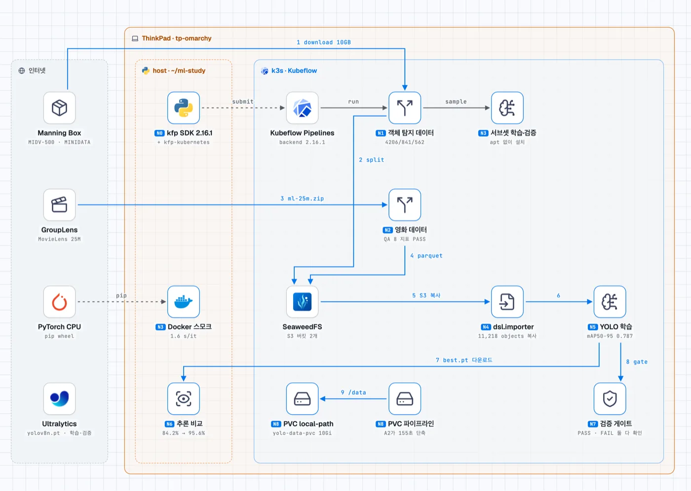
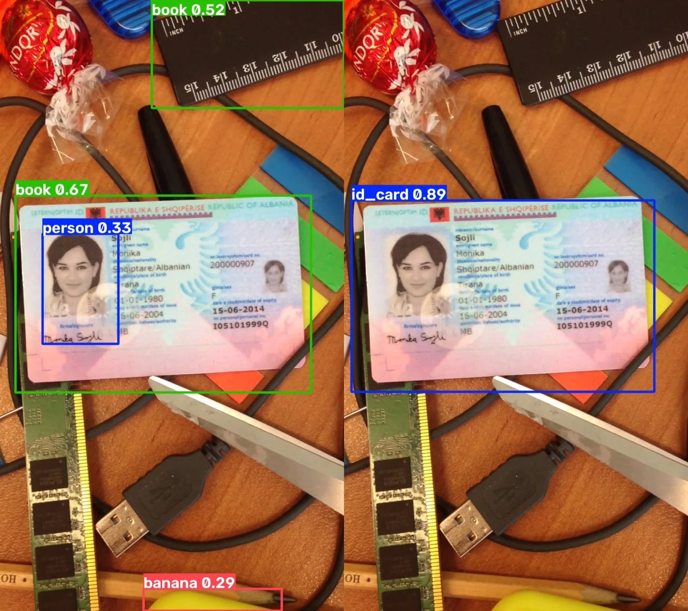

<nav id="manual-toc" class="manual-toc" aria-label="목차">

### 목차

**[1부. 실습 환경과 비교 기준](#section-1)**

- [1.1 같은 클러스터에 더한 실습 흐름 아홉 개](#s1-1)
- [1.2 스터디 실습 환경과 다른 곳 - 멀티유저, 8코어, KFP 2.16.1](#s1-2)

**[2부. 데이터 준비 파이프라인](#section-2)**

- [2.1 객체 탐지 데이터 - 10,279,296,832바이트를 경로로 넘기기](#s2-1)
- [2.2 SeaweedFS 볼륨 한도 - 4.00에서는 364개로 자동 계산](#s2-2)
- [2.3 영화 추천 데이터 - Parquet와 QA 지표 8개](#s2-3)
- [2.4 datasets 버킷과 프로필 키 - Secret을 환경 변수로](#s2-4)

**[3부. YOLO 학습 컴포넌트](#section-3)**

- [3.1 container component가 필요한 이유](#s3-1)
- [3.2 파드 안에서 실패하는 apt-get - capabilities drop ALL](#s3-2)
- [3.3 && 목록과 set -e](#s3-3)
- [3.4 CPU request와 limit - 예약 여유 3,048m](#s3-4)
- [3.5 dsl.importer 고정 경로 - 객체 11,218개, 1분 49초](#s3-5)
- [3.6 1 epoch 학습 결과 - val mAP50-95 0.787](#s3-6)

**[4부. 학습한 모델 검증](#section-4)**

- [4.1 학습 전후 추론 비교 - IoU 0.5 적중 84.2%에서 95.6%로](#s4-1)
- [4.2 검증 게이트 - 검사 6개와 통과·실패 run](#s4-2)

**[5부. PVC로 데이터 공유](#section-5)**

- [5.1 kfp-kubernetes의 PVC 함수 세 개](#s5-1)
- [5.2 DeletePVC 뒤 Terminating에 멈춘 PVC](#s5-2)
- [5.3 KFP 2.16.1 CreatePVC의 고정 이름 충돌](#s5-3)
- [5.4 MINIDATA의 ._ 파일 - 1,142쌍에서 571쌍으로](#s5-4)
- [5.5 A1 537초와 A2 382초 - importer 방식과 비교](#s5-5)
- [5.6 다운로드 중 멈춘 노드와 CPU 97°C](#s5-6)

**[전체 흐름 정리](#section-6)** · **[출처](#section-7)**

</nav>

---

## 1부. 실습 환경과 비교 기준

<a id="s1-1"></a>

### 1.1 같은 클러스터에 더한 실습 흐름 아홉 개

4편에서 KServe 서빙과 드리프트 모니터링을 올린 홈서버 k3s 클러스터에 책 7.3절부터 9.1절까지를 더했습니다. 기존 InferenceService와 Argo CD 앱은 그대로 두고, KFP 파이프라인과 PVC만 새로 만들었습니다.

<figure>
  
  <figcaption>이번 실습의 구성도입니다. 파란 실선이 데이터 흐름이고, 번호는 아래 목록과 같습니다. 모든 단계를 마친 상태라 단계 타일에 파란 테두리가 있습니다. (출처: 직접 작성한 구성도)</figcaption>
</figure>

화살표 번호 순서대로 보면 다음과 같습니다.

1. `download_dataset`이 Manning Box에서 신분증 데이터셋 FULL을 받아 풉니다(2.1절).
2. `split_dataset`이 이미지와 라벨을 파일명으로 짝지어 75/15/10으로 나누고, 결과가 SeaweedFS에 올라갑니다(2.1절).
3. 영화 데이터 파이프라인이 GroupLens에서 `ml-25m.zip`을 받습니다(2.3절).
4. CSV를 Parquet으로 바꾸고 나눠서 `datasets/ml-25m/`에 올립니다(2.3절).
5. 1·2번 결과를 S3 서버 측 복사로 고정 경로에 둡니다(3.5절).
6. `dsl.importer`가 그 경로를 가져와 YOLOv8n 학습 컴포넌트에 넘깁니다(3.6절).
7. 학습한 `best.pt`를 호스트로 내려받아 Docker에서 기본 `yolov8n.pt`와 비교합니다. KFP 파이프라인이 아닙니다(4.1절).
8. 검증 게이트가 `best.pt`를 검사해 run을 통과시키거나 실패시킵니다(4.2절).
9. PVC 파이프라인이 MINIDATA를 PVC `/data`에 받고, 모든 태스크가 같은 PVC를 마운트합니다(5부).

<a id="s1-2"></a>

### 1.2 스터디 실습 환경과 다른 곳 - 멀티유저, 8코어, KFP 2.16.1

이 글의 비교 기준은 CloudNet@ 스터디 자료에 실린 실습 로그입니다. 같은 책 코드를 돌렸지만 환경이 꽤 다릅니다.

- **스터디 실습** - 스터디 자료에 실린 실습 로그입니다.
  - kind 클러스터 `book-env`, KFP 2.4.1 단독 설치(단일 사용자), SDK `kfp==2.9.0`
  - CPU 16코어, 메모리 14GiB, SeaweedFS 3.85, StorageClass `standard`
- **이 실습** - 홈서버 노트북 한 대의 k3s v1.36.5입니다.
  - KCD 26.03.1(KFP 2.16.1, 멀티유저 프로필 네임스페이스), SDK `kfp==2.16.1`과 `kfp-kubernetes==2.16.1`
  - CPU 8코어, 메모리 30GiB, SeaweedFS 4.00, StorageClass `local-path`

이 차이 가운데 실습 결과를 바꾼 것은 세 가지였습니다.

- **멀티유저 Kubeflow**
  - run은 프로필 네임스페이스 `kubeflow-user-example-com`에서 돌고, 그 네임스페이스는 Pod Security `baseline`입니다(3.2절).
  - 제출은 `default-editor` 서비스 계정 토큰으로 합니다. 토큰 없이 `kfp.Client(host=...)`만 쓰는 스터디 코드는 그대로 쓸 수 없습니다.
- **KFP 2.16.1**
  - `CreatePVC`가 같은 이름을 만나면 실패합니다(5.3절). 2.4.1은 기존 PVC를 그대로 썼습니다.
- **8코어**
  - 노드 예약 여유가 약 3 CPU라 학습 파드에 request와 limit을 따로 줘야 했습니다(3.4절).

나머지 숫자는 대부분 스터디 실습과 같게 나왔습니다.

---

## 2부. 데이터 준비 파이프라인

<a id="s2-1"></a>

### 2.1 객체 탐지 데이터 - 10,279,296,832바이트를 경로로 넘기기

7.3.1절의 파이프라인은 컴포넌트 세 개입니다.

```
download_dataset ──▶ split_dataset ──▶ output_file_contents
 (Manning Box .gz)    (75/15/10)         (validation 5개 출력 + 짝 검사)
```

데이터는 MIDV-500 계열 신분증 사진과 YOLO 라벨입니다. 라벨 한 줄은 `0 0.475926 0.476042 0.772222 0.282292`처럼 클래스 번호와 정규화한 박스 중심·너비·높이입니다. YOLO는 `images/CA01_01.tif`의 라벨을 `labels/CA01_01.txt`에서 찾기 때문에, 분할할 때 이 이름 짝이 깨지면 안 됩니다.

책 코드를 그대로 돌리면 실패합니다. 스터디 실습에서 찾은 수정 다섯 개를 같이 적용했습니다.

- **`BASE_PATH = "MINIDATA"` → `"DATA"`**
  - FULL tar의 최상위 폴더는 `DATA`입니다. `MINIDATA`로 두면 glob이 빈 목록을 돌려주고 `train_test_split`이 `ValueError`를 냅니다.
- **이미지와 라벨을 파일명(stem)으로 짝지은 뒤 정렬해서 분할**
  - 책은 두 목록을 따로 glob해서 나눕니다. 순서가 어긋나면 짝이 틀어질 수 있습니다.
- **다운로드 `chunk_size` 1KiB → 1MiB, `tqdm(mininterval=30)`**
  - 1KiB면 10GB에 약 1,000만 번 반복하고 진행 로그가 쏟아집니다.
- **책 Listing 7.23의 출력 이름 `x_val_output` → `validation_dataset`**
  - 실제 출력 이름과 달라 컴파일 오류가 납니다.
- **확인 컴포넌트는 `validation_dataset`만 받음**

결과는 다음과 같습니다(run `od-dataprep-1114`).

| 단계 | 값 |
|------|-----|
| 다운로드 | 10,279,296,832바이트, 7분 16초(23.5MB/s) |
| 압축 해제 | 파일 11,218개, 최상위 `DATA` |
| 짝 맞춤 | 이미지 5,609 · 라벨 5,609 · 짝 5,609 · 짝 없는 파일 0 |
| 분할 | train 4,206 / val 841 / test 562 |
| 확인 | validation 이미지 841 · 라벨 841 · 짝 불일치 0 |

숫자는 스터디 실습과 모두 같습니다. 분할 간 중복이 없다는 점은 `split_dataset` 안의 `assert`로 확인했습니다.

컴포넌트는 `Output[Dataset]`의 로컬 경로(`/minio/mlpipeline/private-artifacts/.../download-dataset/<id>/output_dataset`)에 파일을 쓰기만 합니다. KFP 런처가 그 디렉터리를 SeaweedFS에 올리고, 다음 컴포넌트의 런처가 같은 경로로 내려받습니다.

4편 5.1절에서 잰 값 전달 한도(128KiB, 3MiB)와 관계없이 동작하는 이유가 이것입니다.

<a id="s2-2"></a>

### 2.2 SeaweedFS 볼륨 한도 - 4.00에서는 364개로 자동 계산

스터디 실습은 다운로드 결과를 올리다가 `status code: 500`으로 실패했습니다. Kubeflow의 `minio`가 실제로는 SeaweedFS 3.85였고, 기동 인자가 `-volume.max=100 -master.volumeSizeLimitMB=64`라 한도가 약 6.4GB였기 때문입니다. 원본과 분할본을 합치면 약 33.8GB가 필요해서, `-volume.max=1000`으로 올려 해결했습니다.

이 클러스터에서는 그 수정이 필요 없었습니다. 실행 전에 `weed shell`의 `volume.list`로 확인한 값은 다음과 같습니다.

```
Topology volumeSizeLimit:1024 MB hdd(volume:49/364 active:49 free:315)
```

SeaweedFS 4.00은 기동 인자에 `-volume.max`가 없으면 디스크 여유를 보고 볼륨 수를 정합니다. 여기서는 1GB 볼륨 364개, 약 364GB였습니다. 같은 "minio"라도 버전에 따라 한도가 6.4GB일 수도 364GB일 수도 있으니, 큰 데이터를 올리기 전에 `volume.list`를 한 번 보는 편이 낫습니다.

<a id="s2-3"></a>

### 2.3 영화 추천 데이터 - Parquet와 QA 지표 8개

7.3.2절은 MovieLens 25M을 9장의 추천 모델용으로 준비합니다. 컴포넌트는 여섯 종류이고, `csv_to_parquet`와 `put_to_minio`를 두 번씩 써서 태스크는 여덟 개입니다.

```
download ─▶ unzip ─┬▶ csv_to_parquet(ratings) ─▶ split ─▶ put_to_minio(u2) ─┐
                   └▶ csv_to_parquet(movies)  ──────────▶ put_to_minio(u1) ─┴▶ qa_data
```

원본 코드에서 두 곳을 고쳤습니다.

- **`split_dataset`의 `ratings_df.user_id.max()`, `item_id.max()` 삭제**
  - 실제 열 이름은 `userId`, `movieId`라 `AttributeError`가 납니다. 계산한 값도 쓰지 않습니다.
- **`except BucketAlreadyExists` → `except Exception`**
  - u1과 u2가 동시에 버킷을 만들려고 할 수 있습니다.

`qa_data`에는 스터디 자료의 옵션 과제대로 `Output[Metrics]`와 `Output[Markdown]`을 더했습니다. 이 QA는 movies 파일도 읽으므로 순서를 `.after(u1, u2)`로 바꿨습니다. 저장소 코드의 `.after(u2)`만 두면 movies 업로드가 끝나기 전에 QA가 시작될 수 있습니다.

결과는 다음과 같습니다(run `mr-dataprep-A-1114`).

| 지표 | 값 |
|------|-----|
| `ml-25m.zip` | 261,978,986바이트 |
| ratings | 25,000,095행, 열 `userId, movieId, rating, timestamp` |
| 분할 | train 18,750,071 / val 3,750,014 / test 2,500,010 |
| movies | 62,423행 |
| `train_ratio` | 0.75 |
| `rating_mean` | 3.5336 |

KFP UI의 Visualization 탭에 Metrics 표와 Markdown 리포트(PASS 세 줄)가 나옵니다. 값은 스터디 실습과 같습니다.

스터디 자료의 B안(`target_image`로 의존성을 이미지에 미리 굽는 방식)은 하지 않았습니다. 2026-11-08 스터디 강의(녹취 58:22~58:58)에서 강사가 내부 레지스트리가 없으면 번거로우니 굳이 하지 말라고 했고, 스터디 실습에서는 오히려 split이 약 4배 느려졌습니다. 이미지에 pyarrow와 fastparquet이 같이 들어가서 pandas가 pyarrow 엔진을 골랐기 때문입니다.

<a id="s2-4"></a>

### 2.4 datasets 버킷과 프로필 키 - Secret을 환경 변수로

`put_to_minio`와 `qa_data`는 KFP 아티팩트가 아니라 `datasets` 버킷에 직접 씁니다. 책 코드는 `minio`/`minio123`을 하드코딩합니다. 멀티유저 Kubeflow에서는 두 가지가 걸립니다.

- **사용자 네임스페이스의 `mlpipeline-minio-artifact` 키는 프로필 전용**
  - `mlpipeline` 버킷의 `private-artifacts/<네임스페이스>/` 아래만 쓸 수 있습니다. 다른 버킷은 403이 납니다(2편 실습에서 확인).
- **키를 코드에 쓰면 컴파일한 YAML과 KFP 기록에 남음**

그래서 관리자 키를 담은 Secret `feast-s3-cred`(4편에서 사용자 네임스페이스로 복사해 둔 것)를 `kfp-kubernetes`로 넣었습니다.

```python
kubernetes.use_secret_as_env(
    task, secret_name="feast-s3-cred",
    secret_key_to_env={"accesskey": "AWS_ACCESS_KEY_ID", "secretkey": "AWS_SECRET_ACCESS_KEY"})
```

boto3와 pyarrow는 `AWS_ACCESS_KEY_ID`, `AWS_SECRET_ACCESS_KEY`를 자동으로 읽습니다. 컴파일한 YAML에는 `secretKeyRef`만 남고 키 값은 남지 않습니다.

---

## 3부. YOLO 학습 컴포넌트

<a id="s3-1"></a>

### 3.1 container component가 필요한 이유

8장은 7.3.1절에서 나눈 데이터로 YOLOv8n을 학습합니다. 학습 코드 자체는 짧습니다.

```python
model = YOLO("yolov8n.pt")   # COCO로 미리 학습한 가중치에서 시작
model.train(data="data.yaml", imgsz=640, epochs=epochs, batch=batch,
            project=project_path, name="yolov8n_custom")
```

`data.yaml`에는 train·val·test 이미지 경로와 클래스 이름(`0: id_card`)이 들어갑니다. 책은 이 학습을 `@dsl.component` 대신 `@dsl.container_component`로 만듭니다.

- **`@dsl.component`**
  - 파이썬 함수 하나를 직렬화해 기본 이미지에서 실행합니다. 추가 설치는 `packages_to_install`의 pip 패키지뿐입니다.
- **`@dsl.container_component` + `dsl.ContainerSpec`**
  - 이미지, 셸 명령, 인자를 직접 줍니다. 시스템 패키지 설치나 heredoc으로 스크립트 파일을 만드는 단계를 넣을 수 있습니다.

책이 container component를 고른 이유는 OpenCV가 요구하는 `libGL.so.1`을 apt로 설치해야 해서입니다. 스터디 실습은 `python:3.11-slim`(Debian 13)에 `libgl1-mesa-glx` 패키지가 없어 `libgl1`로 바꿨고, heredoc 들여쓰기, 쉼표 누락, CPU 전용 torch 휠, 버전 고정(`ultralytics==8.4.207`, `torch==2.15.0`)을 고쳤습니다.

이 실습도 그 수정을 따랐습니다. torchvision은 2026-11-14에 확인한 PyTorch CPU 인덱스의 최신 Python 3.11용 휠인 0.29.1을 torch 2.15.0과 함께 고정했고, 이 조합으로 스모크와 파이프라인을 실행했습니다.

<a id="s3-2"></a>

### 3.2 파드 안에서 실패하는 apt-get - capabilities drop ALL

24/8/8장 서브셋으로 처음 돌린 학습 태스크가 이렇게 실패했습니다.

```
ImportError: libxcb.so.1: cannot open shared object file: No such file or directory
```

ultralytics 8.4.207은 GUI판 `opencv-python`을 설치하고, 이 패키지는 X11 라이브러리 `libxcb`도 요구합니다. apt 목록에 `libxcb1`을 더했고, 호스트 Docker에서는 학습이 통과했습니다. 그런데 KFP 파드에서는 같은 오류가 다시 났습니다.

파드 로그 앞부분에 원인이 있었습니다.

```
E: setgroups 65534 failed - setgroups (1: Operation not permitted)
E: seteuid 42 failed - seteuid (1: Operation not permitted)
W: chown to _apt:root of directory /var/lib/apt/lists/partial failed
```

파드 스펙을 보면 이유가 나옵니다.

```
spec.securityContext:            {"seccompProfile":{"type":"RuntimeDefault"}}
containers[main].securityContext: {"allowPrivilegeEscalation":false,"capabilities":{"drop":["ALL"]}, ...}
namespace label:                 pod-security.kubernetes.io/enforce=baseline
```

컨테이너는 root(uid 0)로 돌지만 리눅스 capability를 전부 뺀 상태입니다. apt는 다운로드를 `_apt` 사용자로 넘기려고 `setgroups`, `seteuid`, `chown`을 부르는데, 이 호출에 필요한 `CAP_SETGID`, `CAP_SETUID`, `CAP_CHOWN`이 없습니다. kind 단일 사용자 설치인 스터디 환경에는 이 제한이 없어서 같은 코드가 통과했습니다.

해결은 apt를 쓰지 않는 쪽으로 했습니다.

```bash
pip install torch==2.15.0 torchvision==0.29.1 --index-url https://download.pytorch.org/whl/cpu
pip install ultralytics==8.4.207 pyyaml
pip uninstall -y opencv-python
pip install opencv-python-headless
```

`opencv-python-headless`는 GUI 모듈이 빠진 빌드라 `libGL`과 `libxcb`가 필요 없습니다. ultralytics가 의존성으로 `opencv-python`을 다시 끌어오므로 설치 뒤에 지우고 바꿉니다.

호스트 스모크도 `docker run --cap-drop ALL --security-opt no-new-privileges`로 파드와 같은 조건을 맞춰 다시 시험했습니다. 처음 스모크가 통과한 이유는 Docker 기본 설정이 capability 일부를 남기기 때문이었습니다.

<a id="s3-3"></a>

### 3.3 && 목록과 set -e

3.2절의 실패가 apt 단계가 아니라 Python import에서 드러난 데는 셸 규칙이 한몫했습니다. 스크립트는 `set -e`로 시작했지만, 설치 줄이 이렇게 묶여 있었습니다.

```bash
set -e
apt-get update -qq && apt-get install -y -qq libgl1 libglib2.0-0 libxcb1 > /dev/null
```

bash는 `&&`, `||` 목록 안에서 마지막이 아닌 명령이 실패하면 `set -e`로 스크립트를 멈추지 않습니다. `apt-get update`가 실패하자 `apt-get install`을 건너뛰고 목록 전체가 실패로 끝났지만, 스크립트는 다음 줄로 넘어갔습니다. pip 줄도 `A && B > log || (...)` 형태라 리디렉션이 B에만 걸려 있었습니다.

지금은 한 줄에 명령 하나씩 둡니다. 어느 명령이 실패해도 그 줄에서 태스크가 멈추고, KFP UI에 실패한 단계가 그대로 나옵니다.

<a id="s3-4"></a>

### 3.4 CPU request와 limit - 예약 여유 3,048m

스터디 실습은 학습 태스크에 `set_cpu_limit("12").set_memory_limit("6G")`만 줬습니다. 16코어 노드에서는 문제가 없지만, 이 노드에서 그대로 숫자만 낮추면 학습 파드가 Pending에 걸립니다.

```
노드 allocatable CPU      8
기존 파드 requests 합계    4,952m  (KServe, Istio, Kubeflow, Argo CD, ...)
예약 가능                  3,048m
```

쿠버네티스는 limit만 있고 request가 없는 컨테이너에 request = limit을 넣습니다. `set_cpu_limit("6")`만 주면 request도 6이 되고, 3,048m보다 커서 스케줄러가 배치하지 못합니다.

사용률이 낮아도 마찬가지입니다. 스케줄러는 실제 사용량이 아니라 request 합계로 판단하기 때문입니다.

그래서 둘을 나눴습니다.

| 태스크 | CPU request / limit | 메모리 request / limit |
|--------|---------------------|------------------------|
| 학습 | 2 / 6 | 4G / 6G |
| 검증 | 1 / 2 | 2G / 4G |

학습 태스크에는 `kubernetes.empty_dir_mount(task, volume_name="dshm", mount_path="/dev/shm", medium="Memory", size_limit="1Gi")`도 붙였습니다. 컨테이너의 기본 `/dev/shm`은 64MiB라 PyTorch DataLoader 워커가 공유 메모리를 쓰다 죽을 수 있습니다. 워커 수는 `workers=2`로 줄였습니다.

<a id="s3-5"></a>

### 3.5 dsl.importer 고정 경로 - 객체 11,218개, 1분 49초

학습을 시도할 때마다 2.1절의 다운로드·분할(약 25분)을 다시 돌리면 실험 한 번이 너무 깁니다. 스터디 실습은 캐시를 켜 봤지만 같은 컴포넌트가 다시 실행돼서, 분할 결과를 고정 경로에 복사하고 `dsl.importer`로 가져오는 방식으로 바꿨습니다. 이 실습도 같은 방식을 썼습니다.

```
mlpipeline/private-artifacts/kubeflow-user-example-com/v2/artifacts/data-preparation-pipeline/<run>/split-dataset/<id>/train_dataset/...
        │  S3 copy_object (서버 측 복사, 16 스레드)
        ▼
mlpipeline/private-artifacts/kubeflow-user-example-com/datasets/od/split/train_dataset/...
```

복사 대상 경로를 사용자 접두사 `private-artifacts/kubeflow-user-example-com/` 아래로 잡은 이유는 2.4절과 같습니다. 파이프라인 런처는 프로필 키로 importer 경로를 읽으므로, 이 접두사 밖에 두면 403이 납니다.

- **복사** - 객체 11,218개(train 8,412 · val 1,682 · test 1,124), 1분 49초. 원본과 사본의 개수를 다시 세어 대조했습니다.
- **확인 run** `ch08-n4-check-1114` - importer 3개 → `count_files`, train 4,206 / val 841 / test 562, 짝 불일치 0.

importer 방식의 장점은 계보가 남는다는 점입니다. 학습 run의 입력 아티팩트에 `minio://mlpipeline/.../datasets/od/split/train_dataset` URI가 기록됩니다. 대신 사본이 약 16GB를 더 차지하고, 분할 비율이나 seed를 바꾸려면 분할을 다시 돌려 사본을 갈아 끼워야 합니다.

<a id="s3-6"></a>

### 3.6 1 epoch 학습 결과 - val mAP50-95 0.787

전체 학습에 앞서 두 번 시험했습니다.

- **호스트 Docker 스모크** - 24/8/8장, epochs 1, batch 4, `--cpus 6`
  - 설치 61초, 학습 27초, 6 iteration을 iteration당 1.6초에 끝냈습니다. `best.pt`는 6,477,354바이트로 스터디 실습의 6.5MB와 같습니다.
  - 이 속도로 전체 학습(4,206장, batch 8, 526 iteration)을 30~45분으로 추정했습니다.
- **서브셋 파이프라인** `ch08-n3-subset-1114c` - importer → `sample_subset` → 학습 → 검증
  - train 24장으로 1 epoch 학습하고 val 8장에서 평가했습니다. mAP50-95 0.0054, mAP50 0.0353, precision 0.0018, recall 0.5로 스터디 실습 C단계와 같습니다.
  - 이 단계는 정확도가 아니라 importer, 학습, 검증 컴포넌트의 연결을 확인하는 용도입니다.

전체 run `ch08-n5-full-1114`는 importer 3개 → 학습(epochs 1, batch 8) → 검증 구조입니다. 스터디 실습 D단계는 다운로드·분할까지 포함해 53분 33초였는데, 이 run은 importer로 그 두 단계를 건너뛰었습니다.

| 항목 | 스터디 실습 D | 이 실습 |
|------|---------------|---------|
| 학습 루프 | 0.357시간(약 21분) | 0.514시간(약 31분) |
| 워크플로 전체 | 53분 33초(다운로드·분할 포함) | 40분(importer) |
| val mAP50-95 | 0.8317 | 0.787 |
| val mAP50 | 0.9772 | 0.974 |
| val precision · recall | 0.9795 · 0.9572 | 0.975 · 0.939 |

검증은 둘 다 `ultralytics/ultralytics:8.0.194-cpu` 이미지, batch 1, val 841장입니다. 8.4.207로 학습한 `best.pt`를 8.0.194가 문제없이 읽었습니다.

mAP50-95가 0.045 낮습니다. 데이터 개수, seed 42, ultralytics 버전은 같습니다.

차이 후보는 CPU 수와 DataLoader 워커 수(스터디 실습은 기본 8, 이 실습은 2)인데, 1 epoch 학습은 데이터 순서와 학습률 스케줄에 민감해서 한 run으로 원인을 가리기는 어렵습니다. 확인하지 않은 가설로 남겨 둡니다.

책 8.1.2절의 하이퍼파라미터 기본값은 epochs 20, batch 4, imgsz 640이고, optimizer는 `auto`입니다. `auto`는 전체 반복이 10,000회를 넘으면 SGD, 아니면 AdamW를 고릅니다. 1 epoch에 526 iteration이라 이 실습에서는 AdamW가 쓰였습니다.

---

## 4부. 학습한 모델 검증

<a id="s4-1"></a>

### 4.1 학습 전후 추론 비교 - IoU 0.5 적중 84.2%에서 95.6%로

책 8.1.7절은 자동 지표만 믿지 말고 산출물을 직접 내려받아 추론해 보라고 합니다. test 562장에 두 모델을 똑같이 적용했습니다.

- **학습 전** - `yolov8n.pt`. COCO 80종으로 미리 학습한 가중치이고 `id_card` 클래스가 없습니다.
- **학습 후** - 3.6절에서 이 가중치를 신분증 데이터로 1 epoch 파인튜닝한 `best.pt`입니다.

비교 스크립트는 conf ≥ 0.25 예측만 씁니다. 지표마다 기준이 조금 다릅니다.

- **신뢰도와 최상위 클래스** - 이미지마다 신뢰도가 가장 높은 박스 하나로 셉니다.
- **IoU** - 클래스는 무시하고, 예측 박스 전체 가운데 정답 박스와 IoU가 가장 큰 값을 씁니다.
  - 적중률의 분모는 test 562장 전체이고, 평균 최고 IoU의 분모는 검출이 있는 이미지입니다.

| 지표 | 학습 전 | 학습 후 | 스터디 실습(학습 전 → 후) |
|------|---------|---------|---------------------------|
| 검출 1개 이상인 이미지 | 97.2% | 97.3% | 97.2% → 97.3% |
| 최상위 박스 평균 신뢰도 | 0.653 | 0.844 | 0.653 → 0.849 |
| IoU ≥ 0.5 적중 | 84.2% | 95.6% | 84.2% → 96.3% |
| 평균 최고 IoU | 0.840 | 0.876 | 0.816 → 0.880 |
| 최상위 클래스 | book 265 · person 146 · keyboard 83 | id_card 547 | 같음 |

학습 전 모델의 검출 비율, 평균 신뢰도, 적중률, 클래스 분포는 스터디 실습과 같습니다. 평균 최고 IoU만 0.840과 0.816으로 다릅니다.

스터디 실습의 비교 스크립트는 보지 못했습니다. 그래서 이 차이가 분모(검출 이미지와 전체 이미지)나 IoU를 고르는 방식에서 왔는지는 확인하지 않았습니다.

<figure>
  
  <figcaption>왼쪽이 학습 전(yolov8n.pt), 오른쪽이 학습 후(best.pt)입니다. 학습 전 모델도 신분증 위치는 거의 맞히지만 book으로 부르고, 주변 물건까지 잡습니다. 1 epoch 파인튜닝만으로 클래스가 id_card 하나로 정리됩니다. (출처: <a href="https://arxiv.org/abs/1807.05786">MIDV-500</a> 기반 test 이미지에 직접 실행한 결과)</figcaption>
</figure>

"학습 전"이 아무것도 모르는 모델이 아니라는 점이 표를 읽는 열쇠입니다. COCO의 book이나 cell phone은 직사각형 물체라 위치를 84% 맞히고, 파인튜닝은 위치를 조금 더 다듬으면서 이름을 바꿉니다. 같은 강의(녹취 1:31:51)에서 같은 모델이라도 파인튜닝만 거치면 쓸 만한 모델이 된다고 한 대목이 이 숫자입니다.

<a id="s4-2"></a>

### 4.2 검증 게이트 - 검사 6개와 통과·실패 run

검증 단계를 지표 기록에서 끝내지 않고 run을 멈추는 장치로 만든 것이 스터디 실습의 F-1입니다. 검증 없이 서빙으로 넘기면 덜 좋은 모델에 자원을 쓴다는 강의 내용을 파이프라인에 옮긴 것입니다.

`validate_model_gate`는 검사 6개를 합니다.

| 검사 | 대상 | 기준 |
|------|------|------|
| mAP50 | val 841장 `model.val()` | ≥ 0.90 |
| mAP50-95 | 같음 | ≥ 0.60 |
| precision | 같음 | ≥ 0.90 |
| 최상위 박스 평균 신뢰도 | val 앞 50장(파일명 정렬) 추론, conf ≥ 0.25 | ≥ 0.50 |
| 비정상 박스 | 같은 50장 | 0개. 정규화 좌표가 [0,1] 밖이거나 면적이 0.5~99.5% 밖이면 비정상 |
| 검출 없음 | 같은 50장 | 0장 |

하나라도 기준에 못 미치면 `AssertionError`로 태스크를 실패시킵니다. Metrics와 Markdown 리포트는 실패해도 먼저 씁니다.

3.6절의 `best.pt`를 `dsl.importer`로 가져와 두 번 돌렸습니다.

- **통과 run** `ch08-n7-gate-pass-1114` - SUCCEEDED
  - mAP50 0.974, mAP50-95 0.787, precision 0.975, 평균 신뢰도 0.802, 비정상 박스 0, 검출 없음 0
- **실패 run** `ch08-n7-gate-fail-1114` - `min_map50=0.999`, `min_precision=0.999`만 올림
  - FAILED, `AssertionError: validation gate failed: mAP50, precision`

실패 메시지에 기준을 올린 두 항목만 나와서, 게이트가 검사를 섞지 않고 항목별로 판정한다는 것도 확인됩니다. 스터디 실습은 게이트용 `data.yaml`의 경로 때문에 `FileNotFoundError`를 겪었습니다. 그래서 게이트 안에서 `validation_dataset.path/images`로 `data.yaml`을 새로 쓰게 했고, 이 실습에서는 그 문제가 나지 않았습니다.

---

## 5부. PVC로 데이터 공유

<a id="s5-1"></a>

### 5.1 kfp-kubernetes의 PVC 함수 세 개

9.1절은 같은 학습을 PVC로 다시 짭니다. MinIO(SeaweedFS)는 POSIX 파일시스템이 아니라서 아티팩트 방식은 태스크마다 데이터를 올리고 내립니다. PVC를 한 번 만들고 모든 태스크가 `/data`로 마운트하면 그 복사가 없어집니다.

`kfp-kubernetes` 2.16.1의 함수 세 개를 씁니다.

- **`kubernetes.CreatePVC(...)`** - 파이프라인 태스크로 PVC를 만듭니다. `pvc_name`으로 고정 이름을 주거나 `pvc_name_suffix`로 run마다 다른 이름을 받습니다.
- **`kubernetes.mount_pvc(task, pvc_name=..., mount_path="/data")`** - 태스크 파드에 PVC를 붙입니다.
- **`kubernetes.DeletePVC(pvc_name=...)`** - 태스크로 PVC를 지웁니다.

대가는 두 가지입니다.

- **순서를 직접 적어야 함** - 아티팩트 의존성이 없어지므로 KFP가 순서를 모릅니다. `split.after(download)`, `train.after(split)`처럼 적습니다.
- **계보가 남지 않음** - 데이터가 파이프라인 밖(PVC)에 있어서, 3.5절의 importer처럼 입력 URI가 계보에 남지도 않습니다.

시험은 세 단계로 했습니다.

- **A0** - 1Gi PVC를 만들고 쓰기 → 읽기 → 삭제(동적 이름), 고정 이름은 두 번 실행
- **A1** - 책 9.1 파이프라인 `yolo-pvc`. MINIDATA를 받아 PVC에 풀고 분할 → 학습 → 검증
- **A2** - 같은 PVC로 학습 → 검증만

<a id="s5-2"></a>

### 5.2 DeletePVC 뒤 Terminating에 멈춘 PVC

A0 동적 run `ch09-A0-dynamic-1114`는 SUCCEEDED였고, 읽은 값 `hello-dynamic`이 쓴 값과 같았습니다. 그런데 run이 끝난 뒤에도 PVC가 남아 있었습니다.

```
NAME                                         STATUS   DELETION
26123563-...-smoke                           Bound    2026-11-13T18:06:25Z
Finalizers:  [kubernetes.io/pvc-protection]
Used By:     pvc-smoke-dynamic-t2w7t-system-container-impl-1646199101
             pvc-smoke-dynamic-t2w7t-system-container-impl-1823247544
```

`DeletePVC`는 삭제 요청을 보냈지만, 쓰기·읽기 태스크의 완료된 파드 두 개가 아직 PVC를 참조하고 있었습니다. `pvc-protection` finalizer는 PVC를 쓰는 파드가 있는 동안 삭제를 미룹니다. Completed 상태의 파드도 "쓰는 파드"로 셉니다.

그 run의 완료 파드 두 개만 지우자 PVC와 PV가 바로 사라졌습니다. finalizer를 강제로 지우는 방법도 있지만, 다른 run의 파드까지 영향을 받을 수 있어서 쓰지 않았습니다. 스터디 실습도 같은 현상을 기록했고, 워크플로 TTL(`TTL_SECONDS_AFTER_WORKFLOW_FINISH`)로 완료 파드가 정리되면 풀릴 것으로 추정했습니다.

<a id="s5-3"></a>

### 5.3 KFP 2.16.1 CreatePVC의 고정 이름 충돌

고정 이름 `ch09-smoke-static`으로 두 번째 run을 돌리자 driver 단계에서 실패했습니다.

```
failed to create PVC and publish execution createpvc:
failed to create pvc: persistentvolumeclaims "ch09-smoke-static" already exists
```

스터디 실습(KFP 2.4.1)은 같은 상황에서 기존 PVC를 그대로 쓰고 5초 만에 끝났습니다. KFP 2.16.1의 createpvc driver는 이미 있는 PVC를 오류로 처리합니다.

그래서 재사용은 `CreatePVC` 없이 마운트만 하는 파이프라인으로 바꿨습니다.

```python
@dsl.pipeline(name="pvc-smoke-reuse")
def pvc_smoke_reuse(expected: str = "hello-static"):
    r = read_file(expected=expected)
    kubernetes.mount_pvc(r, pvc_name="ch09-smoke-static", mount_path="/data")
```

run `ch09-A0-static-reuse-1114`는 앞 run이 쓴 `hello-static`을 그대로 읽었고, PVC UID(`0e3f634f-...`)도 같았습니다. 이 결과는 A1과 A2의 구조를 정합니다.

- **처음 만드는 파이프라인(A1)** - `CreatePVC` 포함
- **다시 쓰는 파이프라인(A2)** - `CreatePVC` 없이 `mount_pvc`만

책 원본 `pipeline_with_pvc.py`는 마지막에 `DeletePVC(...).after(validate_op)`를 붙입니다. A2가 같은 PVC를 써야 하므로 A1에서는 이 줄을 뺐습니다.

<a id="s5-4"></a>

### 5.4 MINIDATA의 ._ 파일 - 1,142쌍에서 571쌍으로

A1을 처음 끝까지 돌렸을 때 분할 로그가 이랬습니다.

```
[n8] downloaded 1231741871 bytes, files=2289, top=['._MINIDATA', 'MINIDATA']
[n8] pairs=1142 train=856 val=171 test=115
```

스터디 실습은 같은 MINIDATA에서 570쌍(427/85/58)이었습니다. 최상위에 `._MINIDATA`가 있는 데서 원인이 보입니다.

macOS의 tar는 확장 속성을 `._파일이름` 형태의 AppleDouble 파일로 같이 넣습니다. `images/` 안에도 `._CA01_01.tif` 같은 파일이 섞여 있었고, 라벨 쪽에도 `._CA01_01.txt`가 있어서 제 분할 코드가 이것까지 짝으로 셌습니다.

`._`로 시작하는 파일을 빼고 다시 돌리자 571쌍, 분할 428/85/58이 됐습니다. 스터디 실습과 한 쌍 차이가 나는데, 원인은 확인하지 않았습니다. FULL 데이터(2.1절)는 이미지 5,609 · 라벨 5,609 · 짝 5,609로 이런 파일이 없었습니다.

<a id="s5-5"></a>

### 5.5 A1 537초와 A2 382초 - importer 방식과 비교

`._` 수정 뒤의 A1(`ch09-A1-yolo-pvc-rerun-1114b`)과 A2(`ch09-A2-yolo-pvc-reuse-1114b`)의 태스크별 시간입니다.

| 태스크 | A1 | A2 |
|--------|-----|-----|
| download (MINIDATA 1,231,741,871바이트) | 87초 | - |
| split | 28초 | - |
| train (1 epoch, 428장) | 277초 | 282초 |
| validate (85장) | 56초 | 51초 |
| DAG 전체 | 537초 | 382초 |

A2가 155초 짧습니다. download와 split 115초에 그 두 태스크의 driver 파드 시간이 더해진 값입니다. 검증 mAP50-95는 4.6e-5로, 스터디 실습의 7e-5처럼 1 epoch에서는 사실상 학습 전입니다.

importer 방식(3.5절)과 PVC 방식을 같은 축으로 놓으면 다음과 같습니다.

- **importer 고정 경로**
  - 데이터가 객체 저장소에 있고 입력 URI가 run 계보에 남습니다.
  - 태스크마다 런처가 데이터를 내려받습니다. FULL 데이터 학습 run에서는 학습 파드가 분할 데이터 세 개(약 16GB)를 받았습니다.
- **PVC 재사용**
  - 복사가 없고 코드가 짧습니다. 태스크는 `/data`만 봅니다.
  - 계보가 남지 않고, 순서를 `.after()`로 적어야 합니다. `local-path` 볼륨은 데이터가 있는 노드에 묶여서, 그 PVC를 쓰는 태스크도 그 노드에서만 돕니다. 여러 노드에서 동시에 같은 데이터를 쓰려면 RWX 같은 공유 스토리지를 따로 검토해야 합니다.

<a id="s5-6"></a>

### 5.6 다운로드 중 멈춘 노드와 CPU 97°C

처음 A1을 돌리던 2026-11-13 18:56(UTC, 노드 로그 기준)에 노드가 통째로 응답을 멈췄습니다. 확인한 사실은 다음과 같습니다.

- **도달성** - Tailscale은 노드를 `offline, last seen 6m ago`로 표시했습니다. 같은 시점에 인터넷과 다른 단말은 연결돼 있어서, 경로 문제가 아니라 노드가 응답하지 않는 것으로 판단했습니다.
- **멈춘 시점의 작업** - 학습이 아니라 A1의 MINIDATA 다운로드였습니다. N5 학습과 게이트 run은 이미 끝난 뒤였습니다.
- **이전 부팅 로그** - `journalctl -b -1`에 OOM, panic, 하드웨어 오류가 없고 18:56:03(UTC)에서 그냥 끊깁니다.

전원을 다시 넣은 뒤 A1을 다시 돌리면서 온도를 25초 간격으로 쟀습니다. 아래 시각은 KST입니다.

```
09:22:00  load=13.37  x86_pkg_temp=100°C
09:32:32  load=1.37   x86_pkg_temp=99°C
09:38:50  load=25.79  x86_pkg_temp=96°C
throttle 횟수(부팅 후 약 10분): core 76,316 · package 112,070
```

부하가 1~2일 때도 CPU 패키지 온도가 96~100°C였습니다. CPU가 온도 한계에서 계속 클럭을 낮추고 있었다는 뜻입니다.

냉각 문제가 유력하지만, 멈춘 원인으로 증명하지는 못했습니다. 노트북 한 대를 클러스터로 쓰면 장시간 학습 전에 온도부터 보는 편이 낫습니다.

첫 A1 run이 만든 `yolo-data-pvc`는 재부팅 뒤에도 Bound로 남아 있었습니다. 5.3절 때문에 `CreatePVC`를 다시 부를 수 없어서, `CreatePVC`를 뺀 `yolo-pvc-rerun` 파이프라인으로 다운로드부터 다시 돌렸습니다. PVC를 지우지 않고 복구할 수 있었던 것도 5.3절의 구조 덕분입니다.

---

## 전체 흐름 정리

```
      홈서버 k3s v1.36.5 · KCD 26.03.1(KFP 2.16.1, 멀티유저) · SeaweedFS 4.00 · 8코어
              │
              ▼
[2부] 데이터 준비
      신분증 FULL 10,279,296,832바이트 → 11,218파일 → 짝 5,609 → 4,206 / 841 / 562
      Output[Dataset] 경로 전달, SeaweedFS 4.00은 볼륨 364개 자동(수정 불필요)
      MovieLens 25M → Parquet → 18,750,071 / 3,750,014 / 2,500,010, QA Metrics 8개
      datasets 버킷은 관리자 키 Secret을 use_secret_as_env로
              │
              ▼
[3부] YOLO 학습
      container component, 파드는 capabilities drop ALL → apt 실패 → opencv-python-headless
      && 목록 안 실패는 set -e가 못 잡음 → 한 줄에 명령 하나
      예약 여유 3,048m → request 2 / limit 6, /dev/shm 1Gi
      importer 고정 경로(11,218개 1분 49초 복사) → 1 epoch 31분 → val mAP50-95 0.787
              │
              ▼
[4부] 검증
      학습 전 yolov8n(book 265 · person 146) → 학습 후 best.pt(id_card 547)
      IoU 0.5 적중 84.2% → 95.6%
      게이트 6개: 통과 run SUCCEEDED, 기준 0.999 run은 "mAP50, precision"으로 FAILED
              │
              ▼
[5부] PVC
      DeletePVC 뒤 완료 파드가 잡아 Terminating → 그 run 파드만 지워 해제
      KFP 2.16 CreatePVC는 같은 이름 already exists → 재사용은 mount_pvc만
      MINIDATA ._ 파일 제외 → 571쌍, A1 537초 vs A2 382초
      다운로드 중 노드 멈춤 1회, CPU 패키지 96~100°C(원인 미확정)
```

---

## 출처

- Benjamin Tan Wei Hao, Varun Mallya, Shanoop Padmanabhan, *Machine Learning Platform Engineering*, Manning, 7장 *Data analysis and preparation*, 8장 *Model training and validation: Part 1*, 9장 *Model training and validation: Part 2*
- 예제 코드 - [practical-mlops/object-detection-project](https://github.com/practical-mlops/object-detection-project), [practical-mlops/movie-recommender-project](https://github.com/practical-mlops/movie-recommender-project)
- CloudNet@ ML 플랫폼 엔지니어링 스터디 7~9장 정리 자료와 2026-11-08 강의(비공개) - 비교 기준으로 쓴 KFP 2.4.1 실습 결과, 강의 발언 녹취 58:22~58:58(target_image 생략)·1:31:51(파인튜닝)
- 데이터셋 - [MIDV-500](https://arxiv.org/abs/1807.05786)(Arlazarov 외, 2018) 기반으로 책 저자가 Manning Box로 배포한 YOLO 변환본, [MovieLens 25M](https://grouplens.org/datasets/movielens/25m/) (GroupLens)
- Kubeflow Pipelines 문서 - [Kubernetes 확장(kfp-kubernetes)](https://www.kubeflow.org/docs/components/pipelines/user-guides/core-functions/platform-specific-features/)
- Ultralytics YOLOv8 문서 - [docs.ultralytics.com](https://docs.ultralytics.com/)
- Kubernetes 문서 - [Pod Security Standards](https://kubernetes.io/docs/concepts/security/pod-security-standards/), [Storage Object in Use Protection](https://kubernetes.io/docs/concepts/storage/persistent-volumes/#storage-object-in-use-protection)
