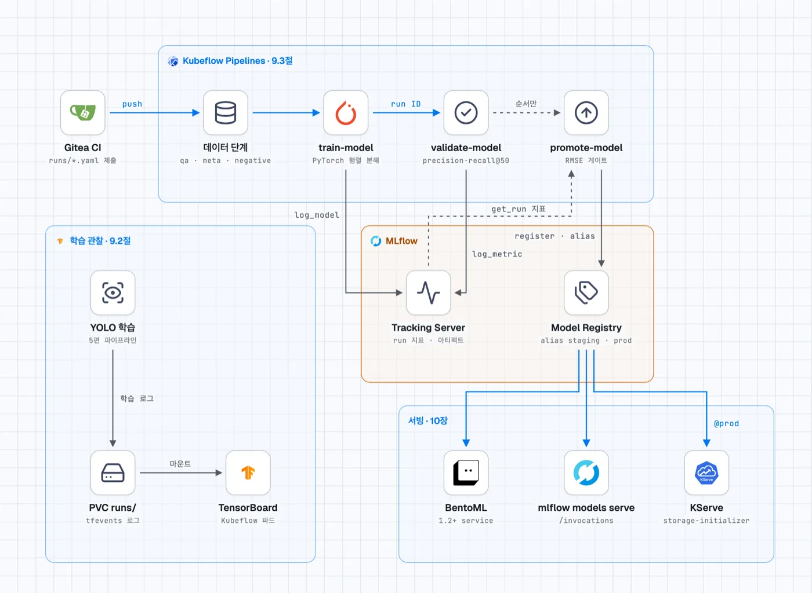

<nav id="manual-toc" class="manual-toc" aria-label="목차">

### 목차

**[1부. 학습을 관찰하는 두 도구 - TensorBoard와 MLflow](#section-1)**

- [1.1 TensorBoard - 로그 파일 하나를 그리는 도구](#s1-1)
- [1.2 단일 run의 내부와 여러 run의 색인](#s1-2)
- [1.3 MLflow 트래킹 서버의 세 가지 구성](#s1-3)

**[2부. 영화 추천기 학습 파이프라인](#section-2)**

- [2.1 MovieLens 25M에서 train 6,400행으로](#s2-1)
- [2.2 QA와 메타데이터 - n_users는 최댓값 162,502](#s2-2)
- [2.3 네거티브 샘플링 - 사용자당 10개, rating 0](#s2-3)
- [2.4 신경망 행렬 분해 - 파라미터 1,856,544개](#s2-4)
- [2.5 SGD와 StepLR - 10 epoch마다 학습률 1/10](#s2-5)

**[3부. 평가 지표와 실험 추적](#section-3)**

- [3.1 RMSE·precision@50·recall@50의 계산 방식](#s3-1)
- [3.2 사용자당 val 15.8행과 top 50](#s3-2)
- [3.3 표 9.1과 9.2 - 학습률 1e-2 run의 지표 변화](#s3-3)
- [3.4 MLflow에 남기는 것 - 파라미터, epoch별 손실, 시그니처](#s3-4)
- [3.5 학습과 검증을 run ID로 연결](#s3-5)

**[4부. 모델 레지스트리와 승격 게이트](#section-4)**

- [4.1 stage에서 alias로](#s4-1)
- [4.2 promote_model_to_staging의 검사 세 개와 비대칭 임곗값](#s4-2)
- [4.3 거부해도 SUCCEEDED - 5편 게이트와 비교](#s4-3)
- [4.4 KFP 그래프에 보이지 않는 지표 전달](#s4-4)

**[5부. 모델 서빙 - BentoML, MLflow, KServe](#section-5)**

- [5.1 ML 모델 배포에 더해지는 고려 사항](#s5-1)
- [5.2 BentoML 1.1 - Runnable, Runner, Service](#s5-2)
- [5.3 관측 엔드포인트 - livez, readyz, metrics](#s5-3)
- [5.4 Bento와 태그 - build, containerize](#s5-4)
- [5.5 MLflow 레지스트리와 BentoML 1.2 이후 API](#s5-5)
- [5.6 MLflow만으로 서빙 - mlflow models serve](#s5-6)
- [5.7 KServe - InferenceService와 storage-initializer](#s5-7)
- [5.8 세 도구의 선택 기준](#s5-8)

**[6부. 파이프라인 제출의 GitOps 관리](#section-6)**

- [6.1 실행 선언 YAML과 CI 제출](#s6-1)
- [6.2 코드로 고정할 수 있는 것과 없는 것](#s6-2)

**[전체 흐름 정리](#section-7)** · **[출처](#section-8)**

</nav>

<figure>

<figcaption>KFP 단계 사이에는 run ID만 오가고, 검증 지표와 모델은 MLflow를 거쳐 승격 게이트와 세 서빙 도구로 갑니다. 직접 그린 도식입니다.</figcaption>
</figure>

---

## 1부. 학습을 관찰하는 두 도구 - TensorBoard와 MLflow

<a id="s1-1"></a>

### 1.1 TensorBoard - 로그 파일 하나를 그리는 도구

5편 5부에서 YOLO 학습 결과를 PVC에 남겼습니다. 9.2절은 그 PVC를 TensorBoard로 엽니다. TensorBoard는 학습 코드가 쓴 이벤트 로그 파일을 읽어 그래프로 그릴 뿐이고, 정보는 모두 그 파일 안에 있습니다.

스터디 실습의 PVC를 보면 `runs/` 아래에 파이프라인마다 디렉터리가 하나씩 생깁니다. 9.1절의 두 파이프라인이 남긴 `yolov8n_custom`과 `yolov8n_a2`입니다.

```
runs/yolov8n_custom/
├── events.out.tfevents.1794586896.yolo-pvc-jxz9f-system-container-impl-...   TensorBoard가 읽는 파일
├── args.yaml          학습 인자 전체 (model: yolov8n.pt, epochs: 1, batch: 8, imgsz: 640)
├── results.csv        epoch별 시간·loss·mAP 표
└── weights/{best.pt, last.pt}
```

이벤트 파일 이름 끝은 그 파일을 쓴 파드 이름입니다. 그래서 파일 이름만 보고도 어느 KFP run의 어느 컴포넌트가 쓴 로그인지 거슬러 찾을 수 있습니다.

Kubeflow는 TensorBoard를 기본 기능으로 제공합니다. 대시보드에서 TensorBoard를 만들 때 소스로 PVC를 고르면 TensorBoard 파드가 하나 뜨고 그 PVC를 마운트합니다. PVC 대신 오브젝트 스토리지 경로를 줄 수도 있습니다.

- **PVC 방식의 제약**
  - 5편 5.1절에서 본 대로 local-path PVC는 ReadWriteOnce입니다. 실제 파일이 특정 노드 디렉터리에 있으므로 TensorBoard 파드도 그 노드에 떠야 마운트됩니다.
- **책의 선택**
  - 책은 KFP가 경로를 만들어 주는 `OutputPath` 대신 VolumeOp로 PVC를 만들고, 그 마운트 지점을 YOLO의 `project` 디렉터리로 지정합니다. YOLO가 로그를 쓰는 위치를 고정해야 TensorBoard가 같은 경로를 읽을 수 있기 때문입니다.

<a id="s1-2"></a>

### 1.2 단일 run의 내부와 여러 run의 색인

9장은 TensorBoard와 MLflow를 함께 쓰라고 권합니다. 둘 다 학습 지표를 그리지만 보는 범위가 다릅니다.

- **TensorBoard - 하나의 run 안을 깊게 봅니다**
  - epoch별 mAP·loss 곡선으로 과적합과 조기 종료 시점을 판단합니다.
- **MLflow - 여러 run을 색인하고 검색합니다**
  - 하이퍼파라미터, 데이터 버전, 코드 버전, 최종 모델을 run마다 기록합니다.
  - 모델 레지스트리와 결합해 "지금 운영 중인 모델이 어떤 설정으로 학습됐나"에 답합니다.

<a id="s1-3"></a>

### 1.3 MLflow 트래킹 서버의 세 가지 구성

MLflow 클라이언트가 run을 기록할 때, 메타데이터와 아티팩트는 다른 곳에 저장됩니다. 메타데이터(파라미터, 지표)는 백엔드 스토어에, 모델 파일 같은 아티팩트는 아티팩트 스토어에 들어갑니다. 아티팩트를 누가 쓰느냐에 따라 구성이 세 가지로 나뉩니다.

| 구성 | 클라이언트가 아는 것 | 아티팩트 쓰기 경로 |
|------|----------------------|--------------------|
| 트래킹 서버(프록시) | 서버 URL만 | 서버를 거쳐 저장소에 씁니다 |
| 트래킹 서버 + 직접 접근 | 서버 URL과 저장소 자격 증명 | 클라이언트가 저장소에 바로 씁니다 |
| 서버 없음 | 로컬 경로 | 로컬 파일과 로컬 DB(SQLite 등) |

프록시 구성은 자격 증명을 서버 한 곳에만 두므로 KFP 컴포넌트마다 S3 키를 넣지 않아도 됩니다. 대신 모델 파일이 모두 서버를 지나가서 서버 부하가 커집니다. 직접 접근 구성은 그 반대입니다.

---

## 2부. 영화 추천기 학습 파이프라인

<a id="s2-1"></a>

### 2.1 MovieLens 25M에서 train 6,400행으로

9.3절은 앞의 객체 탐지와 다른 유형의 문제인 추천 시스템을 다룹니다. 입력은 이미지가 아니라 `userId, movieId, rating, timestamp` 네 열의 표 데이터입니다. 5편 2.3절에서 이 데이터를 Parquet로 바꿔 객체 저장소에 올렸습니다.

| 분할 | 원본(5편 2.3절) | 스터디 실습 소형 데이터 |
|------|-----------------|-------------------------|
| train | 18,750,071행 | 6,400행 (영화 2,524개) |
| val | 3,750,014행 | 1,282행 |
| test | 2,500,010행 | 846행 |
| 사용자 | 약 16만 명 | 81명 |

CPU만으로 학습을 몇 분 안에 끝내려고 스터디 실습은 원본을 **사용자 단위로** 줄였습니다. 시드 42의 순서로 사용자를 훑으며 train이 약 6,400행이 될 때까지 더합니다. 사용자 단위로 자르므로 한 사용자의 train·val·test가 함께 남습니다.

사용자 50은 9.3.7절의 추론에서 이 사용자의 추천을 보므로 반드시 포함합니다.

이 축소는 추천 품질을 크게 낮춥니다. train에 등장한 영화 2,524개는 모델의 영화 임베딩 행 208,716개의 약 1.2%입니다. 나머지 영화의 점수는 학습되지 않은 임베딩에서 나오므로 10장에서 서빙한 추천 결과도 품질을 판단할 근거가 되지 못합니다.

<a id="s2-2"></a>

### 2.2 QA와 메타데이터 - n_users는 최댓값 162,502

파이프라인의 첫 단계는 데이터 품질 검사(QA)입니다. 책의 `check_dataset`은 `user_id, item_id, rating` 열이 있는지만 확인합니다. 스터디 실습은 dtype, null, rating이 0~5 범위인지를 더 검사합니다.

이번에는 5편과 달리 PVC가 아니라 객체 저장소에서 바로 읽습니다.

다음 단계 `get_dataset_metadata`는 임베딩 크기를 정합니다. 값은 사용자 수가 아니라 ID의 **최댓값**입니다. 소형 데이터에서도 `n_users`는 162,502, `n_items`는 208,715가 나옵니다.

ID를 임베딩 행 번호로 바로 쓰기 때문에, 행 수는 최댓값보다 커야 합니다. 그 결과 사용자 81명만 학습하는 모델도 사용자 임베딩 행을 162,503개 가집니다.

<a id="s2-3"></a>

### 2.3 네거티브 샘플링 - 사용자당 10개, rating 0

MovieLens에는 사용자가 본 영화의 평점만 있습니다. 이 데이터로만 학습하면 모델은 "안 본 영화"가 어떤 점수를 받아야 하는지 배우지 못합니다. 추론에서는 모든 영화의 점수를 매겨 순위를 내므로 이 정보가 필요합니다.

`negative_sampling`은 사용자마다 본 적 없는 영화를 10개(`num_ng_test`) 뽑아 rating 0.0으로 붙입니다.

```
원본 train            6,400행 (rating > 0)
+ 네거티브 샘플   81명 × 10 = 810행 (rating = 0.0, timestamp 고정값 1051631039)
= 학습 입력           7,210행
```

네거티브는 train에만 더합니다. test와 val은 실제 평점 그대로 둡니다. 평가는 사용자가 실제로 준 평점으로 해야 의미가 있기 때문입니다.

<a id="s2-4"></a>

### 2.4 신경망 행렬 분해 - 파라미터 1,856,544개

모델은 PyTorch로 작성한 행렬 분해입니다. 사용자와 영화를 각각 임베딩 벡터로 바꾸고, 두 벡터에서 평점 하나를 예측합니다.

```
user_id ─▶ Embedding(n_users+1, k) ─┐
                                    ├─ 원소별 곱(torch.mul) ─▶ Linear(k→h) ─▶ ReLU ─▶ Dropout(0.2) ─▶ Linear(h→1) ─▶ 평점
movie_id ─▶ Embedding(n_items+1, k) ─┘
```

고전적인 행렬 분해는 두 벡터의 내적이 곧 예측입니다. 이 모델은 내적 대신 원소별 곱을 은닉층에 넣어, 임베딩 차원마다 가중치를 다르게 줄 수 있습니다.

스터디 실습의 학습 로그에 찍힌 파라미터 수는 파이프라인 기본값(임베딩 k=5, 은닉 h=64)과 정확히 맞습니다.

| 층 | 파라미터 | 계산 |
|----|----------|------|
| 사용자 임베딩 | 812,515 | 162,503 × 5 |
| 영화 임베딩 | 1,043,580 | 208,716 × 5 |
| Linear 1 | 384 | 5 × 64 + 64 |
| Linear 2 | 65 | 64 × 1 + 1 |
| 합계 | 1,856,544 | |

파라미터의 99.97%가 임베딩입니다. 그리고 2.1절에서 본 대로 그 임베딩 행의 대부분은 학습 데이터에 한 번도 나오지 않습니다.

<a id="s2-5"></a>

### 2.5 SGD와 StepLR - 10 epoch마다 학습률 1/10

옵티마이저는 SGD, 손실 함수는 L1Loss(평균 절대 오차)입니다. 학습률 스케줄러 `StepLR(step_size=10, gamma=0.1)`이 10 epoch마다 학습률을 1/10로 줄입니다.

| epoch | 시작 lr 0.001 | 시작 lr 0.01 |
|-------|---------------|--------------|
| 0~9 | 0.001 | 0.01 |
| 10~19 | 0.0001 | 0.001 |
| 20~29 | 0.00001 | 0.0001 |

시작 학습률이 0.001이면 20 epoch 이후의 갱신 폭은 시작의 1/100입니다. 그래서 MLflow에서 두 run의 `avg_training_loss`를 겹쳐 보면 lr 0.001 곡선은 10 epoch 근처부터 거의 평평해집니다.

---

## 3부. 평가 지표와 실험 추적

<a id="s3-1"></a>

### 3.1 RMSE·precision@50·recall@50의 계산 방식

9장의 지표는 세 개입니다.

- **RMSE** - 예측 평점과 실제 평점의 오차입니다. 낮을수록 좋습니다.
- **precision@50** - 상위 50개 추천 중 실제로 관련 있는 비율입니다. 높을수록 좋습니다.
- **recall@50** - 관련 있는 항목 중 상위 50개에 들어온 비율입니다. 높을수록 좋습니다.

"관련 있음"의 기준은 평점 3 이상(`threshold=3`)입니다. 검증 코드는 사용자별로 (예측, 실제) 쌍을 모은 뒤 예측 점수 순으로 정렬합니다.

```
n_rel           실제 평점 ≥ 3인 항목 수
n_rec_k         상위 k개 중 예측 ≥ 3인 항목 수
n_rel_and_rec_k 상위 k개 중 예측과 실제가 모두 ≥ 3인 항목 수

precision = n_rel_and_rec_k / n_rec_k   (n_rec_k가 0이면 1)
recall    = n_rel_and_rec_k / n_rel     (n_rel이 0이면 1)
```

사용자별 값을 평균한 것이 최종 precision과 recall입니다. 코드를 읽으면 숫자를 해석할 때 주의할 점이 세 가지 나옵니다.

- **분모가 0이면 1점**
  - 예측이 모두 3 미만인 사용자는 precision 1을 받습니다. 아무것도 추천하지 않은 사용자가 평균을 올립니다.
- **RMSE는 배치 평균끼리의 오차**
  - `y_pred`와 `y_true`에 배치마다 평균값 하나씩을 넣고 RMSE를 계산합니다. 배치 안에서 오차가 서로 상쇄되므로 평점 하나하나의 RMSE보다 작게 나옵니다.
- **sklearn 버전**
  - 책의 `mean_squared_error(..., squared=False)`는 scikit-learn 1.4에서 deprecated되고 1.6에서 제거됐습니다. 스터디 실습은 `root_mean_squared_error`로 바꿨습니다.

<a id="s3-2"></a>

### 3.2 사용자당 val 15.8행과 top 50

precision@50과 recall@50은 순위 지표입니다. 그런데 순위를 매기는 후보는 전체 영화가 아니라 **그 사용자가 val에서 실제로 평가한 영화**뿐입니다.

스터디 실습의 소형 데이터는 val 1,282행에 사용자 81명입니다. 사용자당 평균 15.8행이라 대부분의 사용자는 val 항목 전체가 상위 50개 안에 들어갑니다.

```
후보가 50개 이하인 사용자
  상위 50개 = 후보 전체 → 정렬 순서가 결과에 영향을 주지 않음
  precision = (예측 ≥ 3이고 실제 ≥ 3) / (예측 ≥ 3)
  recall    = (예측 ≥ 3이고 실제 ≥ 3) / (실제 ≥ 3)
```

이 경우 두 지표는 "평점 3 이상인가"를 맞히는 이진 분류의 정밀도와 재현율이 됩니다. 순위를 평가하려면 k를 사용자당 항목 수보다 작게(예: 10) 두거나, 본 적 없는 영화까지 후보에 넣어야 합니다.

<a id="s3-3"></a>

### 3.3 표 9.1과 9.2 - 학습률 1e-2 run의 지표 변화

책은 MLflow가 필요한 이유를 두 run의 비교로 보여 줍니다. 두 run 모두 데이터 6,400개, 배치 64, 30 epoch이고 학습률만 다릅니다.

| run | precision@50 | recall@50 | RMSE |
|-----|--------------|-----------|------|
| 기본값(lr 1e-3), 표 9.1 | 0.7533 | 0.6316 | 0.290 |
| lr 1e-2, 표 9.2 | 0.7422 | 0.8649 | 0.2836 |
| 차이 | −0.0111 | +0.2333 | −0.0064 |

책은 두 번째 run이 "약간 낮게 나왔으므로" 원래 파라미터로 되돌려야 한다고 씁니다. 그런데 표에서 낮아진 것은 precision 하나이고, recall은 0.23 오르고 RMSE도 줄었습니다.

4.2절의 승격 게이트를 기본 임곗값 그대로 이 두 run에 적용하면 결과는 승격입니다. RMSE가 늘지 않았고, precision 하락 0.0111은 허용 폭 0.3 안이기 때문입니다. 책 본문의 판단과 책 코드의 판단이 다른 셈입니다.

어느 run이 나은지와 별개로, 판단 기준을 코드로 적어 두지 않으면 같은 표를 보고도 결론이 갈립니다. 그리고 원래 학습률이 무엇이었는지 기억에 의존하지 않으려면 run마다 설정이 기록돼 있어야 합니다.

<a id="s3-4"></a>

### 3.4 MLflow에 남기는 것 - 파라미터, epoch별 손실, 시그니처

리스트 9.13은 학습 로직을 그대로 두고 MLflow 기록 코드만 더합니다.

```python
def train_model(mlflow_experiment_name='recommender', mlflow_run_id=None,
                mlflow_tags={}, hot_reload_model_run_id=None,
                model_embedding_factors=20, model_learning_rate=1e-3, ...):
    input_params = {k: v for k, v in locals().items()}     # 인자 전체를 캡처
    ...
    mlflow.set_experiment(mlflow_experiment_name)
    with mlflow.start_run(run_id=mlflow_run_id):
        for k, v in input_params.items():
            if 'mlflow_' not in k:
                mlflow.log_param(k, v)
        mlflow.log_artifact("model_summary.txt")           # torchinfo 요약
        for train_iter in range(training_epochs):
            ...
            mlflow.log_metric("avg_training_loss", ..., step=train_iter)
            mlflow.log_metric("avg_testing_loss", ..., step=train_iter)
        mlflow.pytorch.log_model(model, "model", signature=model_signature)
```

- **`locals()` 캡처** - 함수 맨 위에서 인자 전체를 복사합니다. 하이퍼파라미터를 추가해도 로깅 코드를 고칠 필요가 없습니다.
- **epoch별 지표** - `step=train_iter`로 기록해서 MLflow UI가 곡선으로 그립니다. 3.3절의 비교는 Compare 화면에서 이 곡선을 겹쳐 보는 일입니다.
- **시그니처** - 첫 배치에서 `infer_signature`로 입력 `{'user', 'movie'}`와 출력 형태를 기록합니다. 모델을 받는 쪽은 별도 문서 없이 입력 형식을 압니다.

<a id="s3-5"></a>

### 3.5 학습과 검증을 run ID로 연결

리스트 9.14의 검증 함수는 모델 객체가 아니라 run ID 문자열을 받습니다.

```python
def validate_model(model_run_id, top_k=50, threshold=3, val_batch_size=32):
    model = mlflow.pytorch.load_model(f"runs:/{model_run_id}/model")
    ...                                   # 3.1절의 precision/recall/RMSE 계산
    mlflow.log_metric(f"precision_{k}", average_precision, run_id=model_run_id)
    mlflow.log_metric(f"recall_{k}", average_recall, run_id=model_run_id)
    mlflow.log_metric("rms", rms, run_id=model_run_id)
```

학습 단계는 run ID만 넘기므로 모델 파일이 KFP 단계 사이를 오가지 않습니다. 검증 지표는 새 run을 만들지 않고 학습 run에 덧붙입니다. 이미 끝난 run에도 지표를 더 기록할 수 있어서 학습과 평가를 다른 시점과 다른 컴포넌트에서 해도 한 run에 이력이 모입니다.

스터디 실습의 학습 컴포넌트 출력도 이 run ID 하나입니다(`d0d0d158a22a4f87a5e753719897e55d` 같은 32자리 문자열). KFP와 MLflow는 이 문자열로 연결됩니다.

---

## 4부. 모델 레지스트리와 승격 게이트

<a id="s4-1"></a>

### 4.1 stage에서 alias로

2편 2.5절에서는 등록 모델에 Staging·Production **stage**를 붙이고 `models:/random-forest-classifier/Production`으로 불러왔습니다. 9장은 stage 대신 **alias(별칭)**를 씁니다. MLflow는 2.9부터 stage를 deprecated로 표시하고 alias를 권장합니다.

| 구분 | stage | alias |
|------|-------|-------|
| 이름 | None·Staging·Production·Archived 고정 | `staging`, `prod`, `champion` 등 자유 |
| 한 버전에 붙는 수 | 하나 | 여러 개 |
| 불러오는 URI | `models:/<이름>/Production` | `models:/<이름>@prod` |

스터디 실습에서 `prod` alias를 조회한 응답은 두 방식의 차이를 그대로 보여 줍니다.

```json
{"model_version": {
  "name": "recommender_production", "version": "3",
  "current_stage": "None",
  "run_id": "77950800028a43c79d75c7856e4e150e",
  "aliases": ["prod", "staging"]}}
```

`current_stage`는 `None`이고, 버전 3 하나에 `prod`와 `staging`이 함께 붙어 있습니다. 승격과 롤백은 alias를 다른 버전으로 옮기는 일입니다. 서빙 쪽은 `@prod`만 알면 되므로 코드를 고치지 않고 모델이 바뀝니다.

<a id="s4-2"></a>

### 4.2 promote_model_to_staging의 검사 세 개와 비대칭 임곗값

리스트 9.15는 새 run을 현재 `staging` 버전과 비교해 나쁘지 않으면 승격합니다.

```
현재 staging 버전 조회 ─▶ 같은 run이면 종료
        │
        ▼
diff = 새 run 지표 − staging run 지표
  rms_diff  > rms_threshold        → 거부   (RMSE는 늘면 나쁨)
  prec_diff < precision_threshold  → 거부
  rec_diff  < recall_threshold     → 거부
        │ 세 검사 통과
        ▼
register_model(runs:/<run_id>/model) → 새 버전, staging alias를 새 버전으로 이동
```

임곗값은 절대 기준이 아니라 **허용하는 변화량**입니다. 기본값이 비대칭이라 실제로는 RMSE 하나가 승격을 결정합니다.

- **rms_threshold** - 함수 기본값 0.0, 파이프라인 기본값 0.0001입니다. RMSE가 조금이라도 늘면 거부합니다.
- **precision_threshold -0.3, recall_threshold -0.2** - precision이 0.3, recall이 0.2까지 떨어져도 허용합니다.

스터디 실습에서 3 epoch run이 30 epoch staging 모델을 대체하지 못한 것도 RMSE 검사 때문입니다. 특정 검사만 시험하려면 앞 검사를 크게 열어야 합니다(예: `rms_th=10`).

책 코드를 그대로 쓰면 두 군데가 걸립니다.

- **첫 실행** - `staging`이 없으면 `current_staging`이 `None`인 채로 `current_staging.run_id`를 읽어 `AttributeError`가 납니다. `None` 확인이 그 다음 줄에 있기 때문입니다. 스터디 실습 코드는 이 순서를 바로잡아, 첫 run이 비교 없이 v1으로 등록됐습니다.
- **모델 이름** - `registered_model_name`을 인자로 받지만 `register_model`과 `set_registered_model_alias`에는 `"recommender_production"`을 문자열로 적었습니다. 인자를 바꿔도 등록 이름은 바뀌지 않습니다.

이 함수는 `staging`까지만 올립니다. 책은 운영(`prod`) 승격은 사람이 검토하는 수동 절차로 두는 것을 기본 전제로 합니다.

<a id="s4-3"></a>

### 4.3 거부해도 SUCCEEDED - 5편 게이트와 비교

게이트가 승격을 거부해도 함수는 `return`할 뿐이라 KFP 태스크는 성공으로 끝납니다. 스터디 실습에서 일부러 불가능한 기준(`prec_th=0.5`)을 준 run도 SUCCEEDED였고, 레지스트리에 v4가 생기지 않은 것으로만 거부를 확인했습니다.

5편 4.2절의 YOLO 검증 게이트는 반대로 동작합니다.

| 항목 | 9장 승격 게이트 | 5편 YOLO 검증 게이트 |
|------|-----------------|----------------------|
| 비교 대상 | 현재 staging 모델 (상대 기준) | 고정 임곗값 (절대 기준) |
| 실패 시 | `return`, run SUCCEEDED | `AssertionError`, run FAILED |
| 실패 확인 위치 | MLflow 레지스트리 | KFP run 상태 |
| 실패 메시지 | 로그의 `REJECT` 줄 | 실패한 검사 이름 (`mAP50, precision`) |

두 방식은 목적이 다릅니다. 9장 게이트는 "이번 모델을 올릴지"를 정하므로 거부도 정상 결과입니다. 5편 게이트는 "이 모델이 다음 단계로 갈 자격이 있는지"를 정하므로 거부를 실패로 드러냅니다.

거부가 정상 결과라면 그 결과를 KFP 쪽에서도 보이게 하는 편이 운영에 유리합니다. 예를 들어 승격 여부를 출력 파라미터로 돌려주면 다음 단계(서빙 갱신)를 `dsl.If`로 건너뛸 수 있습니다.

<a id="s4-4"></a>

### 4.4 KFP 그래프에 보이지 않는 지표 전달

리스트 9.16의 파이프라인은 다음 순서로 이어집니다.

```
qa-data → get-dataset-metadata → negative-sampling → get-test-valid-dataset
                                                        │
                       train-model ◀────────────────────┘ (train·test 아티팩트, 메타 파라미터)
                           │ Output = MLflow run ID
              ┌────────────┴────────────┐
              ▼                         ▼
        validate-model ──(순서만)──▶ promote-model-to-staging
              │                         ▲
              └── log_metric ─▶ MLflow ─┘ get_run(...).data.metrics
```

`promote-model-to-staging`은 `validate-model`의 출력을 입력으로 받지 않습니다. 둘 다 학습 run ID를 받고, `.after(val)`은 순서만 정합니다. 실제 지표는 검증 단계가 MLflow run에 쓰고, 승격 단계가 MLflow에서 다시 읽어 전달됩니다.

그래서 KFP UI의 그래프만 보면 검증 결과가 승격에 쓰인다는 사실이 드러나지 않습니다. 3편 5부의 표현으로는, 이 파이프라인은 지표를 값이나 경로로 넘기지 않고 외부 저장소를 거쳐 넘깁니다. 디버깅할 때는 KFP 그래프와 MLflow run을 함께 봐야 합니다.

---

## 5부. 모델 서빙 - BentoML, MLflow, KServe

<a id="s5-1"></a>

### 5.1 ML 모델 배포에 더해지는 고려 사항

10장은 9장까지 승격한 모델을 API로 제공합니다. 일반 소프트웨어 배포에도 버전 관리, 테스트, CI/CD가 필요한데, ML 모델 배포에는 다음 항목이 더해집니다.

- **추론 패턴** - 배치 예측인지, 실시간 추론인지, 둘 다인지 정해야 합니다.
- **데이터 의존성** - 학습 때의 전처리를 서빙에서도 똑같이 재현해야 합니다. 4편 2.3절의 `drop_first` 버그가 이 항목의 실패 사례입니다.
- **하드웨어와 확장** - GPU가 필요한 모델이 있고, 부하에 따라 복제본 수가 바뀝니다.
- **버전과 롤백** - 4부의 alias가 이 요구를 다룹니다.
- **설명 가능성과 보안** - 규제 산업에서는 예측 근거가 필요하고, 모델이 민감 정보를 노출하지 않아야 합니다.

어떤 서빙 도구를 쓰든 하는 일은 같습니다. 서빙에 필요한 파일(가중치, 의존성, 코드)을 모으고, 컨테이너 이미지로 묶어 파드로 띄웁니다. 도구마다 다른 것은 이 과정을 얼마나 대신해 주느냐입니다.

<a id="s5-2"></a>

### 5.2 BentoML 1.1 - Runnable, Runner, Service

3편 1.3절에서 서비스와 러너의 구분을 봤습니다. 요청을 받는 API 서버와 모델을 들고 있는 러너는 부하가 달라서 따로 확장합니다. 10장은 YOLO 모델로 러너를 직접 정의합니다.

```python
class YOLOv8Runnable(bentoml.Runnable):
    def __init__(self):
        self.model = YOLO("yolov8_custom.pt")       # service.py와 같은 디렉터리

    @bentoml.Runnable.method(batchable=False)
    def inference(self, input_img):
        results = self.model(input_img)[0]
        return json.loads(results[0].tojson())

yolo_v8_runner = bentoml.Runner(YOLOv8Runnable, name="yolov8_runnable")
svc = bentoml.Service("yolo_v8", runners=[yolo_v8_runner])

@svc.api(input=Image(), output=JSON())
async def invocation(input_img):
    return await yolo_v8_runner.inference.async_run([input_img])
```

- **`bentoml.Runnable`** - 모델을 감싼 클래스입니다. `@bentoml.Runnable.method`가 붙은 메서드만 원격 호출 대상이 됩니다.
- **`bentoml.Runner`** - Runnable을 별도 파이썬 워커 프로세스에서 실행하는 단위입니다. 이름을 주지 않으면 클래스 이름이 쓰여 로그에서 알아보기 어렵습니다.
- **`async_run`과 `await`** - `async_run`은 결과가 아니라 나중에 결과를 줄 객체를 돌려줍니다. `await`가 없으면 탐지가 끝나기 전에 다음 줄이 실행됩니다.

API 서버 워커 수는 `--api-workers`로 정하고, 주지 않으면 CPU 코어 수만큼 뜹니다. 엔드포인트는 두 개입니다.

- **`/invocation`** - 이미지를 받아 JSON(클래스, 신뢰도, 상자 좌표)을 돌려줍니다. 다른 시스템이 호출하는 용도입니다.
- **`/render`** - 상자, 레이블, 신뢰도를 그린 이미지를 돌려줍니다. 사람이 결과를 눈으로 확인하는 용도입니다.

<a id="s5-3"></a>

### 5.3 관측 엔드포인트 - livez, readyz, metrics

쿠버네티스에 올리는 서비스에는 liveness·readiness 프로브용 엔드포인트가 필요합니다. BentoML은 이것을 기본으로 제공합니다.

| 엔드포인트 | 용도 | 실패하면 |
|------------|------|----------|
| `/livez` | liveness 프로브 | kubelet이 컨테이너를 재시작 |
| `/readyz` | readiness 프로브 | Service 엔드포인트에서 빠져 트래픽을 받지 않음 |
| `/metrics` | Prometheus 수집 | (지표 제공) |

`/metrics`는 API 서버와 러너의 요청 수를 따로 셉니다. 스터디 실습에서 샘플 이미지 3장을 `/invocation`으로 보내자 두 카운터가 각각 3 올랐고, 한 번 더 보내자 6이 됐습니다.

API 서버 카운터와 러너 카운터가 따로 있으므로 두 값이 어긋나면 요청이 API 서버에서 막혔는지 러너에서 막혔는지 구분할 수 있습니다. 11장의 모니터링은 이 지표 위에 커스텀 지표를 더합니다.

<a id="s5-4"></a>

### 5.4 Bento와 태그 - build, containerize

Bento는 배포용 패키지입니다. 소스 코드, 파이썬 의존성, 모델 아티팩트, 서빙 로직을 한 형식으로 묶습니다. 3편 1.4절의 `bentofile.yaml`이 그 명세이고, 10장은 가중치 파일을 직접 포함합니다.

```yaml
service: "service.py:svc"
include:
  - "service.py"
  - "yolov8_custom.pt"
docker:
  base_image: "ultralytics/ultralytics:8.0.203-cpu"
```

```
bentoml build                       → Bento 태그 yolo_v8:3jghhcfxvwsrnbsb
  ~/bentoml/bentos/yolo_v8/<버전>/    소스, 가중치, 패키지 목록, OpenAPI, Dockerfile, README
bentoml containerize yolo_v8:<버전>  → env/docker/Dockerfile을 빌드한 이미지
docker run -p 3000:3000 <이미지> serve --production --api-workers 2
```

태그는 `서비스_이름:버전_레이블` 형식이고 빌드할 때마다 자동으로 붙습니다. `yolo_v8`처럼 버전 없이 쓰면 최신 Bento를 가리키지만 Docker 이미지 태그처럼 버전을 명시하는 것이 권장됩니다.

`containerize`는 Bento 안에 생성된 Dockerfile을 빌드하는 일이라 CI 도구로도 같은 결과를 낼 수 있습니다. BentoML이 대신해 주는 일은 필요한 파일을 빠짐없이 모으는 것입니다.

스터디 실습의 Bento는 약 5.99MiB였고 이미지는 약 6.6GB였습니다. 이미지 크기는 대부분 ultralytics 베이스 이미지와 PyTorch에서 옵니다.

<a id="s5-5"></a>

### 5.5 MLflow 레지스트리와 BentoML 1.2 이후 API

10.6절은 추천 모델을 MLflow 레지스트리에서 가져와 BentoML로 서빙합니다. 그런데 리스트 10.1은 10.3절과 다른 API로 작성돼 있습니다.

```python
@bentoml.service(resources={"cpu": "2"}, traffic={"timeout": 10})
class RecommenderRunnable:
    def __init__(self, registered_model_name='recommender_production', device='cpu'):
        mlflow.set_tracking_uri(uri="http://mlflow:8080")
        current_prod = MlflowClient().get_model_version_by_alias(registered_model_name, "prod")
        bentoml.mlflow.import_model("recommender", f"runs:/{current_prod.run_id}/model")
        path = bentoml.mlflow.get("recommender:latest").path_of(bentoml.mlflow.MLFLOW_MODEL_FOLDER)
        self.model = mlflow.pytorch.load_model(path).to(device).eval()

    @bentoml.api
    def predict(self, user_id: int, top_k: int = 10, ranked_movies: np.ndarray = None) -> np.ndarray:
        ...   # 후보 1..n_items에서 본 영화를 빼고, 예측 점수 상위 top_k개의 영화 ID
```

`@bentoml.service` 클래스와 `@bentoml.api` 메서드는 BentoML 1.2에서 도입된 API입니다. 1.1의 Runnable·Runner·Service 세 객체가 클래스 하나로 합쳐졌고, 리소스와 타임아웃을 데코레이터 인자로 적습니다. 그래서 스터디 실습은 YOLO 서비스(A)는 1.1.6으로, 추천 서비스(B)는 1.4로 나눠 돌렸습니다.

`__init__`에서 하는 일은 9.3.7절의 노트북 추론과 같습니다. `prod` alias의 run을 찾고, 모델을 BentoML 모델 저장소로 내려받아 불러옵니다. 모델 파일이 Bento 안에 들어 있지 않고 서비스가 시작될 때 MLflow에서 오므로 `prod` alias를 옮기고 서비스를 재시작하면 새 모델이 서빙됩니다.

스터디 실습의 컨테이너 로그에 찍힌 run ID는 레지스트리의 `recommender_production` v3 run ID와 같았습니다. 9.3절의 승격 결과가 10장의 서빙까지 이어진 것을 이 값으로 확인할 수 있습니다.

<a id="s5-6"></a>

### 5.6 MLflow만으로 서빙 - mlflow models serve

MLflow는 실험 추적, 레지스트리에 더해 서빙과 컨테이너화도 제공합니다. 도구 하나로 전체 생애주기를 다루므로 한두 명이 MLOps를 맡는 초기 조직에 맞습니다.

```bash
export MLFLOW_TRACKING_URI=http://mlflow:5000
mlflow models serve -m "models:/recommender_production@prod"

mlflow models build-docker -m "models:/recommender_production@prod" \
  -n recommender_service --enable-mlserver
```

모델 서버는 `/health`와 `/invocations` 엔드포인트를 제공합니다.

스터디 실습은 pyfunc 래퍼로 모델을 감쌌습니다. 아티팩트가 S3에 있어서 서빙 프로세스에도 S3 자격 증명을 넣어야 했습니다. 1.3절의 직접 접근 구성에서는 학습 클라이언트뿐 아니라 서빙 쪽에도 저장소 자격 증명이 있어야 합니다.

<a id="s5-7"></a>

### 5.7 KServe - InferenceService와 storage-initializer

4편 2부에서 소득 분류기를 KServe로 서빙했습니다. 10.8절은 KServe를 BentoML의 대안으로 소개합니다. 배포 단위는 `InferenceService` 커스텀 리소스 하나입니다.

```yaml
apiVersion: serving.kserve.io/v1beta1
kind: InferenceService
metadata:
  name: sklearn-iris
spec:
  predictor:
    serviceAccountName: <S3 Secret을 연결한 SA>
    model:
      modelFormat: {name: sklearn}
      storageUri: s3://kserve-smoke/sklearn-iris/
```

이 리소스를 적용하면 KServe 컨트롤러가 파드를 다음 구조로 만듭니다.

```
init 컨테이너  storage-initializer   storageUri의 모델 파일을 파드 로컬 볼륨에 내려받음
컨테이너      kserve-container      그 볼륨의 model.joblib을 sklearn 런타임으로 서빙
사이드카      istio-proxy           메시 트래픽 처리
```

모델 파일을 이미지에 굽지 않고 시작할 때 내려받는 구조는 5.5절의 BentoML 서비스와 같습니다. 다만 내려받는 일은 사용자 코드 대신 KServe가 합니다.

책의 예시에는 오류가 하나 있습니다. PyTorch YOLO 모델 경로(`gs://yolov8/models/pytorch/1.0/model`)에 `modelFormat: sklearn`을 적었습니다. 스터디 실습은 sklearnserver와 같은 scikit-learn 버전으로 iris 모델을 학습해 `model.joblib`을 올리는 방식으로 이 문제를 피했습니다.

<a id="s5-8"></a>

### 5.8 세 도구의 선택 기준

책의 표 10.1입니다.

| 항목 | KServe | BentoML | MLflow |
|------|--------|---------|--------|
| 초점 | 모델 서빙 오케스트레이션 | 배포·서빙 단순화 | ML 생애주기 전체 |
| 쿠버네티스 중심 | 예 | 아니오 | 아니오 |
| 사용 편의성 | 낮음 (K8s 지식 필요) | 높음 | 높음 |
| 실험 추적 | 아니오 | 아니오 | 예 |

세 도구 모두 프레임워크와 클라우드에 무관합니다. 선택은 팀이 쿠버네티스를 얼마나 다루는지와 서빙을 얼마나 세밀하게 제어해야 하는지로 갈립니다.

- **MLflow만** - 실험 추적부터 서빙까지 도구 하나로 끝냅니다. 소규모 팀에 맞습니다.
- **MLflow + BentoML** - 데이터 과학자가 쿠버네티스를 몰라도 서비스를 만들고 이미지로 넘길 수 있습니다.
- **MLflow + KServe** - Kubeflow 안에서 쿠버네티스 리소스로 서빙을 관리합니다. 확장과 트래픽 제어를 플랫폼이 맡습니다.

---

## 6부. 파이프라인 제출의 GitOps 관리

<a id="s6-1"></a>

### 6.1 실행 선언 YAML과 CI 제출

플랫폼(Argo CD, Kubeflow, MLflow)은 코드로 배포했지만 파이프라인 **제출**은 아직 UI나 SDK로 합니다. 스터디 강의는 이 제출도 GitOps로 관리할 수 있는지를 과제로 냈습니다.

스터디 자료의 예시는 실행 하나를 YAML 파일 하나로 선언합니다.

```yaml
# mlops/kfp-gitops/runs/reco-c2-lr1e-3-e1.yaml
function: c2
experiment: ch09-gitops
parameters: {epochs: 1, lr: 0.001}
wait: true
```

`runs/` 아래 파일이 push되면 CI 워크플로가 바뀐 파일마다 KFP run을 만듭니다. run 이름은 파일명과 커밋 SHA 앞 7자리입니다. 파라미터를 바꿔 커밋하는 것이 곧 새 실험이고, 실험 이력이 Git 로그에 남습니다.

<a id="s6-2"></a>

### 6.2 코드로 고정할 수 있는 것과 없는 것

ML 파이프라인 전체를 GitOps로 옮기기는 어렵습니다.

- **코드로 고정할 수 있는 것** - 파이프라인 정의, 제출 파라미터, 서빙 매니페스트, 게이트 임곗값입니다.
- **코드로 고정하기 어려운 것** - 계속 바뀌는 데이터, 네거티브 샘플링처럼 시드 없는 단계, 학습 결과에 따라 정해지는 alias 이동입니다.

GitOps는 "선언한 상태로 수렴"이 전제인데 학습 결과는 실행해 보기 전에는 선언할 수 없습니다. 그래서 현실적으로는 제출과 서빙 설정을 Git으로 관리하고, 승격 판단은 4.2절 같은 코드 게이트에 맡깁니다.

---

## 전체 흐름 정리

```
      5편까지: 데이터 준비(MovieLens Parquet) · YOLO 학습 · PVC
              │
              ▼
[1부] 학습 관찰 - TensorBoard는 run 내부, MLflow는 run 색인
      PVC runs/ 의 events.out.tfevents.* → Kubeflow TensorBoard 파드가 PVC 마운트
      MLflow 구성: 프록시(서버만 자격 증명) / 직접 접근 / 서버 없음
              │
              ▼
[2부] 추천기 학습 - qa → meta → negative_sampling → test/val → train
      소형 데이터 train 6,400행, 사용자 81명(사용자 50 포함), seed 42
      n_users·n_items는 ID 최댓값 162,502·208,715 → 파라미터 1,856,544개, 99.97%가 임베딩
      네거티브 사용자당 10개(rating 0), SGD + StepLR(10 epoch마다 1/10)
              │
              ▼
[3부] 평가와 추적 - precision@50·recall@50(평점 ≥ 3), RMSE(배치 평균끼리)
      val 사용자당 15.8행 → top 50이 후보 전체 → 사실상 이진 분류 지표
      표 9.2: precision −0.011, recall +0.233, RMSE −0.006 → 기본 게이트는 승격
      locals() 캡처, epoch별 손실, 시그니처 / 검증 지표는 학습 run ID에 덧붙임
              │
              ▼
[4부] 레지스트리와 게이트 - stage 대신 alias(staging, prod)
      diff = 새 run − staging run, RMSE가 늘면 거부, precision 0.3·recall 0.2까지 허용
      거부해도 run SUCCEEDED (5편 게이트는 AssertionError로 FAILED)
      validate → promote 지표는 KFP가 아니라 MLflow를 거쳐 전달
              │
              ▼
[5부] 서빙 - 파일을 모아 이미지로 묶고 파드로 띄운다
      BentoML 1.1: Runnable → Runner → Service, /invocation·/render, livez·readyz·metrics
      Bento 태그 → containerize (Bento 5.99MiB, 이미지 6.6GB)
      BentoML 1.2+: @bentoml.service 클래스, 시작할 때 MLflow @prod 모델 로드
      MLflow: mlflow models serve, /health·/invocations
      KServe: InferenceService, storage-initializer가 storageUri에서 모델을 내려받음
              │
              ▼
[6부] GitOps - 제출과 서빙 설정은 Git 선언으로, 승격 판단은 코드 게이트로
              │
              ▼
      다음: 11장 모니터링(커스텀 지표, Loki 로깅, 알림)과 설명 가능성
```

---

## 출처

- Benjamin Tan Wei Hao, Varun Mallya, Shanoop Padmanabhan, *Machine Learning Platform Engineering*, Manning, 9장 *Model training and validation: Part 2*, 10장 *Model inference and serving*
- 예제 코드 - [practical-mlops/object-detection-project](https://github.com/practical-mlops/object-detection-project), [practical-mlops/movie-recommender-project](https://github.com/practical-mlops/movie-recommender-project)
- CloudNet@ ML 플랫폼 엔지니어링 스터디 9~11장 정리 자료와 2026-11-15 강의(비공개) - 소형 데이터셋·c1/c2/c5 파이프라인·BentoML·KServe 실습 결과, 강의 1교시 0:00~10:02(TensorBoard, GitOps 과제)·19:28~27:45(트래킹 서버 구성), 2교시 47:37~1:02:33(BentoML 실습)
- 데이터셋 - [MovieLens 25M](https://grouplens.org/datasets/movielens/25m/) (GroupLens)
- MLflow 문서 - [Tracking Server](https://mlflow.org/docs/latest/tracking/server/), [Model Registry](https://mlflow.org/docs/latest/model-registry/)
- BentoML 문서 - [docs.bentoml.com](https://docs.bentoml.com/)
- KServe 문서 - [kserve.github.io](https://kserve.github.io/website/)
